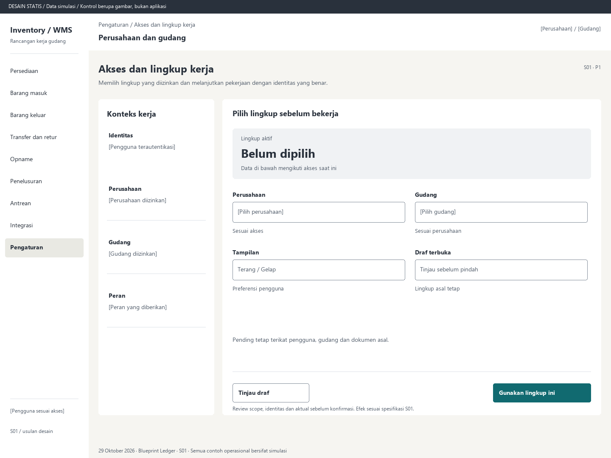

# S01. Akses dan lingkup kerja

Status: usulan desain statis, tanpa implementasi. Semua angka/kode pada papan adalah **Data simulasi**; bukan hasil transaksi atau UAT.

**Pengguna:** Semua pengguna; administrator akses. **Paket:** P1. **Pola:** form.

**Kebutuhan asal:** FR-04; TRK-03, TRK-14. **Keputusan terbuka:** D01, D03, D05; T04.

**Pekerjaan layar:** Memilih lingkup yang diizinkan dan melanjutkan pekerjaan dengan identitas yang benar.

[Vektor SVG](../boards/01-akses-dan-lingkup.svg). Gambar kontrol tidak interaktif; kontraknya berada di bawah.

## Komposisi dan prioritas

Konteks utama: Perusahaan dan gudang. Fokus: Lingkup aktif, dengan nilai ilustrasi Belum dipilih. Data di bawah mengikuti akses saat ini.

Bagian pemilihan/konteks: Konteks kerja. Ruang kerja: Pilih lingkup sebelum bekerja. Pemisahan ini membantu pengguna memilih objek lalu meninjau dampaknya. Papan menggunakan shell yang sama; isi mengikuti kebutuhan fungsi, bukan menambah grafik atau KPI.

Informasi minimum yang tetap terbaca:

- Identitas: [Pengguna terautentikasi].
- Perusahaan: [Perusahaan diizinkan].
- Gudang: [Gudang diizinkan].
- Peran: [Peran yang diberikan].

Field/kolom penentu: Pengaturan, Pilihan desain, Ketentuan. Nama barang, kode, kuantitas dan unit tidak diganti dengan ikon atau tooltip.

## Urutan kerja

1. Masuk melalui metode identitas yang kelak disepakati D03; jangan menggambar form sandi khusus sebagai keputusan SSO.
2. Tampilkan hanya perusahaan/gudang yang diizinkan; pengguna meninjau peran dan memilih scope.
3. Jika ada draf atau pending, jelaskan pilihan menyelesaikan, menyimpan atau membatalkan draf sesuai kebijakan perangkat; jangan memindahkan pending.
4. Sesudah scope sah, buka pekerjaan sesuai peran. Preferensi tampilan dapat diubah tanpa mengubah scope.

## Kontrol dan hasil yang direncanakan

| Kontrol | Perilaku dan hasil |
|---|---|
| Gunakan lingkup ini | Meminta validasi scope; melanjutkan hanya jika akses masih sah. |
| Tinjau draf | Membuka S17 dengan scope asal, bukan mengirim sebagai pengguna baru. |
| Kelola izin | Bagian admin: lihat peran, gudang, tindakan dan versi kebijakan; perubahan memerlukan otorisasi D03 serta audit. |
| Terang / Gelap | Pilihan eksklusif; seluruh komponen memakai peran warna yang sama. |

## Validasi dan dampak

Akses setiap baca, mutasi, lampiran dan ekspor diperiksa backend. Pembuat tidak menyetujui tindakannya sendiri bila kebijakan melarang. Perubahan izin berlaku pada aksi berikutnya.

Tidak mengubah stok. Identitas dan scope menjadi konteks tindakan berikutnya, bukan bukti izin dari klien.

Pending tetap terikat pengguna, gudang dan dokumen asal.

## Keadaan selain berhasil

| Keadaan | Pesan dan pemulihan |
|---|---|
| Kosong | Belum ada gudang yang diizinkan. Hubungi pengelola akses. |
| Memuat | Memuat akses dan lingkup kerja pada lingkup terpilih. Data sebelumnya tidak dianggap terbaru. |
| Filter kosong | Tidak ada hasil untuk filter aktif. Pertahankan filter dan sediakan Hapus filter. |
| Error | Lingkup tidak dapat dimuat. Coba muat kembali sebelum memilih pekerjaan. |
| Konflik / tertahan | Sesi berakhir atau akses berubah. Masuk kembali; draf tetap mengikuti kebijakan perangkat. |
| Akses ditolak | Tindakan atau lingkup ini tidak diizinkan. Kembali ke scope sah; jangan tampilkan isi objek terlarang. |
| Offline / hasil belum pasti | Untuk perintah konfirmasi, gunakan kontrak S17; pending lokal, unknown dan penolakan pasti mempunyai pemulihan berbeda. Baca saja menampilkan data tidak tersedia/belum segar. |

## Desktop, rentang menengah dan scanner

Desktop mengikuti komposisi papan. Pada rentang menengah, menu berlabel dan pemilih objek menggantikan sidebar/panel sempit. Pada rentang sempit, objek, field penentu, status, aktual/satuan dan aksi menjadi record vertikal. Metadata boleh dipindahkan ke detail, tetapi tidak menghilangkan alasan tertahan atau dampak kuantitas.

Kontrak minimum: target 44px, scanner 52px; label terlihat, fokus 3px, Tab sesuai alur, dialog Escape saat aman dan fokus kembali. Input tidak boleh tertutup keyboard. Scope/dokumen tidak berubah saat pending tanpa keputusan eksplisit. Lihat [fondasi](../00-foundation.md) dan [komponen/state](../02-components-and-states.md).

## Bukti penerimaan yang perlu disiapkan

Skenario terkait: UAT-13; TRK-UAT-19, TRK-UAT-22. Semuanya tetap **Belum dijalankan**. Pemetaan ini menyebut cakupan yang perlu dibuktikan, bukan hasil lulus.

Tinjauan desain: baca konteks, tentukan langkah yang benar, jelaskan dampak dan jalankan kembali skenario gagal menggunakan spesifikasi. Setelah implementasi: uji semua kontrol yang disebut di atas, narrow/menengah/desktop, kedua tema, keyboard dan perangkat nyata. Pemeriksaan API/database dibutuhkan untuk akses, idempotensi, transaksi dan saldo; gambar tidak membuktikannya.

## Sumber

[PRD](../../../docs/planning/01-product-requirements.md), [TRD](../../../docs/planning/02-technical-requirements.md), [Flow](../../../docs/planning/03-app-flow.md), [Design Brief](../../../docs/planning/04-design-brief.md), [Schema](../../../docs/planning/05-backend-schema.md), [Plan](../../../docs/planning/06-implementation-plan.md), [PRD tracker](../../../docs/planning/prd-tracker-barcode-rfid.md).
