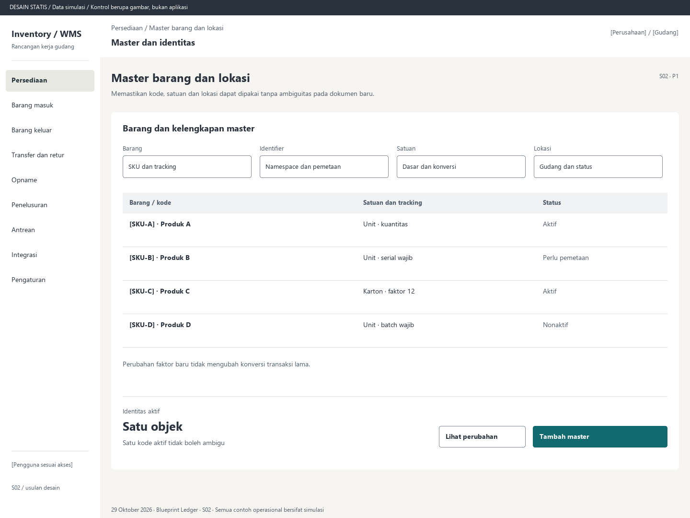

# S02. Master barang dan lokasi

Status: usulan desain statis, tanpa implementasi. Semua angka/kode pada papan adalah **Data simulasi**; bukan hasil transaksi atau UAT.

**Pengguna:** Administrator master. **Paket:** P1. **Pola:** table.

**Kebutuhan asal:** FR-01, FR-04; TRK-01, TRK-08, TRK-09. **Keputusan terbuka:** D01, D02, D03; T01, T02.

**Pekerjaan layar:** Memastikan kode, satuan dan lokasi dapat dipakai tanpa ambiguitas pada dokumen baru.

[Vektor SVG](../boards/02-master-barang-lokasi-satuan.svg). Gambar kontrol tidak interaktif; kontraknya berada di bawah.

## Komposisi dan prioritas

Konteks utama: Master dan identitas. Fokus: Identitas aktif, dengan nilai ilustrasi Satu objek. Satu kode aktif tidak boleh ambigu.

Bagian pemilihan/konteks: Jenis master. Ruang kerja: Barang dan kelengkapan master. Pemisahan ini membantu pengguna memilih objek lalu meninjau dampaknya. Papan menggunakan shell yang sama; isi mengikuti kebutuhan fungsi, bukan menambah grafik atau KPI.

Informasi minimum yang tetap terbaca:

- Barang: SKU dan tracking.
- Identifier: Namespace dan pemetaan.
- Satuan: Dasar dan konversi.
- Lokasi: Gudang dan status.

Field/kolom penentu: Barang / kode, Satuan dan tracking, Status. Nama barang, kode, kuantitas dan unit tidak diganti dengan ikon atau tooltip.

## Urutan kerja

1. Pilih jenis master dan cari kode; bedakan perusahaan, owner, gudang dan lokasi.
2. Isi SKU/nama, unit dasar, faktor konversi positif, level tracking serta barcode/namespace sesuai jenis master.
3. Pilih batch, serial dan expiry wajib hanya berdasarkan kebijakan barang; kemasan memiliki anggota dan versi isi.
4. Tinjau perubahan dan simpan. Master nonaktif tetap terlihat pada histori tetapi tidak untuk dokumen baru.

## Kontrol dan hasil yang direncanakan

| Kontrol | Perilaku dan hasil |
|---|---|
| Tambah master | Buka form jenis master terpilih dengan field wajib; belum mengubah data sebelum disimpan. |
| Simpan master | Validasi unik dan kewenangan; tampilkan error pada field yang bertentangan. |
| Lihat perubahan | Buka audit nilai sebelum/sesudah, pelaku dan waktu. |
| Nonaktifkan | Tampilkan referensi terdampak dan alasan; tidak menghapus transaksi lama. |
| Lihat isi kemasan | Buka anggota, jumlah dan versi; split/merge eksplisit dengan audit, tanpa stok paralel. |

## Validasi dan dampak

Kode aktif unik dalam namespace/scope. Nol depan dipertahankan. Serial/owner/lokasi cocok lingkup. Faktor konversi positif dan snapshot transaksi tidak diubah retroaktif.

Tidak mengedit saldo. Kemasan bukan sumber kuantitas tambahan ketika parent dan child dibaca bersama.

Perubahan faktor baru tidak mengubah konversi transaksi lama.

## Keadaan selain berhasil

| Keadaan | Pesan dan pemulihan |
|---|---|
| Kosong | Belum ada master pada lingkup ini. Tambahkan master sesuai kewenangan. |
| Memuat | Memuat master barang dan lokasi pada lingkup terpilih. Data sebelumnya tidak dianggap terbaru. |
| Filter kosong | Tidak ada hasil untuk filter aktif. Pertahankan filter dan sediakan Hapus filter. |
| Error | Master gagal disimpan. Periksa field yang ditandai, lalu tinjau ulang. |
| Konflik / tertahan | Kode sudah dipetakan atau versi berubah. Muat master terbaru sebelum menyimpan maksud baru. |
| Akses ditolak | Tindakan atau lingkup ini tidak diizinkan. Kembali ke scope sah; jangan tampilkan isi objek terlarang. |
| Offline / hasil belum pasti | Untuk perintah konfirmasi, gunakan kontrak S17; pending lokal, unknown dan penolakan pasti mempunyai pemulihan berbeda. Baca saja menampilkan data tidak tersedia/belum segar. |

## Desktop, rentang menengah dan scanner

Desktop mengikuti komposisi papan. Pada rentang menengah, menu berlabel dan pemilih objek menggantikan sidebar/panel sempit. Pada rentang sempit, objek, field penentu, status, aktual/satuan dan aksi menjadi record vertikal. Metadata boleh dipindahkan ke detail, tetapi tidak menghilangkan alasan tertahan atau dampak kuantitas.

Kontrak minimum: target 44px, scanner 52px; label terlihat, fokus 3px, Tab sesuai alur, dialog Escape saat aman dan fokus kembali. Input tidak boleh tertutup keyboard. Scope/dokumen tidak berubah saat pending tanpa keputusan eksplisit. Lihat [fondasi](../00-foundation.md) dan [komponen/state](../02-components-and-states.md).

## Bukti penerimaan yang perlu disiapkan

Skenario terkait: UAT-13; TRK-UAT-01, TRK-UAT-05, TRK-UAT-15, TRK-UAT-19. Semuanya tetap **Belum dijalankan**. Pemetaan ini menyebut cakupan yang perlu dibuktikan, bukan hasil lulus.

Tinjauan desain: baca konteks, tentukan langkah yang benar, jelaskan dampak dan jalankan kembali skenario gagal menggunakan spesifikasi. Setelah implementasi: uji semua kontrol yang disebut di atas, narrow/menengah/desktop, kedua tema, keyboard dan perangkat nyata. Pemeriksaan API/database dibutuhkan untuk akses, idempotensi, transaksi dan saldo; gambar tidak membuktikannya.

## Sumber

[PRD](../../../docs/planning/01-product-requirements.md), [TRD](../../../docs/planning/02-technical-requirements.md), [Flow](../../../docs/planning/03-app-flow.md), [Design Brief](../../../docs/planning/04-design-brief.md), [Schema](../../../docs/planning/05-backend-schema.md), [Plan](../../../docs/planning/06-implementation-plan.md), [PRD tracker](../../../docs/planning/prd-tracker-barcode-rfid.md).
