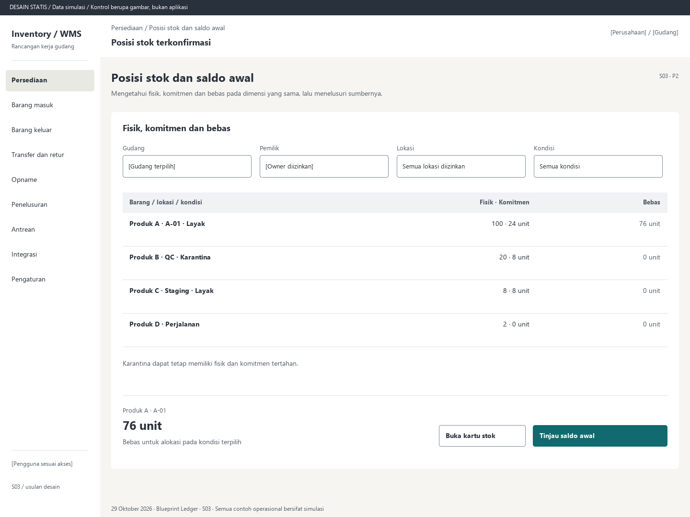

# S03. Posisi stok dan saldo awal

Status: usulan desain statis, tanpa implementasi. Semua angka/kode pada papan adalah **Data simulasi**; bukan hasil transaksi atau UAT.

**Pengguna:** Supervisor, auditor, petugas stok. **Paket:** P2. **Pola:** ledger.

**Kebutuhan asal:** FR-02, FR-03, FR-04, FR-13, FR-15; TRK-15, TRK-22. **Keputusan terbuka:** D01, D02, D03.

**Pekerjaan layar:** Mengetahui fisik, komitmen dan bebas pada dimensi yang sama, lalu menelusuri sumbernya.

[Vektor SVG](../boards/03-posisi-stok-dan-saldo-awal.svg). Gambar kontrol tidak interaktif; kontraknya berada di bawah.

## Komposisi dan prioritas

Konteks utama: Posisi stok terkonfirmasi. Fokus: Produk A · A-01, dengan nilai ilustrasi 76 unit. Bebas untuk alokasi pada kondisi terpilih.

Bagian pemilihan/konteks: Dimensi posisi. Ruang kerja: Fisik, komitmen dan bebas. Pemisahan ini membantu pengguna memilih objek lalu meninjau dampaknya. Papan menggunakan shell yang sama; isi mengikuti kebutuhan fungsi, bukan menambah grafik atau KPI.

Informasi minimum yang tetap terbaca:

- Gudang: [Gudang terpilih].
- Pemilik: [Owner diizinkan].
- Lokasi: Semua lokasi diizinkan.
- Kondisi: Semua kondisi.

Field/kolom penentu: Barang / lokasi / kondisi, Fisik · Komitmen, Bebas. Nama barang, kode, kuantitas dan unit tidak diganti dengan ikon atau tooltip.

## Urutan kerja

1. Pilih perusahaan/owner, gudang, lokasi, kondisi dan batch/serial bila berlaku.
2. Bandingkan fisik, komitmen dan bebas; tampilkan waktu pembaruan dan sumber transaksi utama untuk keputusan alokasi.
3. Buka baris untuk saldo, entri, reservasi dan dokumen sumber pada dimensi sama.
4. Saldo awal melalui dokumen impor/review terotorisasi dengan alasan dan posting Inventory Core; jangan menyediakan edit langsung pada sel saldo.

## Kontrol dan hasil yang direncanakan

| Kontrol | Perilaku dan hasil |
|---|---|
| Buka kartu stok | Buka S16 untuk posisi terpilih dan sumber setiap mutasi. |
| Tinjau saldo awal | Tampilkan preview impor, validasi baris, total per satuan/dimensi dan kewenangan sebelum posting. |
| Rekonsiliasi | Bandingkan saldo dengan entri serta komitmen dengan alokasi; selisih membuka penanganan, bukan menimpa saldo. |

## Validasi dan dampak

Fisik sama dengan jumlah entri, komitmen sama dengan alokasi ACTIVE/HELD. Bebas hanya fisik minus komitmen pada posisi yang layak, tidak freeze dan diizinkan; selain itu nol.

Membaca posisi tidak mengubah stok. Saldo awal merupakan movement yang terotorisasi, atomik dan dapat ditelusuri.

Karantina dapat tetap memiliki fisik dan komitmen tertahan.

## Keadaan selain berhasil

| Keadaan | Pesan dan pemulihan |
|---|---|
| Kosong | Belum ada posisi terposting. Tinjau master dan proses saldo awal yang terotorisasi. |
| Memuat | Memuat posisi stok dan saldo awal pada lingkup terpilih. Data sebelumnya tidak dianggap terbaru. |
| Filter kosong | Tidak ada hasil untuk filter aktif. Pertahankan filter dan sediakan Hapus filter. |
| Error | Posisi stok belum dapat dimuat. Muat ulang sebelum memakai angka untuk keputusan. |
| Konflik / tertahan | Rekonsiliasi menemukan selisih. Buka bukti entri dan alokasi; jangan koreksi saldo langsung. |
| Akses ditolak | Tindakan atau lingkup ini tidak diizinkan. Kembali ke scope sah; jangan tampilkan isi objek terlarang. |
| Offline / hasil belum pasti | Untuk perintah konfirmasi, gunakan kontrak S17; pending lokal, unknown dan penolakan pasti mempunyai pemulihan berbeda. Baca saja menampilkan data tidak tersedia/belum segar. |

## Desktop, rentang menengah dan scanner

Desktop mengikuti komposisi papan. Pada rentang menengah, menu berlabel dan pemilih objek menggantikan sidebar/panel sempit. Pada rentang sempit, objek, field penentu, status, aktual/satuan dan aksi menjadi record vertikal. Metadata boleh dipindahkan ke detail, tetapi tidak menghilangkan alasan tertahan atau dampak kuantitas.

Kontrak minimum: target 44px, scanner 52px; label terlihat, fokus 3px, Tab sesuai alur, dialog Escape saat aman dan fokus kembali. Input tidak boleh tertutup keyboard. Scope/dokumen tidak berubah saat pending tanpa keputusan eksplisit. Lihat [fondasi](../00-foundation.md) dan [komponen/state](../02-components-and-states.md).

## Bukti penerimaan yang perlu disiapkan

Skenario terkait: UAT-01, UAT-08, UAT-09, UAT-10; TRK-UAT-21. Semuanya tetap **Belum dijalankan**. Pemetaan ini menyebut cakupan yang perlu dibuktikan, bukan hasil lulus.

Tinjauan desain: baca konteks, tentukan langkah yang benar, jelaskan dampak dan jalankan kembali skenario gagal menggunakan spesifikasi. Setelah implementasi: uji semua kontrol yang disebut di atas, narrow/menengah/desktop, kedua tema, keyboard dan perangkat nyata. Pemeriksaan API/database dibutuhkan untuk akses, idempotensi, transaksi dan saldo; gambar tidak membuktikannya.

## Sumber

[PRD](../../../docs/planning/01-product-requirements.md), [TRD](../../../docs/planning/02-technical-requirements.md), [Flow](../../../docs/planning/03-app-flow.md), [Design Brief](../../../docs/planning/04-design-brief.md), [Schema](../../../docs/planning/05-backend-schema.md), [Plan](../../../docs/planning/06-implementation-plan.md), [PRD tracker](../../../docs/planning/prd-tracker-barcode-rfid.md).

[Contoh tema gelap](../boards/03-posisi-stok-dan-saldo-awal-dark.png).
