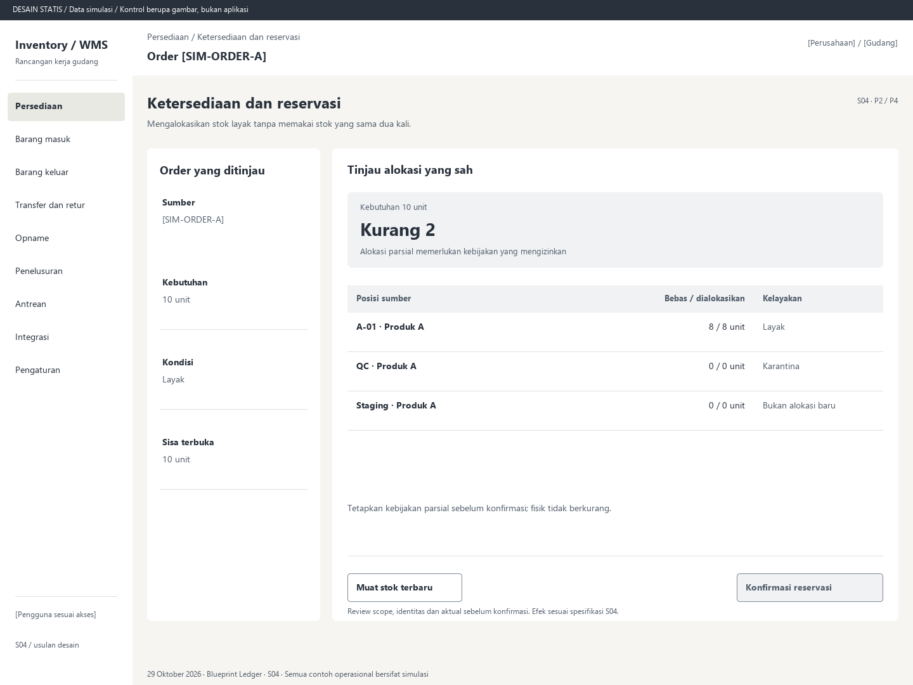

# S04. Ketersediaan dan reservasi

Status: usulan desain statis, tanpa implementasi. Semua angka/kode pada papan adalah **Data simulasi**; bukan hasil transaksi atau UAT.

**Pengguna:** Supervisor atau petugas alokasi. **Paket:** P2 / P4. **Pola:** allocation.

**Kebutuhan asal:** FR-03, FR-07, FR-15; TRK-05, TRK-08, TRK-12. **Keputusan terbuka:** D02, D03.

**Pekerjaan layar:** Mengalokasikan stok layak tanpa memakai stok yang sama dua kali.

[Vektor SVG](../boards/04-ketersediaan-dan-reservasi.svg). Gambar kontrol tidak interaktif; kontraknya berada di bawah.

## Komposisi dan prioritas

Konteks utama: Order [SIM-ORDER-A]. Fokus: Kebutuhan 10 unit, dengan nilai ilustrasi Kurang 2. Alokasi parsial memerlukan kebijakan yang mengizinkan.

Bagian pemilihan/konteks: Order yang ditinjau. Ruang kerja: Tinjau alokasi yang sah. Pemisahan ini membantu pengguna memilih objek lalu meninjau dampaknya. Papan menggunakan shell yang sama; isi mengikuti kebutuhan fungsi, bukan menambah grafik atau KPI.

Informasi minimum yang tetap terbaca:

- Sumber: [SIM-ORDER-A].
- Kebutuhan: 10 unit.
- Kondisi: Layak.
- Sisa terbuka: 10 unit.

Field/kolom penentu: Posisi sumber, Bebas / dialokasikan, Kelayakan. Nama barang, kode, kuantitas dan unit tidak diganti dengan ikon atau tooltip.

## Urutan kerja

1. Buka order yang sudah dilepas dan approval sah.
2. Tampilkan kebutuhan, sudah dialokasikan, sisa, posisi layak dan pembatas lokasi/kondisi/expiry.
3. Tinjau kekurangan; jangan otomatis memilih parsial sebelum kebijakan D02 mendukungnya.
4. Konfirmasi; server memvalidasi ulang stok di bawah lock. Tampilkan alokasi tersimpan atau konflik tanpa mengasumsikan hasil preview tetap berlaku.

## Kontrol dan hasil yang direncanakan

| Kontrol | Perilaku dan hasil |
|---|---|
| Konfirmasi reservasi | Pada contoh kekurangan, tombol ditahan sampai kebijakan parsial mengizinkan atau kebutuhan terpenuhi. Review jumlah dan posisi; kirim satu maksud dengan versi dan kunci tetap. |
| Muat stok terbaru | Perbarui preview, tidak diam-diam mengubah maksud yang hasilnya belum pasti. |
| Tinjau reservasi tertahan | Lihat penyebab karantina serta order/tugas terdampak; realokasi/pelepasan mengikuti D02 dan audit. |

## Validasi dan dampak

Backend utama mengunci dan memeriksa sisa serta kondisi terkini. Total komitmen tidak melebihi fisik. Staging, quarantine, freeze dan expiry yang melarang tidak menjadi alokasi baru.

Komitmen bertambah sebesar alokasi sah; fisik tetap. HELD tetap dihitung sebagai komitmen dan menahan picking/shipment.

Tetapkan kebijakan parsial sebelum konfirmasi; fisik tidak berkurang.

## Keadaan selain berhasil

| Keadaan | Pesan dan pemulihan |
|---|---|
| Kosong | Tidak ada order yang siap dialokasikan. Periksa release dan approval. |
| Memuat | Memuat ketersediaan dan reservasi pada lingkup terpilih. Data sebelumnya tidak dianggap terbaru. |
| Filter kosong | Tidak ada hasil untuk filter aktif. Pertahankan filter dan sediakan Hapus filter. |
| Error | Ketersediaan gagal dimuat. Muat ulang sebelum mengalokasikan. |
| Konflik / tertahan | Stok layak berubah. Muat ulang dan tinjau alokasi; pilihan parsial memerlukan kebijakan yang sah. |
| Akses ditolak | Tindakan atau lingkup ini tidak diizinkan. Kembali ke scope sah; jangan tampilkan isi objek terlarang. |
| Offline / hasil belum pasti | Untuk perintah konfirmasi, gunakan kontrak S17; pending lokal, unknown dan penolakan pasti mempunyai pemulihan berbeda. Baca saja menampilkan data tidak tersedia/belum segar. |

## Desktop, rentang menengah dan scanner

Desktop mengikuti komposisi papan. Pada rentang menengah, menu berlabel dan pemilih objek menggantikan sidebar/panel sempit. Pada rentang sempit, objek, field penentu, status, aktual/satuan dan aksi menjadi record vertikal. Metadata boleh dipindahkan ke detail, tetapi tidak menghilangkan alasan tertahan atau dampak kuantitas.

Kontrak minimum: target 44px, scanner 52px; label terlihat, fokus 3px, Tab sesuai alur, dialog Escape saat aman dan fokus kembali. Input tidak boleh tertutup keyboard. Scope/dokumen tidak berubah saat pending tanpa keputusan eksplisit. Lihat [fondasi](../00-foundation.md) dan [komponen/state](../02-components-and-states.md).

## Bukti penerimaan yang perlu disiapkan

Skenario terkait: UAT-01, UAT-03, UAT-08, UAT-10; TRK-UAT-07, TRK-UAT-08. Semuanya tetap **Belum dijalankan**. Pemetaan ini menyebut cakupan yang perlu dibuktikan, bukan hasil lulus.

Tinjauan desain: baca konteks, tentukan langkah yang benar, jelaskan dampak dan jalankan kembali skenario gagal menggunakan spesifikasi. Setelah implementasi: uji semua kontrol yang disebut di atas, narrow/menengah/desktop, kedua tema, keyboard dan perangkat nyata. Pemeriksaan API/database dibutuhkan untuk akses, idempotensi, transaksi dan saldo; gambar tidak membuktikannya.

## Sumber

[PRD](../../../docs/planning/01-product-requirements.md), [TRD](../../../docs/planning/02-technical-requirements.md), [Flow](../../../docs/planning/03-app-flow.md), [Design Brief](../../../docs/planning/04-design-brief.md), [Schema](../../../docs/planning/05-backend-schema.md), [Plan](../../../docs/planning/06-implementation-plan.md), [PRD tracker](../../../docs/planning/prd-tracker-barcode-rfid.md).
