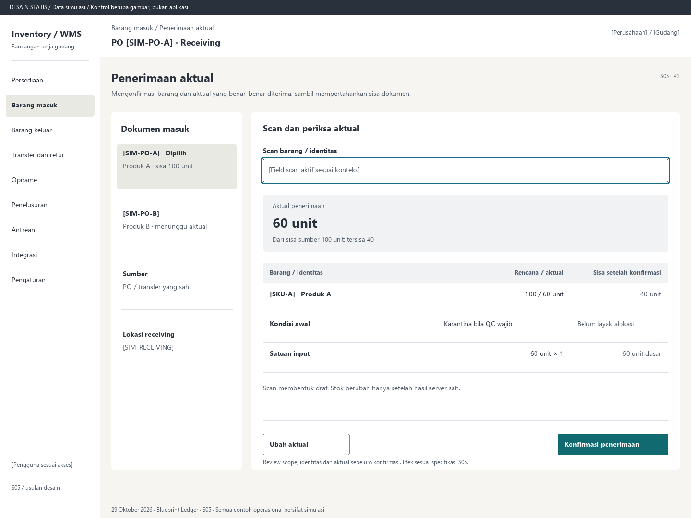

# S05. Penerimaan aktual

Status: usulan desain statis, tanpa implementasi. Semua angka/kode pada papan adalah **Data simulasi**; bukan hasil transaksi atau UAT.

**Pengguna:** Operator receiving. **Paket:** P3. **Pola:** quantity.

**Kebutuhan asal:** FR-05, FR-06, FR-14, FR-15; TRK-03, TRK-04, TRK-08, TRK-10, TRK-11, TRK-12, TRK-13. **Keputusan terbuka:** D02, D03, D05; T01-T04.

**Pekerjaan layar:** Mengonfirmasi barang dan aktual yang benar-benar diterima, sambil mempertahankan sisa dokumen.

[Vektor SVG](../boards/05-penerimaan-aktual.svg). Gambar kontrol tidak interaktif; kontraknya berada di bawah.

## Komposisi dan prioritas

Konteks utama: PO [SIM-PO-A] · Receiving. Fokus: Aktual penerimaan, dengan nilai ilustrasi 60 unit. Dari sisa sumber 100 unit; tersisa 40.

Bagian pemilihan/konteks: Dokumen masuk. Ruang kerja: Scan dan periksa aktual. Pemisahan ini membantu pengguna memilih objek lalu meninjau dampaknya. Papan menggunakan shell yang sama; isi mengikuti kebutuhan fungsi, bukan menambah grafik atau KPI.

Informasi minimum yang tetap terbaca:

- [SIM-PO-A]: Produk A · sisa 100 unit.
- [SIM-PO-B]: Produk B · menunggu aktual.
- Sumber: PO / transfer yang sah.
- Lokasi receiving: [SIM-RECEIVING].

Field/kolom penentu: Barang / identitas, Rencana / aktual, Sisa setelah konfirmasi. Nama barang, kode, kuantitas dan unit tidak diganti dengan ikon atau tooltip.

## Urutan kerja

1. Pilih PO atau transfer yang sah; baca sisa, gudang dan lokasi receiving.
2. Pilih mode input jumlah atau tambah per scan, scan barang lalu isi aktual/satuan. Batch/serial/expiry muncul ketika wajib.
3. Tinjau aktual, konversi, sisa, kondisi awal, ditolak dan kelebihan. Barcode ambigu tidak ditebak.
4. Review dan konfirmasi. Hasil sukses menampilkan nomor transaksi, aktual, posisi receiving dan sisa; status ERP terpisah. Jika QC wajib, arahkan ke S06.

## Kontrol dan hasil yang direncanakan

| Kontrol | Perilaku dan hasil |
|---|---|
| Scan barang | Input berlabel dan fokus eksplisit; jenis input barang tidak boleh tertukar dengan lokasi/dokumen. |
| Ubah aktual | Ubah draf sebelum pengiriman; hitung ulang review dengan faktor yang terlihat. |
| Konfirmasi penerimaan | Buka review scope, sumber, item, aktual, unit dan efek; posting setelah konfirmasi akhir. |
| Periksa hasil | Pada timeout buka S17 dan gunakan kunci/payload asli. |

## Validasi dan dampak

Sisa/toleransi, akses, versi, barcode aktif, satuan dan tracking wajib diperiksa ulang server. Scan SKU sama yang disengaja dapat menambah draf sesuai mode; replay kejadian scan tidak menambah lagi.

Receiving bertambah sebesar aktual sah dan sisa sumber berkurang sebesar aktual. PO 100 diterima 60 menyisakan 40; konfirmasi ulang tidak menambah 60 lagi.

Scan membentuk draf. Stok berubah hanya setelah hasil server sah.

## Keadaan selain berhasil

| Keadaan | Pesan dan pemulihan |
|---|---|
| Kosong | Belum ada dokumen terbuka untuk gudang ini. Periksa referensi kedatangan. |
| Memuat | Memuat penerimaan aktual pada lingkup terpilih. Data sebelumnya tidak dianggap terbaru. |
| Filter kosong | Tidak ada hasil untuk filter aktif. Pertahankan filter dan sediakan Hapus filter. |
| Error | Penerimaan belum terkirim. Draf aktual tersedia; periksa koneksi. |
| Konflik / tertahan | Aktual melampaui sisa atau tracking belum lengkap. Perbaiki baris atau minta peninjauan yang sah. |
| Akses ditolak | Tindakan atau lingkup ini tidak diizinkan. Kembali ke scope sah; jangan tampilkan isi objek terlarang. |
| Offline / hasil belum pasti | Untuk perintah konfirmasi, gunakan kontrak S17; pending lokal, unknown dan penolakan pasti mempunyai pemulihan berbeda. Baca saja menampilkan data tidak tersedia/belum segar. |

## Desktop, rentang menengah dan scanner

Desktop mengikuti komposisi papan. Pada rentang menengah, menu berlabel dan pemilih objek menggantikan sidebar/panel sempit. Pada rentang sempit, objek, field penentu, status, aktual/satuan dan aksi menjadi record vertikal. Metadata boleh dipindahkan ke detail, tetapi tidak menghilangkan alasan tertahan atau dampak kuantitas.

Kontrak minimum: target 44px, scanner 52px; label terlihat, fokus 3px, Tab sesuai alur, dialog Escape saat aman dan fokus kembali. Input tidak boleh tertutup keyboard. Scope/dokumen tidak berubah saat pending tanpa keputusan eksplisit. Lihat [fondasi](../00-foundation.md) dan [komponen/state](../02-components-and-states.md).

## Bukti penerimaan yang perlu disiapkan

Skenario terkait: UAT-02, UAT-08, UAT-09, UAT-10, UAT-12; TRK-UAT-02, TRK-UAT-03, TRK-UAT-04, TRK-UAT-05, TRK-UAT-09, TRK-UAT-22. Semuanya tetap **Belum dijalankan**. Pemetaan ini menyebut cakupan yang perlu dibuktikan, bukan hasil lulus.

Tinjauan desain: baca konteks, tentukan langkah yang benar, jelaskan dampak dan jalankan kembali skenario gagal menggunakan spesifikasi. Setelah implementasi: uji semua kontrol yang disebut di atas, narrow/menengah/desktop, kedua tema, keyboard dan perangkat nyata. Pemeriksaan API/database dibutuhkan untuk akses, idempotensi, transaksi dan saldo; gambar tidak membuktikannya.

## Sumber

[PRD](../../../docs/planning/01-product-requirements.md), [TRD](../../../docs/planning/02-technical-requirements.md), [Flow](../../../docs/planning/03-app-flow.md), [Design Brief](../../../docs/planning/04-design-brief.md), [Schema](../../../docs/planning/05-backend-schema.md), [Plan](../../../docs/planning/06-implementation-plan.md), [PRD tracker](../../../docs/planning/prd-tracker-barcode-rfid.md).

[Papan handheld](../boards/05-penerimaan-aktual-handheld.png) dan [SVG handheld](../boards/05-penerimaan-aktual-handheld.svg).

[Papan tablet](../boards/05-penerimaan-aktual-tablet.png).
