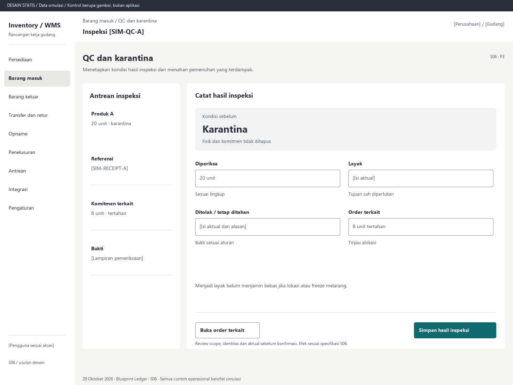

# S06. QC dan karantina

Status: usulan desain statis, tanpa implementasi. Semua angka/kode pada papan adalah **Data simulasi**; bukan hasil transaksi atau UAT.

**Pengguna:** Petugas QC; supervisor. **Paket:** P3. **Pola:** form.

**Kebutuhan asal:** FR-03, FR-06, FR-07, FR-04; TRK-04, TRK-08, TRK-16. **Keputusan terbuka:** D02, D03.

**Pekerjaan layar:** Menetapkan kondisi hasil inspeksi dan menahan pemenuhan yang terdampak.

[Vektor SVG](../boards/06-qc-dan-karantina.svg). Gambar kontrol tidak interaktif; kontraknya berada di bawah.

## Komposisi dan prioritas

Konteks utama: Inspeksi [SIM-QC-A]. Fokus: Kondisi sebelum, dengan nilai ilustrasi Karantina. Fisik dan komitmen tidak dihapus.

Bagian pemilihan/konteks: Antrean inspeksi. Ruang kerja: Catat hasil inspeksi. Pemisahan ini membantu pengguna memilih objek lalu meninjau dampaknya. Papan menggunakan shell yang sama; isi mengikuti kebutuhan fungsi, bukan menambah grafik atau KPI.

Informasi minimum yang tetap terbaca:

- Produk A: 20 unit · karantina.
- Referensi: [SIM-RECEIPT-A].
- Komitmen terkait: 8 unit · tertahan.
- Bukti: [Lampiran pemeriksaan].

Field/kolom penentu: Bagian pemeriksaan, Hasil rancangan, Tindak lanjut. Nama barang, kode, kuantitas dan unit tidak diganti dengan ikon atau tooltip.

## Urutan kerja

1. Pilih inspeksi dari antrean dengan sumber, umur tunggu, kondisi, batch/serial dan jumlah.
2. Isi hasil per kondisi dan alasan/bukti yang diwajibkan; total tidak melampaui jumlah diperiksa.
3. Tinjau reservasi dan tugas terkait yang ditahan bila kondisi memburuk.
4. Konfirmasi keputusan QC sesuai kewenangan; buat/lanjutkan putaway hanya untuk hasil yang sah.

## Kontrol dan hasil yang direncanakan

| Kontrol | Perilaku dan hasil |
|---|---|
| Simpan hasil inspeksi | Review distribusi kondisi, bukti dan efek pada order sebelum mengirim. |
| Buka order terkait | Buka daftar alokasi/tugas terdampak, bukan melepas komitmen otomatis. |
| Tambahkan bukti | Tampilkan status upload dan error terpisah; upload selesai bukan posting stok. |

## Validasi dan dampak

Jumlah hasil konsisten, bukti wajib siap dan di scope yang benar, izin QC sah. Karantina setelah reservasi menahan picking/shipment terkait.

Perubahan kondisi tercatat sebagai movement. Komitmen terdampak tetap HELD sampai penyelesaian terotorisasi, bukan menjadi stok bebas diam-diam.

Menjadi layak belum menjamin bebas jika lokasi atau freeze melarang.

## Keadaan selain berhasil

| Keadaan | Pesan dan pemulihan |
|---|---|
| Kosong | Tidak ada inspeksi yang menunggu pada scope ini. |
| Memuat | Memuat qc dan karantina pada lingkup terpilih. Data sebelumnya tidak dianggap terbaru. |
| Filter kosong | Tidak ada hasil untuk filter aktif. Pertahankan filter dan sediakan Hapus filter. |
| Error | Bukti inspeksi belum berhasil diunggah. Coba ulang lampiran sebelum keputusan yang memerlukannya. |
| Konflik / tertahan | Sebagian barang telah berubah kondisi atau versi inspeksi berubah. Muat ulang sebelum memutuskan. |
| Akses ditolak | Tindakan atau lingkup ini tidak diizinkan. Kembali ke scope sah; jangan tampilkan isi objek terlarang. |
| Offline / hasil belum pasti | Untuk perintah konfirmasi, gunakan kontrak S17; pending lokal, unknown dan penolakan pasti mempunyai pemulihan berbeda. Baca saja menampilkan data tidak tersedia/belum segar. |

## Desktop, rentang menengah dan scanner

Desktop mengikuti komposisi papan. Pada rentang menengah, menu berlabel dan pemilih objek menggantikan sidebar/panel sempit. Pada rentang sempit, objek, field penentu, status, aktual/satuan dan aksi menjadi record vertikal. Metadata boleh dipindahkan ke detail, tetapi tidak menghilangkan alasan tertahan atau dampak kuantitas.

Kontrak minimum: target 44px, scanner 52px; label terlihat, fokus 3px, Tab sesuai alur, dialog Escape saat aman dan fokus kembali. Input tidak boleh tertutup keyboard. Scope/dokumen tidak berubah saat pending tanpa keputusan eksplisit. Lihat [fondasi](../00-foundation.md) dan [komponen/state](../02-components-and-states.md).

## Bukti penerimaan yang perlu disiapkan

Skenario terkait: UAT-03; TRK-UAT-08. Semuanya tetap **Belum dijalankan**. Pemetaan ini menyebut cakupan yang perlu dibuktikan, bukan hasil lulus.

Tinjauan desain: baca konteks, tentukan langkah yang benar, jelaskan dampak dan jalankan kembali skenario gagal menggunakan spesifikasi. Setelah implementasi: uji semua kontrol yang disebut di atas, narrow/menengah/desktop, kedua tema, keyboard dan perangkat nyata. Pemeriksaan API/database dibutuhkan untuk akses, idempotensi, transaksi dan saldo; gambar tidak membuktikannya.

## Sumber

[PRD](../../../docs/planning/01-product-requirements.md), [TRD](../../../docs/planning/02-technical-requirements.md), [Flow](../../../docs/planning/03-app-flow.md), [Design Brief](../../../docs/planning/04-design-brief.md), [Schema](../../../docs/planning/05-backend-schema.md), [Plan](../../../docs/planning/06-implementation-plan.md), [PRD tracker](../../../docs/planning/prd-tracker-barcode-rfid.md).
