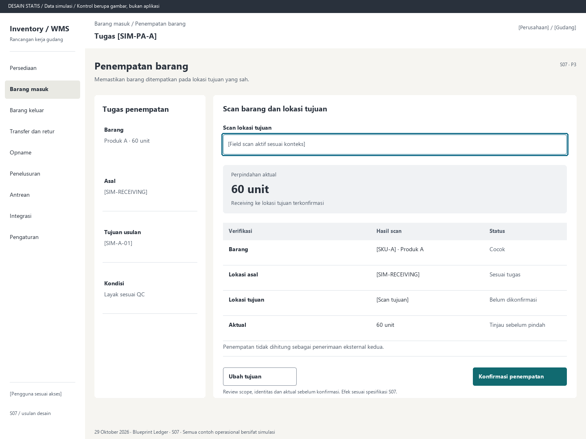

# S07. Penempatan barang

Status: usulan desain statis, tanpa implementasi. Semua angka/kode pada papan adalah **Data simulasi**; bukan hasil transaksi atau UAT.

**Pengguna:** Operator gudang. **Paket:** P3. **Pola:** scan.

**Kebutuhan asal:** FR-06, FR-14, FR-15; TRK-03, TRK-06, TRK-08, TRK-10, TRK-13. **Keputusan terbuka:** D02, D05; T04.

**Pekerjaan layar:** Memastikan barang ditempatkan pada lokasi tujuan yang sah.

[Vektor SVG](../boards/07-penempatan-putaway.svg). Gambar kontrol tidak interaktif; kontraknya berada di bawah.

## Komposisi dan prioritas

Konteks utama: Tugas [SIM-PA-A]. Fokus: Perpindahan aktual, dengan nilai ilustrasi 60 unit. Receiving ke lokasi tujuan terkonfirmasi.

Bagian pemilihan/konteks: Tugas penempatan. Ruang kerja: Scan barang dan lokasi tujuan. Pemisahan ini membantu pengguna memilih objek lalu meninjau dampaknya. Papan menggunakan shell yang sama; isi mengikuti kebutuhan fungsi, bukan menambah grafik atau KPI.

Informasi minimum yang tetap terbaca:

- Barang: Produk A · 60 unit.
- Asal: [SIM-RECEIVING].
- Tujuan usulan: [SIM-A-01].
- Kondisi: Layak sesuai QC.

Field/kolom penentu: Verifikasi, Hasil scan, Status. Nama barang, kode, kuantitas dan unit tidak diganti dengan ikon atau tooltip.

## Urutan kerja

1. Buka tugas dengan sumber receiving dan kondisi hasil QC.
2. Scan barang serta lokasi tujuan; lokasi usulan tidak dianggap bukti penempatan fisik.
3. Isi aktual, periksa batch/serial, asal dan tujuan yang diizinkan.
4. Review dan konfirmasi; tampilkan nomor perpindahan dan posisi akhir server.

## Kontrol dan hasil yang direncanakan

| Kontrol | Perilaku dan hasil |
|---|---|
| Scan tujuan | Menyelesaikan field lokasi eksplisit; scan SKU tidak diterima sebagai lokasi. |
| Ubah tujuan | Hanya lokasi yang diizinkan; revisi menuntut review baru. |
| Konfirmasi penempatan | Posting perpindahan aktual, bukan kuantitas rencana secara otomatis. |

## Validasi dan dampak

Lokasi tujuan dan barang cocok scope; freeze, kondisi dan sisa tugas diperiksa ulang. Tujuan tidak boleh disimpulkan dari pemilihan daftar saja.

Asal berkurang dan tujuan bertambah dengan aktual sama. Total fisik dalam gudang tetap; bebas mengikuti kelayakan tujuan/kondisi.

Penempatan tidak dihitung sebagai penerimaan eksternal kedua.

## Keadaan selain berhasil

| Keadaan | Pesan dan pemulihan |
|---|---|
| Kosong | Belum ada tugas penempatan yang dilepas. Periksa hasil receiving/QC. |
| Memuat | Memuat penempatan barang pada lingkup terpilih. Data sebelumnya tidak dianggap terbaru. |
| Filter kosong | Tidak ada hasil untuk filter aktif. Pertahankan filter dan sediakan Hapus filter. |
| Error | Konfirmasi penempatan belum terkirim. Draf scan tetap pending. |
| Konflik / tertahan | Lokasi tujuan sedang dibekukan atau tidak diizinkan. Pilih tujuan sah setelah meninjau tugas. |
| Akses ditolak | Tindakan atau lingkup ini tidak diizinkan. Kembali ke scope sah; jangan tampilkan isi objek terlarang. |
| Offline / hasil belum pasti | Untuk perintah konfirmasi, gunakan kontrak S17; pending lokal, unknown dan penolakan pasti mempunyai pemulihan berbeda. Baca saja menampilkan data tidak tersedia/belum segar. |

## Desktop, rentang menengah dan scanner

Desktop mengikuti komposisi papan. Pada rentang menengah, menu berlabel dan pemilih objek menggantikan sidebar/panel sempit. Pada rentang sempit, objek, field penentu, status, aktual/satuan dan aksi menjadi record vertikal. Metadata boleh dipindahkan ke detail, tetapi tidak menghilangkan alasan tertahan atau dampak kuantitas.

Kontrak minimum: target 44px, scanner 52px; label terlihat, fokus 3px, Tab sesuai alur, dialog Escape saat aman dan fokus kembali. Input tidak boleh tertutup keyboard. Scope/dokumen tidak berubah saat pending tanpa keputusan eksplisit. Lihat [fondasi](../00-foundation.md) dan [komponen/state](../02-components-and-states.md).

## Bukti penerimaan yang perlu disiapkan

Skenario terkait: UAT-03, UAT-12; TRK-UAT-08, TRK-UAT-09, TRK-UAT-22. Semuanya tetap **Belum dijalankan**. Pemetaan ini menyebut cakupan yang perlu dibuktikan, bukan hasil lulus.

Tinjauan desain: baca konteks, tentukan langkah yang benar, jelaskan dampak dan jalankan kembali skenario gagal menggunakan spesifikasi. Setelah implementasi: uji semua kontrol yang disebut di atas, narrow/menengah/desktop, kedua tema, keyboard dan perangkat nyata. Pemeriksaan API/database dibutuhkan untuk akses, idempotensi, transaksi dan saldo; gambar tidak membuktikannya.

## Sumber

[PRD](../../../docs/planning/01-product-requirements.md), [TRD](../../../docs/planning/02-technical-requirements.md), [Flow](../../../docs/planning/03-app-flow.md), [Design Brief](../../../docs/planning/04-design-brief.md), [Schema](../../../docs/planning/05-backend-schema.md), [Plan](../../../docs/planning/06-implementation-plan.md), [PRD tracker](../../../docs/planning/prd-tracker-barcode-rfid.md).

[Papan handheld](../boards/07-penempatan-putaway-handheld.png) dan [SVG handheld](../boards/07-penempatan-putaway-handheld.svg).
