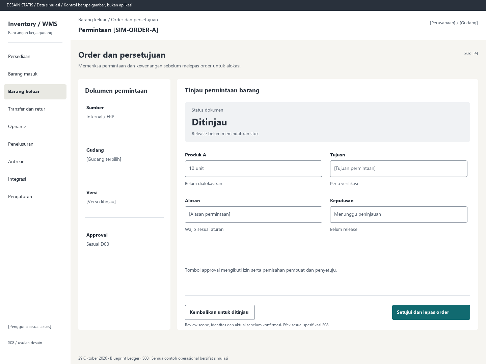

# S08. Order dan persetujuan

Status: usulan desain statis, tanpa implementasi. Semua angka/kode pada papan adalah **Data simulasi**; bukan hasil transaksi atau UAT.

**Pengguna:** Peminta internal; supervisor. **Paket:** P4. **Pola:** form.

**Kebutuhan asal:** FR-04, FR-07; TRK-03, TRK-14, TRK-16. **Keputusan terbuka:** D02, D03, D04.

**Pekerjaan layar:** Memeriksa permintaan dan kewenangan sebelum melepas order untuk alokasi.

[Vektor SVG](../boards/08-order-dan-persetujuan.svg). Gambar kontrol tidak interaktif; kontraknya berada di bawah.

## Komposisi dan prioritas

Konteks utama: Permintaan [SIM-ORDER-A]. Fokus: Status dokumen, dengan nilai ilustrasi Ditinjau. Release belum memindahkan stok.

Bagian pemilihan/konteks: Dokumen permintaan. Ruang kerja: Tinjau permintaan barang. Pemisahan ini membantu pengguna memilih objek lalu meninjau dampaknya. Papan menggunakan shell yang sama; isi mengikuti kebutuhan fungsi, bukan menambah grafik atau KPI.

Informasi minimum yang tetap terbaca:

- Sumber: Internal / ERP.
- Gudang: [Gudang terpilih].
- Versi: [Versi ditinjau].
- Approval: Sesuai D03.

Field/kolom penentu: Baris permintaan, Jumlah / satuan, Pemenuhan. Nama barang, kode, kuantitas dan unit tidak diganti dengan ikon atau tooltip.

## Urutan kerja

1. Peminta menyusun barang, jumlah/satuan, kebutuhan dan sumber yang diperlukan.
2. Peninjau melihat isi dan versi dokumen beserta alasan/bukti; aturan approval tidak diasumsikan final.
3. Setujui/lepas jika berwenang atau kembalikan dengan alasan; bila approval tidak diperlukan gunakan release sesuai kebijakan.
4. Order dilepas menuju S04. Peminta tetap melihat alokasi, picked, shipped dan sisa secara terpisah.

## Kontrol dan hasil yang direncanakan

| Kontrol | Perilaku dan hasil |
|---|---|
| Simpan draf | Menyimpan permintaan, tidak mengalokasikan stok. |
| Setujui dan lepas order | Tindakan hanya untuk policy yang mengizinkan gabungan ini; bila terpisah tampilkan dua tahap approval lalu release. |
| Kembalikan untuk ditinjau | Alasan wajib; tidak menghapus bukti versi sebelumnya. |

## Validasi dan dampak

Peran pembuat/peninjau, versi kebijakan dan revisi isi diperiksa. Perubahan material setelah approval dapat memerlukan review baru sesuai D03.

Order siap dialokasikan setelah release, fisik dan komitmen belum berubah. S04 menangani reservasi.

Tombol approval mengikuti izin serta pemisahan pembuat dan penyetuju.

## Keadaan selain berhasil

| Keadaan | Pesan dan pemulihan |
|---|---|
| Kosong | Belum ada permintaan yang memerlukan keputusan Anda. |
| Memuat | Memuat order dan persetujuan pada lingkup terpilih. Data sebelumnya tidak dianggap terbaru. |
| Filter kosong | Tidak ada hasil untuk filter aktif. Pertahankan filter dan sediakan Hapus filter. |
| Error | Keputusan belum terkirim. Periksa koneksi dan hasil sebelum mengirim ulang. |
| Konflik / tertahan | Isi order berubah setelah dibuka. Tinjau versi terbaru sebelum menyetujui. |
| Akses ditolak | Tindakan atau lingkup ini tidak diizinkan. Kembali ke scope sah; jangan tampilkan isi objek terlarang. |
| Offline / hasil belum pasti | Untuk perintah konfirmasi, gunakan kontrak S17; pending lokal, unknown dan penolakan pasti mempunyai pemulihan berbeda. Baca saja menampilkan data tidak tersedia/belum segar. |

## Desktop, rentang menengah dan scanner

Desktop mengikuti komposisi papan. Pada rentang menengah, menu berlabel dan pemilih objek menggantikan sidebar/panel sempit. Pada rentang sempit, objek, field penentu, status, aktual/satuan dan aksi menjadi record vertikal. Metadata boleh dipindahkan ke detail, tetapi tidak menghilangkan alasan tertahan atau dampak kuantitas.

Kontrak minimum: target 44px, scanner 52px; label terlihat, fokus 3px, Tab sesuai alur, dialog Escape saat aman dan fokus kembali. Input tidak boleh tertutup keyboard. Scope/dokumen tidak berubah saat pending tanpa keputusan eksplisit. Lihat [fondasi](../00-foundation.md) dan [komponen/state](../02-components-and-states.md).

## Bukti penerimaan yang perlu disiapkan

Skenario terkait: UAT-13; TRK-UAT-19. Semuanya tetap **Belum dijalankan**. Pemetaan ini menyebut cakupan yang perlu dibuktikan, bukan hasil lulus.

Tinjauan desain: baca konteks, tentukan langkah yang benar, jelaskan dampak dan jalankan kembali skenario gagal menggunakan spesifikasi. Setelah implementasi: uji semua kontrol yang disebut di atas, narrow/menengah/desktop, kedua tema, keyboard dan perangkat nyata. Pemeriksaan API/database dibutuhkan untuk akses, idempotensi, transaksi dan saldo; gambar tidak membuktikannya.

## Sumber

[PRD](../../../docs/planning/01-product-requirements.md), [TRD](../../../docs/planning/02-technical-requirements.md), [Flow](../../../docs/planning/03-app-flow.md), [Design Brief](../../../docs/planning/04-design-brief.md), [Schema](../../../docs/planning/05-backend-schema.md), [Plan](../../../docs/planning/06-implementation-plan.md), [PRD tracker](../../../docs/planning/prd-tracker-barcode-rfid.md).
