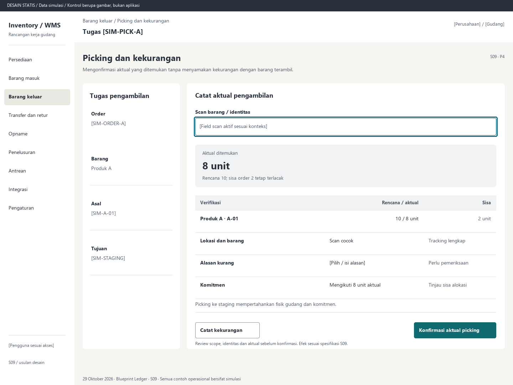

# S09. Picking dan kekurangan

Status: usulan desain statis, tanpa implementasi. Semua angka/kode pada papan adalah **Data simulasi**; bukan hasil transaksi atau UAT.

**Pengguna:** Operator picking; supervisor selisih. **Paket:** P4. **Pola:** quantity.

**Kebutuhan asal:** FR-03, FR-07, FR-14, FR-15; TRK-03, TRK-05, TRK-08, TRK-10, TRK-12, TRK-16. **Keputusan terbuka:** D02, D03, D05.

**Pekerjaan layar:** Mengonfirmasi aktual yang ditemukan tanpa menyamakan kekurangan dengan barang terambil.

[Vektor SVG](../boards/09-picking-dan-short-pick.svg). Gambar kontrol tidak interaktif; kontraknya berada di bawah.

## Komposisi dan prioritas

Konteks utama: Tugas [SIM-PICK-A]. Fokus: Aktual ditemukan, dengan nilai ilustrasi 8 unit. Rencana 10; sisa order 2 tetap terlacak.

Bagian pemilihan/konteks: Tugas pengambilan. Ruang kerja: Catat aktual pengambilan. Pemisahan ini membantu pengguna memilih objek lalu meninjau dampaknya. Papan menggunakan shell yang sama; isi mengikuti kebutuhan fungsi, bukan menambah grafik atau KPI.

Informasi minimum yang tetap terbaca:

- Order: [SIM-ORDER-A].
- Barang: Produk A.
- Asal: [SIM-A-01].
- Tujuan: [SIM-STAGING].

Field/kolom penentu: Verifikasi, Rencana / aktual, Sisa. Nama barang, kode, kuantitas dan unit tidak diganti dengan ikon atau tooltip.

## Urutan kerja

1. Buka tugas beralokasi; scan asal, barang dan identitas wajib.
2. Isi aktual yang ditemukan. Bila kurang dari rencana, tampilkan short pick dan alasan di dekat angka.
3. Review aktual ke staging serta sisa order/reservasi. Jangan menghapus selisih fisik atau melepas sisa otomatis.
4. Konfirmasi aktual sah; lanjutkan S10 untuk jumlah yang benar-benar ada di staging.

## Kontrol dan hasil yang direncanakan

| Kontrol | Perilaku dan hasil |
|---|---|
| Catat kekurangan | Membuka alasan, bukti dan tindak lanjut untuk sisa; nilai aktual tetap terlihat. |
| Konfirmasi aktual picking | Review asal/tujuan, aktual, identitas dan dampak komitmen. |
| Buka reservasi | Lihat ACTIVE/HELD dan penyebab pemenuhan tertahan. |

## Validasi dan dampak

Alokasi benar, kondisi dan freeze terbaru, scan lokasi/item/serial cocok, aktual tidak melebihi tugas sah. Sisa ditahan/dilepas/realokasi melalui tindakan D02.

Hanya aktual berpindah ke staging bersama komitmennya. Order 10 aktual 8 menyisakan 2 terbuka; fisik gudang belum keluar.

Picking ke staging mempertahankan fisik gudang dan komitmen.

## Keadaan selain berhasil

| Keadaan | Pesan dan pemulihan |
|---|---|
| Kosong | Belum ada tugas picking yang diberikan pada scope ini. |
| Memuat | Memuat picking dan kekurangan pada lingkup terpilih. Data sebelumnya tidak dianggap terbaru. |
| Filter kosong | Tidak ada hasil untuk filter aktif. Pertahankan filter dan sediakan Hapus filter. |
| Error | Aktual picking belum terkirim. Periksa antrean pending sebelum melanjutkan dokumen lain. |
| Konflik / tertahan | Barang dikarantina atau lokasi freeze. Picking ditahan; buka alasan dan tugas terkait. |
| Akses ditolak | Tindakan atau lingkup ini tidak diizinkan. Kembali ke scope sah; jangan tampilkan isi objek terlarang. |
| Offline / hasil belum pasti | Untuk perintah konfirmasi, gunakan kontrak S17; pending lokal, unknown dan penolakan pasti mempunyai pemulihan berbeda. Baca saja menampilkan data tidak tersedia/belum segar. |

## Desktop, rentang menengah dan scanner

Desktop mengikuti komposisi papan. Pada rentang menengah, menu berlabel dan pemilih objek menggantikan sidebar/panel sempit. Pada rentang sempit, objek, field penentu, status, aktual/satuan dan aksi menjadi record vertikal. Metadata boleh dipindahkan ke detail, tetapi tidak menghilangkan alasan tertahan atau dampak kuantitas.

Kontrak minimum: target 44px, scanner 52px; label terlihat, fokus 3px, Tab sesuai alur, dialog Escape saat aman dan fokus kembali. Input tidak boleh tertutup keyboard. Scope/dokumen tidak berubah saat pending tanpa keputusan eksplisit. Lihat [fondasi](../00-foundation.md) dan [komponen/state](../02-components-and-states.md).

## Bukti penerimaan yang perlu disiapkan

Skenario terkait: UAT-03, UAT-04, UAT-12; TRK-UAT-06, TRK-UAT-07, TRK-UAT-08, TRK-UAT-22. Semuanya tetap **Belum dijalankan**. Pemetaan ini menyebut cakupan yang perlu dibuktikan, bukan hasil lulus.

Tinjauan desain: baca konteks, tentukan langkah yang benar, jelaskan dampak dan jalankan kembali skenario gagal menggunakan spesifikasi. Setelah implementasi: uji semua kontrol yang disebut di atas, narrow/menengah/desktop, kedua tema, keyboard dan perangkat nyata. Pemeriksaan API/database dibutuhkan untuk akses, idempotensi, transaksi dan saldo; gambar tidak membuktikannya.

## Sumber

[PRD](../../../docs/planning/01-product-requirements.md), [TRD](../../../docs/planning/02-technical-requirements.md), [Flow](../../../docs/planning/03-app-flow.md), [Design Brief](../../../docs/planning/04-design-brief.md), [Schema](../../../docs/planning/05-backend-schema.md), [Plan](../../../docs/planning/06-implementation-plan.md), [PRD tracker](../../../docs/planning/prd-tracker-barcode-rfid.md).

[Papan handheld](../boards/09-picking-dan-short-pick-handheld.png) dan [SVG handheld](../boards/09-picking-dan-short-pick-handheld.svg).
