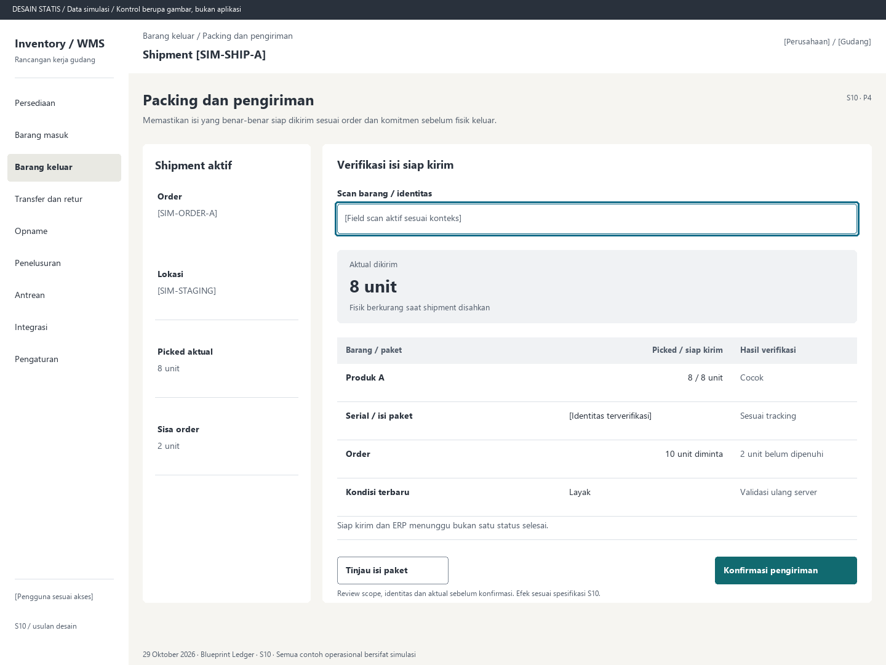

# S10. Packing dan pengiriman

Status: usulan desain statis, tanpa implementasi. Semua angka/kode pada papan adalah **Data simulasi**; bukan hasil transaksi atau UAT.

**Pengguna:** Operator packing / outbound. **Paket:** P4. **Pola:** quantity.

**Kebutuhan asal:** FR-03, FR-07, FR-14, FR-15; TRK-05, TRK-08, TRK-11, TRK-12, TRK-19. **Keputusan terbuka:** D02, D03; T03.

**Pekerjaan layar:** Memastikan isi yang benar-benar siap dikirim sesuai order dan komitmen sebelum fisik keluar.

[Vektor SVG](../boards/10-packing-dan-pengiriman.svg). Gambar kontrol tidak interaktif; kontraknya berada di bawah.

## Komposisi dan prioritas

Konteks utama: Shipment [SIM-SHIP-A]. Fokus: Aktual dikirim, dengan nilai ilustrasi 8 unit. Fisik berkurang saat shipment disahkan.

Bagian pemilihan/konteks: Shipment aktif. Ruang kerja: Verifikasi isi siap kirim. Pemisahan ini membantu pengguna memilih objek lalu meninjau dampaknya. Papan menggunakan shell yang sama; isi mengikuti kebutuhan fungsi, bukan menambah grafik atau KPI.

Informasi minimum yang tetap terbaca:

- Order: [SIM-ORDER-A].
- Lokasi: [SIM-STAGING].
- Picked aktual: 8 unit.
- Sisa order: 2 unit.

Field/kolom penentu: Barang / paket, Picked / siap kirim, Hasil verifikasi. Nama barang, kode, kuantitas dan unit tidak diganti dengan ikon atau tooltip.

## Urutan kerja

1. Buka order/shipment dengan hasil picking aktual dan komitmen staging.
2. Scan/cocokkan item, serial serta kemasan; parent dan child tidak dihitung dua kali.
3. Tinjau actual picked, siap kirim, kondisi dan sisa; parsial hanya bila diizinkan D02.
4. Konfirmasi shipment; server memeriksa ulang. Hasil menampilkan ID, aktual terkirim, sisa order serta status ERP terpisah.

## Kontrol dan hasil yang direncanakan

| Kontrol | Perilaku dan hasil |
|---|---|
| Tinjau isi paket | Buka anggota/versi isi, identitas expected dan hasil verifikasi. |
| Konfirmasi pengiriman | Review aktual keluar, sumber komitmen dan tujuan sebelum posting. |
| Periksa selisih | Tahan baris salah/kurang/tidak dikenal; tidak menambahkan barang asing diam-diam. |

## Validasi dan dampak

Kondisi, sisa, unit, alokasi dan isi packing masih sah. Karantina, freeze, serial order lain atau observasi belum selesai menahan baris terkait.

Fisik keluar sebesar aktual shipment sah; komitmen pemenuhan terkait selesai. Picking atau baca RFID saja tidak mengeluarkan fisik.

Siap kirim dan ERP menunggu bukan satu status selesai.

## Keadaan selain berhasil

| Keadaan | Pesan dan pemulihan |
|---|---|
| Kosong | Belum ada hasil picking yang siap diverifikasi untuk pengiriman. |
| Memuat | Memuat packing dan pengiriman pada lingkup terpilih. Data sebelumnya tidak dianggap terbaru. |
| Filter kosong | Tidak ada hasil untuk filter aktif. Pertahankan filter dan sediakan Hapus filter. |
| Error | Hasil pengiriman belum pasti. Periksa hasil dengan kunci dan isi asli melalui S17. |
| Konflik / tertahan | Kondisi atau komitmen berubah. Pengiriman ditahan sampai masalah diselesaikan. |
| Akses ditolak | Tindakan atau lingkup ini tidak diizinkan. Kembali ke scope sah; jangan tampilkan isi objek terlarang. |
| Offline / hasil belum pasti | Untuk perintah konfirmasi, gunakan kontrak S17; pending lokal, unknown dan penolakan pasti mempunyai pemulihan berbeda. Baca saja menampilkan data tidak tersedia/belum segar. |

## Desktop, rentang menengah dan scanner

Desktop mengikuti komposisi papan. Pada rentang menengah, menu berlabel dan pemilih objek menggantikan sidebar/panel sempit. Pada rentang sempit, objek, field penentu, status, aktual/satuan dan aksi menjadi record vertikal. Metadata boleh dipindahkan ke detail, tetapi tidak menghilangkan alasan tertahan atau dampak kuantitas.

Kontrak minimum: target 44px, scanner 52px; label terlihat, fokus 3px, Tab sesuai alur, dialog Escape saat aman dan fokus kembali. Input tidak boleh tertutup keyboard. Scope/dokumen tidak berubah saat pending tanpa keputusan eksplisit. Lihat [fondasi](../00-foundation.md) dan [komponen/state](../02-components-and-states.md).

## Bukti penerimaan yang perlu disiapkan

Skenario terkait: UAT-03, UAT-04, UAT-08, UAT-10; TRK-UAT-06, TRK-UAT-07, TRK-UAT-08, TRK-UAT-10. Semuanya tetap **Belum dijalankan**. Pemetaan ini menyebut cakupan yang perlu dibuktikan, bukan hasil lulus.

Tinjauan desain: baca konteks, tentukan langkah yang benar, jelaskan dampak dan jalankan kembali skenario gagal menggunakan spesifikasi. Setelah implementasi: uji semua kontrol yang disebut di atas, narrow/menengah/desktop, kedua tema, keyboard dan perangkat nyata. Pemeriksaan API/database dibutuhkan untuk akses, idempotensi, transaksi dan saldo; gambar tidak membuktikannya.

## Sumber

[PRD](../../../docs/planning/01-product-requirements.md), [TRD](../../../docs/planning/02-technical-requirements.md), [Flow](../../../docs/planning/03-app-flow.md), [Design Brief](../../../docs/planning/04-design-brief.md), [Schema](../../../docs/planning/05-backend-schema.md), [Plan](../../../docs/planning/06-implementation-plan.md), [PRD tracker](../../../docs/planning/prd-tracker-barcode-rfid.md).

[Papan handheld](../boards/10-packing-dan-pengiriman-handheld.png) dan [SVG handheld](../boards/10-packing-dan-pengiriman-handheld.svg).
