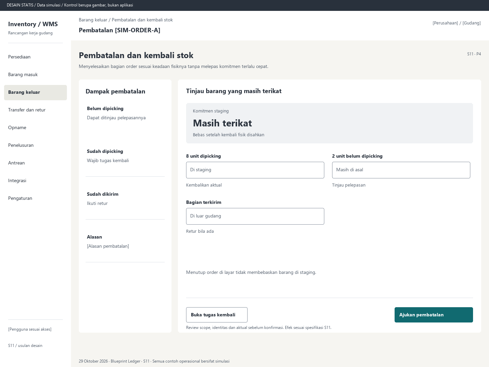

# S11. Pembatalan dan kembali stok

Status: usulan desain statis, tanpa implementasi. Semua angka/kode pada papan adalah **Data simulasi**; bukan hasil transaksi atau UAT.

**Pengguna:** Supervisor; operator pengembalian. **Paket:** P4. **Pola:** form.

**Kebutuhan asal:** FR-08, FR-03, FR-04, FR-15; TRK-05, TRK-07, TRK-16. **Keputusan terbuka:** D02, D03.

**Pekerjaan layar:** Menyelesaikan bagian order sesuai keadaan fisiknya tanpa melepas komitmen terlalu cepat.

[Vektor SVG](../boards/11-pembatalan-dan-kembali-stok.svg). Gambar kontrol tidak interaktif; kontraknya berada di bawah.

## Komposisi dan prioritas

Konteks utama: Pembatalan [SIM-ORDER-A]. Fokus: Komitmen staging, dengan nilai ilustrasi Masih terikat. Bebas setelah kembali fisik disahkan.

Bagian pemilihan/konteks: Dampak pembatalan. Ruang kerja: Tinjau barang yang masih terikat. Pemisahan ini membantu pengguna memilih objek lalu meninjau dampaknya. Papan menggunakan shell yang sama; isi mengikuti kebutuhan fungsi, bukan menambah grafik atau KPI.

Informasi minimum yang tetap terbaca:

- Belum dipicking: Dapat ditinjau pelepasannya.
- Sudah dipicking: Wajib tugas kembali.
- Sudah dikirim: Ikuti retur.
- Alasan: [Alasan pembatalan].

Field/kolom penentu: Bagian order, Keadaan fisik, Tindakan sah. Nama barang, kode, kuantitas dan unit tidak diganti dengan ikon atau tooltip.

## Urutan kerja

1. Tinjau bagian belum dipicking, dipicking dan terkirim per baris.
2. Masukkan alasan, dampak dan approval sesuai kebijakan; ajukan pembatalan.
3. Server melepas hanya bagian yang sah dilepas dan membentuk tugas kembali untuk barang dipicking.
4. Operator scan barang/lokasi kembali dan aktual; konfirmasi return-to-stock. Bagian terkirim menuju S13.

## Kontrol dan hasil yang direncanakan

| Kontrol | Perilaku dan hasil |
|---|---|
| Ajukan pembatalan | Review pemisahan keadaan dan alasan, lalu validasi server. |
| Buka tugas kembali | Buka scan asal staging, identitas, tujuan sah dan aktual kembali. |
| Konfirmasi barang kembali | Sahkan perpindahan fisik balik dan selesaikan komitmen yang terkait aktual tersebut. |

## Validasi dan dampak

Status order/shipment terbaru, kewenangan dan jumlah aktual kembali. Dilarang menghapus shipment terposting atau membebaskan semua komitmen dari satu toggle header.

Bagian belum dipicking dilepas jika sah; bagian dipicking tetap terikat sampai kembali fisik. Riwayat pembatalan/pengembalian tetap dapat ditelusuri.

Menutup order di layar tidak membebaskan barang di staging.

## Keadaan selain berhasil

| Keadaan | Pesan dan pemulihan |
|---|---|
| Kosong | Tidak ada bagian order yang dapat dibatalkan melalui alur ini. |
| Memuat | Memuat pembatalan dan kembali stok pada lingkup terpilih. Data sebelumnya tidak dianggap terbaru. |
| Filter kosong | Tidak ada hasil untuk filter aktif. Pertahankan filter dan sediakan Hapus filter. |
| Error | Hasil pembatalan belum pasti. Periksa hasil sebelum membuat permintaan baru. |
| Konflik / tertahan | Sebagian barang sudah dikirim sejak review. Muat ulang dan pisahkan alur retur. |
| Akses ditolak | Tindakan atau lingkup ini tidak diizinkan. Kembali ke scope sah; jangan tampilkan isi objek terlarang. |
| Offline / hasil belum pasti | Untuk perintah konfirmasi, gunakan kontrak S17; pending lokal, unknown dan penolakan pasti mempunyai pemulihan berbeda. Baca saja menampilkan data tidak tersedia/belum segar. |

## Desktop, rentang menengah dan scanner

Desktop mengikuti komposisi papan. Pada rentang menengah, menu berlabel dan pemilih objek menggantikan sidebar/panel sempit. Pada rentang sempit, objek, field penentu, status, aktual/satuan dan aksi menjadi record vertikal. Metadata boleh dipindahkan ke detail, tetapi tidak menghilangkan alasan tertahan atau dampak kuantitas.

Kontrak minimum: target 44px, scanner 52px; label terlihat, fokus 3px, Tab sesuai alur, dialog Escape saat aman dan fokus kembali. Input tidak boleh tertutup keyboard. Scope/dokumen tidak berubah saat pending tanpa keputusan eksplisit. Lihat [fondasi](../00-foundation.md) dan [komponen/state](../02-components-and-states.md).

## Bukti penerimaan yang perlu disiapkan

Skenario terkait: UAT-05, UAT-08, UAT-10; TRK-UAT-17. Semuanya tetap **Belum dijalankan**. Pemetaan ini menyebut cakupan yang perlu dibuktikan, bukan hasil lulus.

Tinjauan desain: baca konteks, tentukan langkah yang benar, jelaskan dampak dan jalankan kembali skenario gagal menggunakan spesifikasi. Setelah implementasi: uji semua kontrol yang disebut di atas, narrow/menengah/desktop, kedua tema, keyboard dan perangkat nyata. Pemeriksaan API/database dibutuhkan untuk akses, idempotensi, transaksi dan saldo; gambar tidak membuktikannya.

## Sumber

[PRD](../../../docs/planning/01-product-requirements.md), [TRD](../../../docs/planning/02-technical-requirements.md), [Flow](../../../docs/planning/03-app-flow.md), [Design Brief](../../../docs/planning/04-design-brief.md), [Schema](../../../docs/planning/05-backend-schema.md), [Plan](../../../docs/planning/06-implementation-plan.md), [PRD tracker](../../../docs/planning/prd-tracker-barcode-rfid.md).
