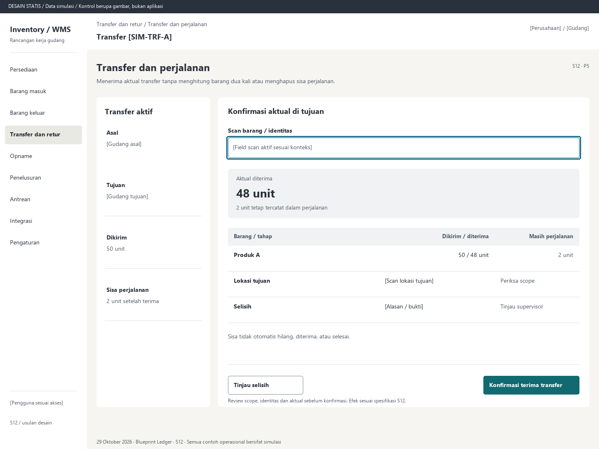

# S12. Transfer dan perjalanan

Status: usulan desain statis, tanpa implementasi. Semua angka/kode pada papan adalah **Data simulasi**; bukan hasil transaksi atau UAT.

**Pengguna:** Operator asal/tujuan; supervisor selisih. **Paket:** P5. **Pola:** quantity.

**Kebutuhan asal:** FR-09, FR-05, FR-15; TRK-06, TRK-08, TRK-22. **Keputusan terbuka:** D01, D02, D03.

**Pekerjaan layar:** Menerima aktual transfer tanpa menghitung barang dua kali atau menghapus sisa perjalanan.

[Vektor SVG](../boards/12-transfer-dan-perjalanan.svg). Gambar kontrol tidak interaktif; kontraknya berada di bawah.

## Komposisi dan prioritas

Konteks utama: Transfer [SIM-TRF-A]. Fokus: Aktual diterima, dengan nilai ilustrasi 48 unit. 2 unit tetap tercatat dalam perjalanan.

Bagian pemilihan/konteks: Transfer aktif. Ruang kerja: Konfirmasi aktual di tujuan. Pemisahan ini membantu pengguna memilih objek lalu meninjau dampaknya. Papan menggunakan shell yang sama; isi mengikuti kebutuhan fungsi, bukan menambah grafik atau KPI.

Informasi minimum yang tetap terbaca:

- Asal: [Gudang asal].
- Tujuan: [Gudang tujuan].
- Dikirim: 50 unit.
- Sisa perjalanan: 2 unit setelah terima.

Field/kolom penentu: Barang / tahap, Dikirim / diterima, Masih perjalanan. Nama barang, kode, kuantitas dan unit tidak diganti dengan ikon atau tooltip.

## Urutan kerja

1. Transfer lokasi dalam gudang memakai scan asal/barang/tujuan dengan delta seimbang.
2. Untuk antar gudang, asal mengonfirmasi dispatch aktual; barang pindah ke perjalanan pada referensi yang benar.
3. Tujuan melihat dikirim, diterima sebelumnya dan sisa, lalu scan serta isi aktual penerimaan.
4. Konfirmasi aktual tujuan. Sisa tetap perjalanan sampai penerimaan lanjutan atau penyelesaian selisih terotorisasi.

## Kontrol dan hasil yang direncanakan

| Kontrol | Perilaku dan hasil |
|---|---|
| Konfirmasi kirim transfer | Variasi peran asal: review aktual dan tujuan, lalu dispatch ke perjalanan. |
| Konfirmasi terima transfer | Variasi peran tujuan: validasi sisa dan posting aktual diterima. |
| Tinjau selisih | Buka bukti/penanggung jawab, penerimaan lanjutan atau keputusan yang diaudit. |

## Validasi dan dampak

Referensi perjalanan dan unit tepat, asal/tujuan dalam lingkup sah, tidak melebihi sisa. Transfer antar perusahaan tidak dimasukkan tanpa cakupan tambahan.

Kirim mengurangi asal dan menambah perjalanan; terima mengurangi perjalanan dan menambah tujuan. 50 dikirim dan 48 diterima menyisakan 2, bukan nol.

Sisa tidak otomatis hilang, diterima, atau selesai.

## Keadaan selain berhasil

| Keadaan | Pesan dan pemulihan |
|---|---|
| Kosong | Tidak ada transfer terbuka untuk gudang ini. |
| Memuat | Memuat transfer dan perjalanan pada lingkup terpilih. Data sebelumnya tidak dianggap terbaru. |
| Filter kosong | Tidak ada hasil untuk filter aktif. Pertahankan filter dan sediakan Hapus filter. |
| Error | Penerimaan transfer belum terkirim. Simpan pending pada dokumen dan scope asalnya. |
| Konflik / tertahan | Sisa transfer berubah karena penerimaan lain. Muat ulang lalu tinjau aktual sebagai maksud baru bila hasil lama pasti. |
| Akses ditolak | Tindakan atau lingkup ini tidak diizinkan. Kembali ke scope sah; jangan tampilkan isi objek terlarang. |
| Offline / hasil belum pasti | Untuk perintah konfirmasi, gunakan kontrak S17; pending lokal, unknown dan penolakan pasti mempunyai pemulihan berbeda. Baca saja menampilkan data tidak tersedia/belum segar. |

## Desktop, rentang menengah dan scanner

Desktop mengikuti komposisi papan. Pada rentang menengah, menu berlabel dan pemilih objek menggantikan sidebar/panel sempit. Pada rentang sempit, objek, field penentu, status, aktual/satuan dan aksi menjadi record vertikal. Metadata boleh dipindahkan ke detail, tetapi tidak menghilangkan alasan tertahan atau dampak kuantitas.

Kontrak minimum: target 44px, scanner 52px; label terlihat, fokus 3px, Tab sesuai alur, dialog Escape saat aman dan fokus kembali. Input tidak boleh tertutup keyboard. Scope/dokumen tidak berubah saat pending tanpa keputusan eksplisit. Lihat [fondasi](../00-foundation.md) dan [komponen/state](../02-components-and-states.md).

## Bukti penerimaan yang perlu disiapkan

Skenario terkait: UAT-06, UAT-08, UAT-10; TRK-UAT-16. Semuanya tetap **Belum dijalankan**. Pemetaan ini menyebut cakupan yang perlu dibuktikan, bukan hasil lulus.

Tinjauan desain: baca konteks, tentukan langkah yang benar, jelaskan dampak dan jalankan kembali skenario gagal menggunakan spesifikasi. Setelah implementasi: uji semua kontrol yang disebut di atas, narrow/menengah/desktop, kedua tema, keyboard dan perangkat nyata. Pemeriksaan API/database dibutuhkan untuk akses, idempotensi, transaksi dan saldo; gambar tidak membuktikannya.

## Sumber

[PRD](../../../docs/planning/01-product-requirements.md), [TRD](../../../docs/planning/02-technical-requirements.md), [Flow](../../../docs/planning/03-app-flow.md), [Design Brief](../../../docs/planning/04-design-brief.md), [Schema](../../../docs/planning/05-backend-schema.md), [Plan](../../../docs/planning/06-implementation-plan.md), [PRD tracker](../../../docs/planning/prd-tracker-barcode-rfid.md).
