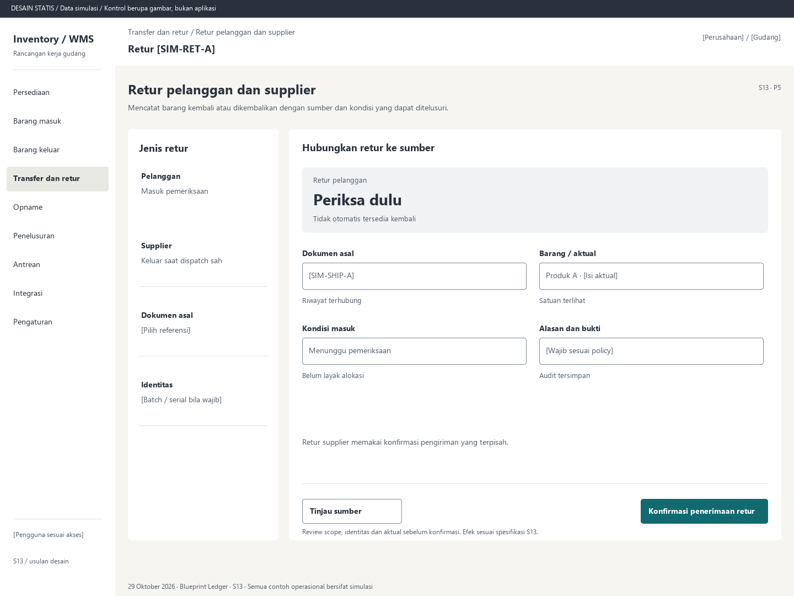

# S13. Retur pelanggan dan supplier

Status: usulan desain statis, tanpa implementasi. Semua angka/kode pada papan adalah **Data simulasi**; bukan hasil transaksi atau UAT.

**Pengguna:** Receiving, outbound, QC dan supervisor. **Paket:** P5. **Pola:** form.

**Kebutuhan asal:** FR-10, FR-04, FR-06, FR-15; TRK-07, TRK-08, TRK-16. **Keputusan terbuka:** D02, D03, D04; T03.

**Pekerjaan layar:** Mencatat barang kembali atau dikembalikan dengan sumber dan kondisi yang dapat ditelusuri.

[Vektor SVG](../boards/13-retur-pelanggan-supplier.svg). Gambar kontrol tidak interaktif; kontraknya berada di bawah.

## Komposisi dan prioritas

Konteks utama: Retur [SIM-RET-A]. Fokus: Retur pelanggan, dengan nilai ilustrasi Periksa dulu. Tidak otomatis tersedia kembali.

Bagian pemilihan/konteks: Jenis retur. Ruang kerja: Hubungkan retur ke sumber. Pemisahan ini membantu pengguna memilih objek lalu meninjau dampaknya. Papan menggunakan shell yang sama; isi mengikuti kebutuhan fungsi, bukan menambah grafik atau KPI.

Informasi minimum yang tetap terbaca:

- Pelanggan: Masuk pemeriksaan.
- Supplier: Keluar saat dispatch sah.
- Dokumen asal: [Pilih referensi].
- Identitas: [Batch / serial bila wajib].

Field/kolom penentu: Bagian retur, Isi yang ditinjau, Efek. Nama barang, kode, kuantitas dan unit tidak diganti dengan ikon atau tooltip.

## Urutan kerja

1. Pilih pelanggan atau supplier dan tautkan shipment/receipt asal.
2. Scan item/unit, isi aktual, satuan, kondisi, alasan dan bukti.
3. Retur pelanggan masuk area pemeriksaan; QC menentukan kelayakan setelahnya.
4. Retur supplier mengurangi stok pada dispatch yang disahkan; simpan referensi ke sumber dan koreksi terkait.

## Kontrol dan hasil yang direncanakan

| Kontrol | Perilaku dan hasil |
|---|---|
| Konfirmasi penerimaan retur | Untuk pelanggan: review aktual dan kondisi pemeriksaan sebelum posting masuk. |
| Konfirmasi pengiriman retur | Untuk supplier: review aktual keluar serta izin sebelum dispatch. |
| Tinjau sumber | Buka dokumen asal dan riwayat unit sesuai akses. |

## Validasi dan dampak

Jumlah tidak melebihi lingkup retur yang sah; lifecycle unit dan sumber cocok. Dedup unit tidak melarang kejadian retur baru yang sah setelah shipment sebelumnya.

Retur masuk menambah posisi pemeriksaan; retur supplier keluar saat dispatch sah. Riwayat shipment/receipt asal tidak diedit atau dihapus.

Retur supplier memakai konfirmasi pengiriman yang terpisah.

## Keadaan selain berhasil

| Keadaan | Pesan dan pemulihan |
|---|---|
| Kosong | Belum ada retur pada lingkup ini. Pilih dokumen asal jika berwenang membuat retur. |
| Memuat | Memuat retur pelanggan dan supplier pada lingkup terpilih. Data sebelumnya tidak dianggap terbaru. |
| Filter kosong | Tidak ada hasil untuk filter aktif. Pertahankan filter dan sediakan Hapus filter. |
| Error | Retur gagal divalidasi. Periksa sumber, identitas dan aktual yang ditandai. |
| Konflik / tertahan | Unit sudah memiliki kejadian aktif atau jumlah retur sumber berubah. Tinjau lifecycle terbaru. |
| Akses ditolak | Tindakan atau lingkup ini tidak diizinkan. Kembali ke scope sah; jangan tampilkan isi objek terlarang. |
| Offline / hasil belum pasti | Untuk perintah konfirmasi, gunakan kontrak S17; pending lokal, unknown dan penolakan pasti mempunyai pemulihan berbeda. Baca saja menampilkan data tidak tersedia/belum segar. |

## Desktop, rentang menengah dan scanner

Desktop mengikuti komposisi papan. Pada rentang menengah, menu berlabel dan pemilih objek menggantikan sidebar/panel sempit. Pada rentang sempit, objek, field penentu, status, aktual/satuan dan aksi menjadi record vertikal. Metadata boleh dipindahkan ke detail, tetapi tidak menghilangkan alasan tertahan atau dampak kuantitas.

Kontrak minimum: target 44px, scanner 52px; label terlihat, fokus 3px, Tab sesuai alur, dialog Escape saat aman dan fokus kembali. Input tidak boleh tertutup keyboard. Scope/dokumen tidak berubah saat pending tanpa keputusan eksplisit. Lihat [fondasi](../00-foundation.md) dan [komponen/state](../02-components-and-states.md).

## Bukti penerimaan yang perlu disiapkan

Skenario terkait: UAT-08, UAT-10, UAT-13; TRK-UAT-17. Semuanya tetap **Belum dijalankan**. Pemetaan ini menyebut cakupan yang perlu dibuktikan, bukan hasil lulus.

Tinjauan desain: baca konteks, tentukan langkah yang benar, jelaskan dampak dan jalankan kembali skenario gagal menggunakan spesifikasi. Setelah implementasi: uji semua kontrol yang disebut di atas, narrow/menengah/desktop, kedua tema, keyboard dan perangkat nyata. Pemeriksaan API/database dibutuhkan untuk akses, idempotensi, transaksi dan saldo; gambar tidak membuktikannya.

## Sumber

[PRD](../../../docs/planning/01-product-requirements.md), [TRD](../../../docs/planning/02-technical-requirements.md), [Flow](../../../docs/planning/03-app-flow.md), [Design Brief](../../../docs/planning/04-design-brief.md), [Schema](../../../docs/planning/05-backend-schema.md), [Plan](../../../docs/planning/06-implementation-plan.md), [PRD tracker](../../../docs/planning/prd-tracker-barcode-rfid.md).
