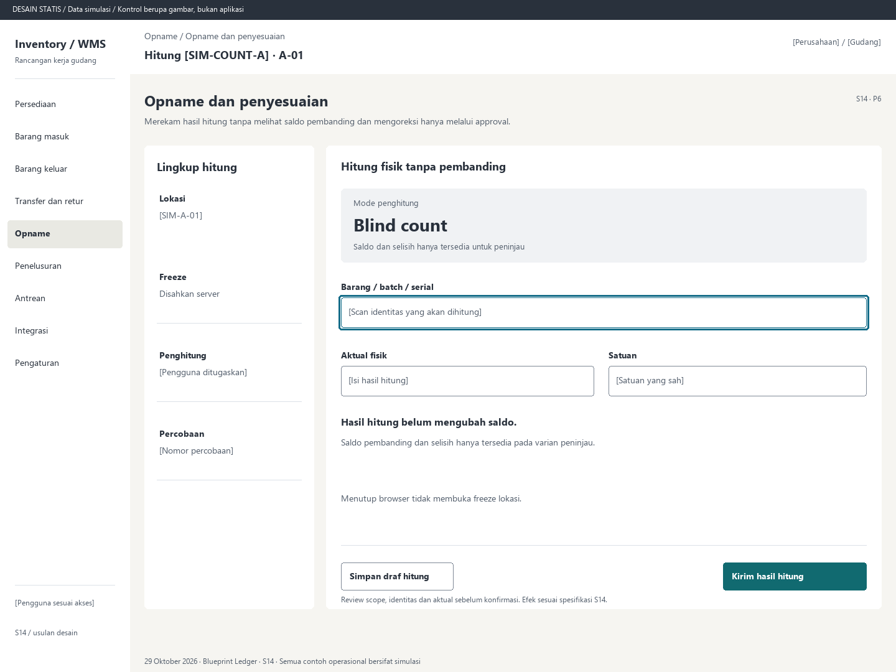

# S14. Opname dan penyesuaian

Status: usulan desain statis, tanpa implementasi. Semua angka/kode pada papan adalah **Data simulasi**; bukan hasil transaksi atau UAT.

**Pengguna:** Supervisor, penghitung dan penyetuju terpisah. **Paket:** P6. **Pola:** blind.

**Kebutuhan asal:** FR-11, FR-04, FR-15; TRK-08, TRK-17, TRK-19. **Keputusan terbuka:** D02, D03, D05.

**Pekerjaan layar:** Merekam hasil hitung tanpa melihat saldo pembanding dan mengoreksi hanya melalui approval.

[Vektor SVG](../boards/14-opname-dan-penyesuaian.svg). Gambar kontrol tidak interaktif; kontraknya berada di bawah.

## Komposisi dan prioritas

Konteks utama: Hitung [SIM-COUNT-A] · A-01. Fokus: Mode penghitung, dengan nilai ilustrasi Blind count. Saldo dan selisih hanya tersedia untuk peninjau.

Bagian pemilihan/konteks: Lingkup hitung. Ruang kerja: Hitung fisik tanpa pembanding. Pemisahan ini membantu pengguna memilih objek lalu meninjau dampaknya. Papan menggunakan shell yang sama; isi mengikuti kebutuhan fungsi, bukan menambah grafik atau KPI.

Informasi minimum yang tetap terbaca:

- Lokasi: [SIM-A-01].
- Freeze: Disahkan server.
- Penghitung: [Pengguna ditugaskan].
- Percobaan: [Nomor percobaan].

Field/kolom penentu: Objek hitung, Isian operator, Ketentuan. Nama barang, kode, kuantitas dan unit tidak diganti dengan ikon atau tooltip.

## Urutan kerja

1. Supervisor menetapkan scope, menangani tugas terkait, lalu mengesahkan freeze dan snapshot.
2. Penghitung menerima objek/lokasi tanpa saldo pembanding, termasuk dari respons API; isi aktual dan satuan.
3. Hitung ulang menjadi percobaan baru. Peninjau berwenang melihat snapshot, hasil, delta dan bukti pada varian layar terpisah.
4. Approval adjustment memposting satu kali setelah validasi. Supervisor membuka lokasi melalui tindakan tercatat; pembatalan juga beralasan.

## Kontrol dan hasil yang direncanakan

| Kontrol | Perilaku dan hasil |
|---|---|
| Kirim hasil hitung | Mengirim bukti hitung, belum mengubah stok. |
| Setujui penyesuaian | Hanya varian peninjau: review snapshot, aktual, delta, alasan, bukti dan komitmen terdampak. |
| Minta hitung ulang | Buat percobaan baru dan pertahankan hasil terdahulu. |
| Buka lokasi | Hanya setelah penyelesaian sah dan izin; audit pelepasan freeze. |

## Validasi dan dampak

Freeze tersimpan dan diperiksa pergerakan lain; approval/pemisahan peran mengikuti D03. Adjustment tidak membuat fisik di bawah komitmen tanpa penyelesaian terkait.

Submit hitung tidak mengubah saldo. Contoh khusus peninjau: snapshot 30, aktual 28, delta -2; hanya adjustment sah memposting -2. Angka ini tidak ada pada papan penghitung.

Menutup browser tidak membuka freeze lokasi.

## Keadaan selain berhasil

| Keadaan | Pesan dan pemulihan |
|---|---|
| Kosong | Belum ada lingkup hitung yang ditugaskan. Minta penugasan supervisor. |
| Memuat | Memuat opname dan penyesuaian pada lingkup terpilih. Data sebelumnya tidak dianggap terbaru. |
| Filter kosong | Tidak ada hasil untuk filter aktif. Pertahankan filter dan sediakan Hapus filter. |
| Error | Hasil hitung belum terkirim. Draf bukan adjustment; freeze tetap berlaku. |
| Konflik / tertahan | Scope atau freeze berubah. Peninjau harus memvalidasi ulang sebelum penyesuaian. |
| Akses ditolak | Tindakan atau lingkup ini tidak diizinkan. Kembali ke scope sah; jangan tampilkan isi objek terlarang. |
| Offline / hasil belum pasti | Untuk perintah konfirmasi, gunakan kontrak S17; pending lokal, unknown dan penolakan pasti mempunyai pemulihan berbeda. Baca saja menampilkan data tidak tersedia/belum segar. |

## Desktop, rentang menengah dan scanner

Desktop mengikuti komposisi papan. Pada rentang menengah, menu berlabel dan pemilih objek menggantikan sidebar/panel sempit. Pada rentang sempit, objek, field penentu, status, aktual/satuan dan aksi menjadi record vertikal. Metadata boleh dipindahkan ke detail, tetapi tidak menghilangkan alasan tertahan atau dampak kuantitas.

Kontrak minimum: target 44px, scanner 52px; label terlihat, fokus 3px, Tab sesuai alur, dialog Escape saat aman dan fokus kembali. Input tidak boleh tertutup keyboard. Scope/dokumen tidak berubah saat pending tanpa keputusan eksplisit. Lihat [fondasi](../00-foundation.md) dan [komponen/state](../02-components-and-states.md).

## Bukti penerimaan yang perlu disiapkan

Skenario terkait: UAT-07, UAT-08, UAT-13; TRK-UAT-18. Semuanya tetap **Belum dijalankan**. Pemetaan ini menyebut cakupan yang perlu dibuktikan, bukan hasil lulus.

Tinjauan desain: baca konteks, tentukan langkah yang benar, jelaskan dampak dan jalankan kembali skenario gagal menggunakan spesifikasi. Setelah implementasi: uji semua kontrol yang disebut di atas, narrow/menengah/desktop, kedua tema, keyboard dan perangkat nyata. Pemeriksaan API/database dibutuhkan untuk akses, idempotensi, transaksi dan saldo; gambar tidak membuktikannya.

## Sumber

[PRD](../../../docs/planning/01-product-requirements.md), [TRD](../../../docs/planning/02-technical-requirements.md), [Flow](../../../docs/planning/03-app-flow.md), [Design Brief](../../../docs/planning/04-design-brief.md), [Schema](../../../docs/planning/05-backend-schema.md), [Plan](../../../docs/planning/06-implementation-plan.md), [PRD tracker](../../../docs/planning/prd-tracker-barcode-rfid.md).

[Papan handheld](../boards/14-opname-dan-penyesuaian-handheld.png) dan [SVG handheld](../boards/14-opname-dan-penyesuaian-handheld.svg).
