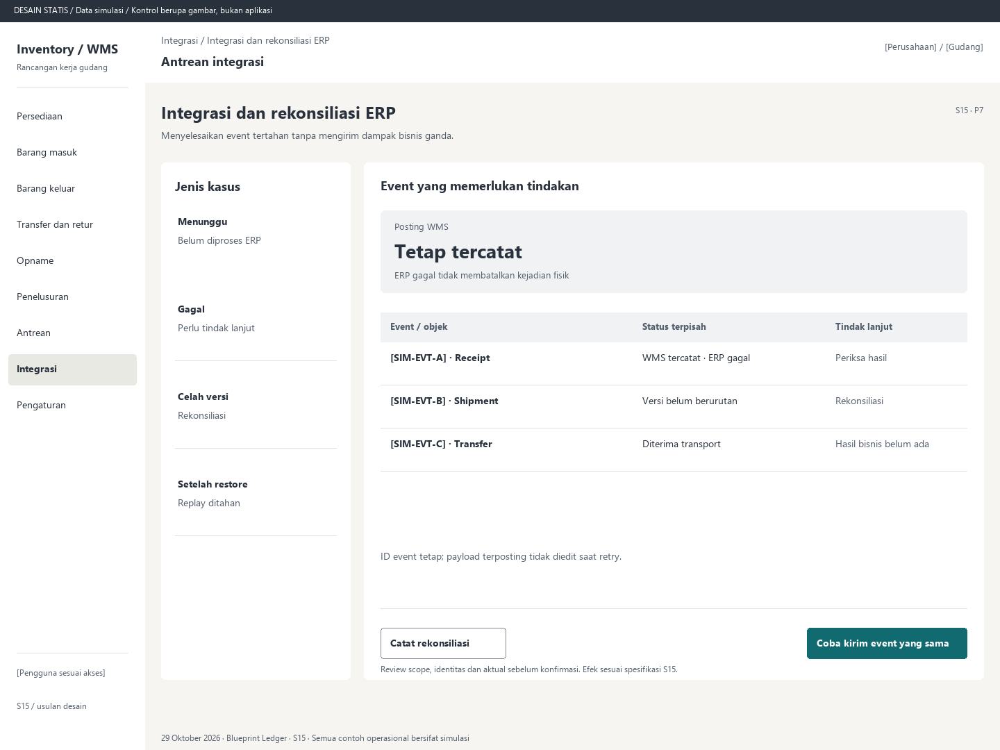

# S15. Integrasi dan rekonsiliasi ERP

Status: usulan desain statis, tanpa implementasi. Semua angka/kode pada papan adalah **Data simulasi**; bukan hasil transaksi atau UAT.

**Pengguna:** Petugas integrasi. **Paket:** P7. **Pola:** queue.

**Kebutuhan asal:** FR-12, FR-04, FR-15, FR-16; TRK-22. **Keputusan terbuka:** D04, D05; T08.

**Pekerjaan layar:** Menyelesaikan event tertahan tanpa mengirim dampak bisnis ganda.

[Vektor SVG](../boards/15-integrasi-erp.svg). Gambar kontrol tidak interaktif; kontraknya berada di bawah.

## Komposisi dan prioritas

Konteks utama: Antrean integrasi. Fokus: Posting WMS, dengan nilai ilustrasi Tetap tercatat. ERP gagal tidak membatalkan kejadian fisik.

Bagian pemilihan/konteks: Jenis kasus. Ruang kerja: Event yang memerlukan tindakan. Pemisahan ini membantu pengguna memilih objek lalu meninjau dampaknya. Papan menggunakan shell yang sama; isi mengikuti kebutuhan fungsi, bukan menambah grafik atau KPI.

Informasi minimum yang tetap terbaca:

- Menunggu: Belum diproses ERP.
- Gagal: Perlu tindak lanjut.
- Celah versi: Rekonsiliasi.
- Setelah restore: Replay ditahan.

Field/kolom penentu: Event / objek, Status terpisah, Tindak lanjut. Nama barang, kode, kuantitas dan unit tidak diganti dengan ikon atau tooltip.

## Urutan kerja

1. Pilih event berdasarkan objek, versi, umur, status dan error aman.
2. Tinjau ID tetap, sumber, riwayat percobaan, ack transport dan hasil bisnis yang terpisah.
3. Retry memakai event sama; celah versi/konflik memerlukan rekonsiliasi, bukan menimpa state terbaru.
4. Setelah restore tahan outbound sampai bukti ERP dibandingkan dan otorisasi rekonsiliasi selesai.

## Kontrol dan hasil yang direncanakan

| Kontrol | Perilaku dan hasil |
|---|---|
| Coba kirim event yang sama | Validasi izin/status dan kontrak dedup D04; tidak membuat event baru. |
| Catat rekonsiliasi | Simpan perbandingan objek/baris/jumlah/versi, bukti dan keputusan. |
| Buka transaksi WMS | Telusuri hasil lokal yang menjadi sumber event. |
| Lanjutkan replay | Hanya setelah prosedur dan kewenangan pascarestore terpenuhi. |

## Validasi dan dampak

Ack transport tidak sama dengan hasil bisnis. Jika ERP tidak mendukung dedup, adapter/periksa hasil bisnis harus disepakati sebelum retry aman diterima.

Tidak menulis ulang ledger WMS. UI memisahkan WMS confirmed, status pengiriman event dan hasil ERP.

ID event tetap; payload terposting tidak diedit saat retry.

## Keadaan selain berhasil

| Keadaan | Pesan dan pemulihan |
|---|---|
| Kosong | Tidak ada event yang memerlukan tindakan pada filter ini. |
| Memuat | Memuat integrasi dan rekonsiliasi erp pada lingkup terpilih. Data sebelumnya tidak dianggap terbaru. |
| Filter kosong | Tidak ada hasil untuk filter aktif. Pertahankan filter dan sediakan Hapus filter. |
| Error | Riwayat integrasi belum dapat dimuat. Muat ulang; jangan menyimpulkan ERP sudah berhasil. |
| Konflik / tertahan | Versi event memiliki celah atau hasil ERP tidak cocok. Tahan dan lakukan rekonsiliasi. |
| Akses ditolak | Tindakan atau lingkup ini tidak diizinkan. Kembali ke scope sah; jangan tampilkan isi objek terlarang. |
| Offline / hasil belum pasti | Untuk perintah konfirmasi, gunakan kontrak S17; pending lokal, unknown dan penolakan pasti mempunyai pemulihan berbeda. Baca saja menampilkan data tidak tersedia/belum segar. |

## Desktop, rentang menengah dan scanner

Desktop mengikuti komposisi papan. Pada rentang menengah, menu berlabel dan pemilih objek menggantikan sidebar/panel sempit. Pada rentang sempit, objek, field penentu, status, aktual/satuan dan aksi menjadi record vertikal. Metadata boleh dipindahkan ke detail, tetapi tidak menghilangkan alasan tertahan atau dampak kuantitas.

Kontrak minimum: target 44px, scanner 52px; label terlihat, fokus 3px, Tab sesuai alur, dialog Escape saat aman dan fokus kembali. Input tidak boleh tertutup keyboard. Scope/dokumen tidak berubah saat pending tanpa keputusan eksplisit. Lihat [fondasi](../00-foundation.md) dan [komponen/state](../02-components-and-states.md).

## Bukti penerimaan yang perlu disiapkan

Skenario terkait: UAT-11, UAT-14; TRK-UAT-21. Semuanya tetap **Belum dijalankan**. Pemetaan ini menyebut cakupan yang perlu dibuktikan, bukan hasil lulus.

Tinjauan desain: baca konteks, tentukan langkah yang benar, jelaskan dampak dan jalankan kembali skenario gagal menggunakan spesifikasi. Setelah implementasi: uji semua kontrol yang disebut di atas, narrow/menengah/desktop, kedua tema, keyboard dan perangkat nyata. Pemeriksaan API/database dibutuhkan untuk akses, idempotensi, transaksi dan saldo; gambar tidak membuktikannya.

## Sumber

[PRD](../../../docs/planning/01-product-requirements.md), [TRD](../../../docs/planning/02-technical-requirements.md), [Flow](../../../docs/planning/03-app-flow.md), [Design Brief](../../../docs/planning/04-design-brief.md), [Schema](../../../docs/planning/05-backend-schema.md), [Plan](../../../docs/planning/06-implementation-plan.md), [PRD tracker](../../../docs/planning/prd-tracker-barcode-rfid.md).
