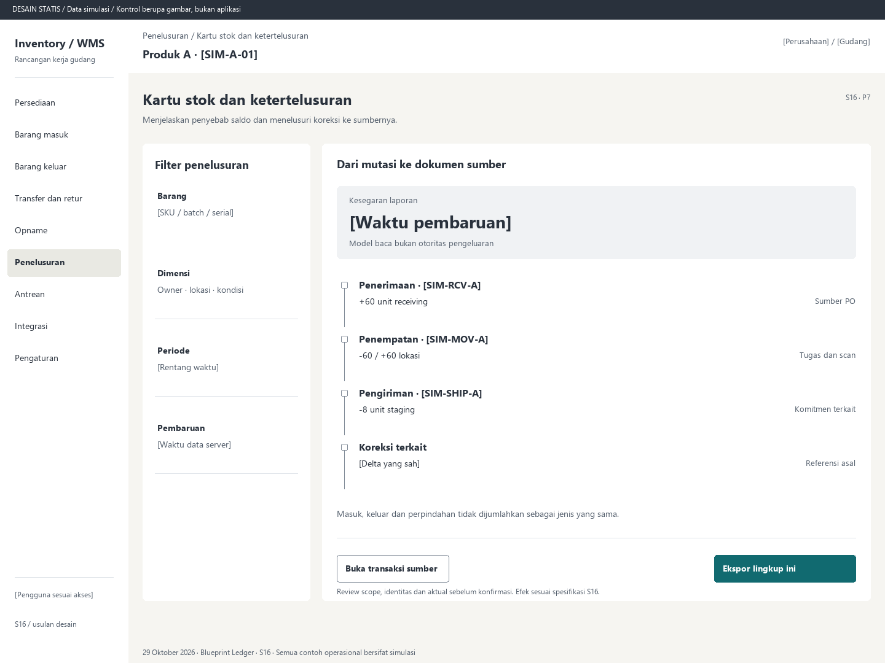

# S16. Kartu stok dan ketertelusuran

Status: usulan desain statis, tanpa implementasi. Semua angka/kode pada papan adalah **Data simulasi**; bukan hasil transaksi atau UAT.

**Pengguna:** Auditor, supervisor, kontrol stok. **Paket:** P7. **Pola:** timeline.

**Kebutuhan asal:** FR-02, FR-04, FR-12, FR-13; TRK-15, TRK-22. **Keputusan terbuka:** D01, D03, D04.

**Pekerjaan layar:** Menjelaskan penyebab saldo dan menelusuri koreksi ke sumbernya.

[Vektor SVG](../boards/16-kartu-stok-dan-laporan.svg). Gambar kontrol tidak interaktif; kontraknya berada di bawah.

## Komposisi dan prioritas

Konteks utama: Produk A · [SIM-A-01]. Fokus: Kesegaran laporan, dengan nilai ilustrasi [Waktu pembaruan]. Model baca bukan otoritas pengeluaran.

Bagian pemilihan/konteks: Filter penelusuran. Ruang kerja: Dari mutasi ke dokumen sumber. Pemisahan ini membantu pengguna memilih objek lalu meninjau dampaknya. Papan menggunakan shell yang sama; isi mengikuti kebutuhan fungsi, bukan menambah grafik atau KPI.

Informasi minimum yang tetap terbaca:

- Barang: [SKU / batch / serial].
- Dimensi: Owner · lokasi · kondisi.
- Periode: [Rentang waktu].
- Pembaruan: [Waktu data server].

Field/kolom penentu: Kejadian / dokumen, Efek kuantitas, Bukti. Nama barang, kode, kuantitas dan unit tidak diganti dengan ikon atau tooltip.

## Urutan kerja

1. Cari posisi/dokumen dan pilih dimensi serta periode yang sah.
2. Lihat saldo awal/akhir, entri, komitmen terkait dan waktu pembaruan; satuan berbeda tidak dijumlahkan sembarang.
3. Pilih mutasi untuk sumber, pelaku, occurred_at, posted_at, batch/serial, audit dan koreksi.
4. Ekspor filter/scope yang sama; server kembali memeriksa izin termasuk attachment.

## Kontrol dan hasil yang direncanakan

| Kontrol | Perilaku dan hasil |
|---|---|
| Buka transaksi sumber | Dari mutasi menuju dokumen dan kembali ke entri terkait. |
| Ekspor lingkup ini | Mempertahankan filter, dimensi, waktu data dan pembatasan akses. |
| Buka koreksi | Telusuri pembalikan/adjustment dengan alasan dan referensi transaksi asal. |

## Validasi dan dampak

Waktu kejadian fisik dan posting tidak dicampur. Histori terposting tidak diedit untuk menyesuaikan saldo. Data laporan tertunda menampilkan timestamp.

Baca/ekspor tidak mengubah stok. Keputusan alokasi atau pengeluaran tetap memakai database utama.

Masuk, keluar dan perpindahan tidak dijumlahkan sebagai jenis yang sama.

## Keadaan selain berhasil

| Keadaan | Pesan dan pemulihan |
|---|---|
| Kosong | Belum ada mutasi terposting pada periode dan dimensi ini. |
| Memuat | Memuat kartu stok dan ketertelusuran pada lingkup terpilih. Data sebelumnya tidak dianggap terbaru. |
| Filter kosong | Tidak ada hasil untuk filter aktif. Pertahankan filter dan sediakan Hapus filter. |
| Error | Kartu stok belum dapat dimuat. Coba ulang dengan filter yang tetap tersimpan. |
| Konflik / tertahan | Detail sumber tidak diizinkan atau sudah berubah aksesnya. Tampilkan alasan aman tanpa membocorkan gudang lain. |
| Akses ditolak | Tindakan atau lingkup ini tidak diizinkan. Kembali ke scope sah; jangan tampilkan isi objek terlarang. |
| Offline / hasil belum pasti | Untuk perintah konfirmasi, gunakan kontrak S17; pending lokal, unknown dan penolakan pasti mempunyai pemulihan berbeda. Baca saja menampilkan data tidak tersedia/belum segar. |

## Desktop, rentang menengah dan scanner

Desktop mengikuti komposisi papan. Pada rentang menengah, menu berlabel dan pemilih objek menggantikan sidebar/panel sempit. Pada rentang sempit, objek, field penentu, status, aktual/satuan dan aksi menjadi record vertikal. Metadata boleh dipindahkan ke detail, tetapi tidak menghilangkan alasan tertahan atau dampak kuantitas.

Kontrak minimum: target 44px, scanner 52px; label terlihat, fokus 3px, Tab sesuai alur, dialog Escape saat aman dan fokus kembali. Input tidak boleh tertutup keyboard. Scope/dokumen tidak berubah saat pending tanpa keputusan eksplisit. Lihat [fondasi](../00-foundation.md) dan [komponen/state](../02-components-and-states.md).

## Bukti penerimaan yang perlu disiapkan

Skenario terkait: UAT-11, UAT-13, UAT-14; TRK-UAT-21. Semuanya tetap **Belum dijalankan**. Pemetaan ini menyebut cakupan yang perlu dibuktikan, bukan hasil lulus.

Tinjauan desain: baca konteks, tentukan langkah yang benar, jelaskan dampak dan jalankan kembali skenario gagal menggunakan spesifikasi. Setelah implementasi: uji semua kontrol yang disebut di atas, narrow/menengah/desktop, kedua tema, keyboard dan perangkat nyata. Pemeriksaan API/database dibutuhkan untuk akses, idempotensi, transaksi dan saldo; gambar tidak membuktikannya.

## Sumber

[PRD](../../../docs/planning/01-product-requirements.md), [TRD](../../../docs/planning/02-technical-requirements.md), [Flow](../../../docs/planning/03-app-flow.md), [Design Brief](../../../docs/planning/04-design-brief.md), [Schema](../../../docs/planning/05-backend-schema.md), [Plan](../../../docs/planning/06-implementation-plan.md), [PRD tracker](../../../docs/planning/prd-tracker-barcode-rfid.md).
