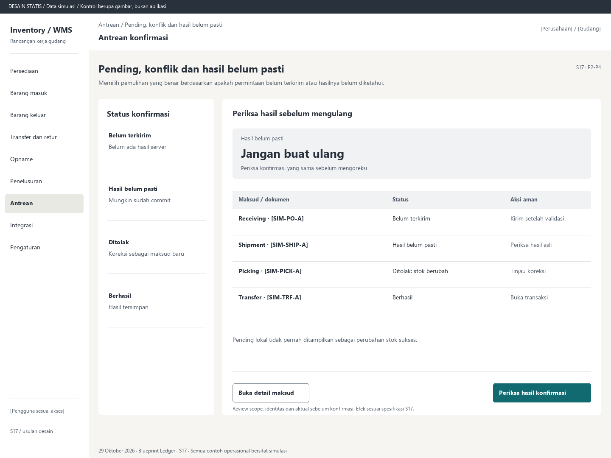

# S17. Pending, konflik dan hasil belum pasti

Status: usulan desain statis, tanpa implementasi. Semua angka/kode pada papan adalah **Data simulasi**; bukan hasil transaksi atau UAT.

**Pengguna:** Operator pemilik draf; supervisor pengecualian. **Paket:** P2-P4. **Pola:** queue.

**Kebutuhan asal:** FR-14, FR-15, FR-04; TRK-03, TRK-10, TRK-11, TRK-12, TRK-13, TRK-14, TRK-16. **Keputusan terbuka:** D03, D05; T04, T07.

**Pekerjaan layar:** Memilih pemulihan yang benar berdasarkan apakah permintaan belum terkirim atau hasilnya belum diketahui.

[Vektor SVG](../boards/17-pending-konflik-dan-retry.svg). Gambar kontrol tidak interaktif; kontraknya berada di bawah.

## Komposisi dan prioritas

Konteks utama: Antrean konfirmasi. Fokus: Hasil belum pasti, dengan nilai ilustrasi Jangan buat ulang. Periksa konfirmasi yang sama sebelum mengoreksi.

Bagian pemilihan/konteks: Status konfirmasi. Ruang kerja: Periksa hasil sebelum mengulang. Pemisahan ini membantu pengguna memilih objek lalu meninjau dampaknya. Papan menggunakan shell yang sama; isi mengikuti kebutuhan fungsi, bukan menambah grafik atau KPI.

Informasi minimum yang tetap terbaca:

- Belum terkirim: Belum ada hasil server.
- Hasil belum pasti: Mungkin sudah commit.
- Ditolak: Koreksi sebagai maksud baru.
- Berhasil: Hasil tersimpan.

Field/kolom penentu: Maksud / dokumen, Status, Aksi aman. Nama barang, kode, kuantitas dan unit tidak diganti dengan ikon atau tooltip.

## Urutan kerja

1. Kelompokkan per pengguna, gudang dan dokumen asal; tampilkan waktu/umur dan pemilik tindak lanjut bila sah.
2. Belum terkirim dapat dikirim setelah koneksi/identitas pulih dan validasi server terbaru.
3. Hasil belum pasti mempertahankan payload/kunci; periksa atau retry tanpa edit jumlah/versi diam-diam.
4. Hasil terminal berhasil membuka nomor transaksi. Penolakan pasti dapat ditinjau sebagai maksud baru dengan alasan/versi baru; observasi asal tetap tercatat.

## Kontrol dan hasil yang direncanakan

| Kontrol | Perilaku dan hasil |
|---|---|
| Periksa hasil konfirmasi | Ambil hasil atau ulang kunci/payload asli; jangan membuat kunci baru. |
| Kirim pending | Hanya yang belum terkirim, dengan identitas dan scope asal yang masih sah. |
| Tinjau koreksi | Hanya setelah penolakan pasti; tampilkan perubahan isi sebagai maksud baru. |
| Buka detail maksud | Lihat aktual, sumber, scope, waktu, alasan, pemilik tindak lanjut dan request_id aman. |

## Validasi dan dampak

Kunci sama/isi beda ditolak. Replay kejadian scan tidak menambah aktual. Sesi kedaluwarsa dan logout tidak mengirim pending milik lama dengan identitas baru. Batas persistensi mengikuti D05.

Hanya keberhasilan bisnis server mengesahkan stok. Error sebelum commit harus rollback seluruh dampak; UI tidak dapat menjamin hal itu sendiri.

Pending lokal tidak pernah ditampilkan sebagai perubahan stok sukses.

## Keadaan selain berhasil

| Keadaan | Pesan dan pemulihan |
|---|---|
| Kosong | Tidak ada scan atau konfirmasi yang menunggu pada scope ini. |
| Memuat | Memuat pending, konflik dan hasil belum pasti pada lingkup terpilih. Data sebelumnya tidak dianggap terbaru. |
| Filter kosong | Tidak ada hasil untuk filter aktif. Pertahankan filter dan sediakan Hapus filter. |
| Error | Hasil belum dapat diperiksa. Pertahankan maksud asli dan coba periksa kembali. |
| Konflik / tertahan | Akses, kondisi atau stok berubah ketika tersambung. Tinjau penolakan; pending tidak otomatis menjadi sukses. |
| Akses ditolak | Tindakan atau lingkup ini tidak diizinkan. Kembali ke scope sah; jangan tampilkan isi objek terlarang. |
| Offline / hasil belum pasti | Untuk perintah konfirmasi, gunakan kontrak S17; pending lokal, unknown dan penolakan pasti mempunyai pemulihan berbeda. Baca saja menampilkan data tidak tersedia/belum segar. |

## Desktop, rentang menengah dan scanner

Desktop mengikuti komposisi papan. Pada rentang menengah, menu berlabel dan pemilih objek menggantikan sidebar/panel sempit. Pada rentang sempit, objek, field penentu, status, aktual/satuan dan aksi menjadi record vertikal. Metadata boleh dipindahkan ke detail, tetapi tidak menghilangkan alasan tertahan atau dampak kuantitas.

Kontrak minimum: target 44px, scanner 52px; label terlihat, fokus 3px, Tab sesuai alur, dialog Escape saat aman dan fokus kembali. Input tidak boleh tertutup keyboard. Scope/dokumen tidak berubah saat pending tanpa keputusan eksplisit. Lihat [fondasi](../00-foundation.md) dan [komponen/state](../02-components-and-states.md).

## Bukti penerimaan yang perlu disiapkan

Skenario terkait: UAT-08, UAT-09, UAT-10, UAT-12, UAT-13; TRK-UAT-03, TRK-UAT-04, TRK-UAT-09, TRK-UAT-22. Semuanya tetap **Belum dijalankan**. Pemetaan ini menyebut cakupan yang perlu dibuktikan, bukan hasil lulus.

Tinjauan desain: baca konteks, tentukan langkah yang benar, jelaskan dampak dan jalankan kembali skenario gagal menggunakan spesifikasi. Setelah implementasi: uji semua kontrol yang disebut di atas, narrow/menengah/desktop, kedua tema, keyboard dan perangkat nyata. Pemeriksaan API/database dibutuhkan untuk akses, idempotensi, transaksi dan saldo; gambar tidak membuktikannya.

## Sumber

[PRD](../../../docs/planning/01-product-requirements.md), [TRD](../../../docs/planning/02-technical-requirements.md), [Flow](../../../docs/planning/03-app-flow.md), [Design Brief](../../../docs/planning/04-design-brief.md), [Schema](../../../docs/planning/05-backend-schema.md), [Plan](../../../docs/planning/06-implementation-plan.md), [PRD tracker](../../../docs/planning/prd-tracker-barcode-rfid.md).

[Papan handheld](../boards/17-pending-konflik-dan-retry-handheld.png) dan [SVG handheld](../boards/17-pending-konflik-dan-retry-handheld.svg).
