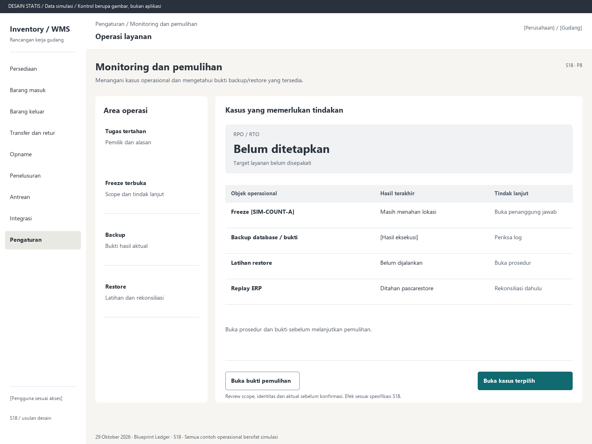

# S18. Monitoring dan pemulihan

Status: usulan desain statis, tanpa implementasi. Semua angka/kode pada papan adalah **Data simulasi**; bukan hasil transaksi atau UAT.

**Pengguna:** Petugas operasi; penanggung jawab layanan. **Paket:** P8. **Pola:** queue.

**Kebutuhan asal:** FR-16, FR-12, FR-04; TRK-13, TRK-16, TRK-21, TRK-22. **Keputusan terbuka:** D01, D04, D05; T07.

**Pekerjaan layar:** Menangani kasus operasional dan mengetahui bukti backup/restore yang tersedia.

[Vektor SVG](../boards/18-monitoring-backup-pemulihan.svg). Gambar kontrol tidak interaktif; kontraknya berada di bawah.

## Komposisi dan prioritas

Konteks utama: Operasi layanan. Fokus: RPO / RTO, dengan nilai ilustrasi Belum ditetapkan. Target layanan belum disepakati.

Bagian pemilihan/konteks: Area operasi. Ruang kerja: Kasus yang memerlukan tindakan. Pemisahan ini membantu pengguna memilih objek lalu meninjau dampaknya. Papan menggunakan shell yang sama; isi mengikuti kebutuhan fungsi, bukan menambah grafik atau KPI.

Informasi minimum yang tetap terbaca:

- Tugas tertahan: Pemilik dan alasan.
- Freeze terbuka: Scope dan tindak lanjut.
- Backup: Bukti hasil aktual.
- Restore: Latihan dan rekonsiliasi.

Field/kolom penentu: Objek operasional, Hasil terakhir, Tindak lanjut. Nama barang, kode, kuantitas dan unit tidak diganti dengan ikon atau tooltip.

## Urutan kerja

1. Tampilkan antrean nyata: integrasi gagal, umur pending, konflik, selisih, tugas/freeze terbuka dan status perangkat bila digunakan.
2. Pilih kasus dan lihat alasan, waktu data, pemilik tindak lanjut serta runbook yang disepakati.
3. Lihat hasil backup database dan bukti; standby tidak ditampilkan sebagai pengganti backup.
4. Rekam latihan restore terisolasi, konsistensi saldo/bukti dan RPO/RTO terukur. ERP tetap ditahan sampai rekonsiliasi.

## Kontrol dan hasil yang direncanakan

| Kontrol | Perilaku dan hasil |
|---|---|
| Buka kasus terpilih | Menuju objek sumber S14/S15/S17/S20 sesuai jenis, bukan retry massal tanpa konteks. |
| Buka bukti pemulihan | Lihat log, titik pulih, measured RPO/RTO dan perbandingan target bila sudah disepakati. |
| Catat tindak lanjut | Catat penanggung jawab, alasan dan penyelesaian sesuai izin, tanpa mengarang feed. |

## Validasi dan dampak

Ambang alert/pemilik mengikuti D05/T07. Nilai kosong berarti belum diukur. Restore aktual mengikuti prosedur operasi terotorisasi dan tidak diluncurkan oleh kontrol mockup.

Monitoring tidak mengubah stok. Pemulihan memerlukan rekonsiliasi database, bukti dan ERP sebelum replay.

Buka prosedur dan bukti sebelum melanjutkan pemulihan.

## Keadaan selain berhasil

| Keadaan | Pesan dan pemulihan |
|---|---|
| Kosong | Tidak ada kasus aktif dari sumber yang tersedia; tampilkan waktu pemeriksaan terakhir. |
| Memuat | Memuat monitoring dan pemulihan pada lingkup terpilih. Data sebelumnya tidak dianggap terbaru. |
| Filter kosong | Tidak ada hasil untuk filter aktif. Pertahankan filter dan sediakan Hapus filter. |
| Error | Sumber monitoring tidak dapat dihubungi. Status layanan belum diketahui, bukan sehat. |
| Konflik / tertahan | Bukti restore belum lengkap atau ERP belum direkonsiliasi. Replay tetap ditahan. |
| Akses ditolak | Tindakan atau lingkup ini tidak diizinkan. Kembali ke scope sah; jangan tampilkan isi objek terlarang. |
| Offline / hasil belum pasti | Untuk perintah konfirmasi, gunakan kontrak S17; pending lokal, unknown dan penolakan pasti mempunyai pemulihan berbeda. Baca saja menampilkan data tidak tersedia/belum segar. |

## Desktop, rentang menengah dan scanner

Desktop mengikuti komposisi papan. Pada rentang menengah, menu berlabel dan pemilih objek menggantikan sidebar/panel sempit. Pada rentang sempit, objek, field penentu, status, aktual/satuan dan aksi menjadi record vertikal. Metadata boleh dipindahkan ke detail, tetapi tidak menghilangkan alasan tertahan atau dampak kuantitas.

Kontrak minimum: target 44px, scanner 52px; label terlihat, fokus 3px, Tab sesuai alur, dialog Escape saat aman dan fokus kembali. Input tidak boleh tertutup keyboard. Scope/dokumen tidak berubah saat pending tanpa keputusan eksplisit. Lihat [fondasi](../00-foundation.md) dan [komponen/state](../02-components-and-states.md).

## Bukti penerimaan yang perlu disiapkan

Skenario terkait: UAT-14, UAT-11; TRK-UAT-20, TRK-UAT-21. Semuanya tetap **Belum dijalankan**. Pemetaan ini menyebut cakupan yang perlu dibuktikan, bukan hasil lulus.

Tinjauan desain: baca konteks, tentukan langkah yang benar, jelaskan dampak dan jalankan kembali skenario gagal menggunakan spesifikasi. Setelah implementasi: uji semua kontrol yang disebut di atas, narrow/menengah/desktop, kedua tema, keyboard dan perangkat nyata. Pemeriksaan API/database dibutuhkan untuk akses, idempotensi, transaksi dan saldo; gambar tidak membuktikannya.

## Sumber

[PRD](../../../docs/planning/01-product-requirements.md), [TRD](../../../docs/planning/02-technical-requirements.md), [Flow](../../../docs/planning/03-app-flow.md), [Design Brief](../../../docs/planning/04-design-brief.md), [Schema](../../../docs/planning/05-backend-schema.md), [Plan](../../../docs/planning/06-implementation-plan.md), [PRD tracker](../../../docs/planning/prd-tracker-barcode-rfid.md).
