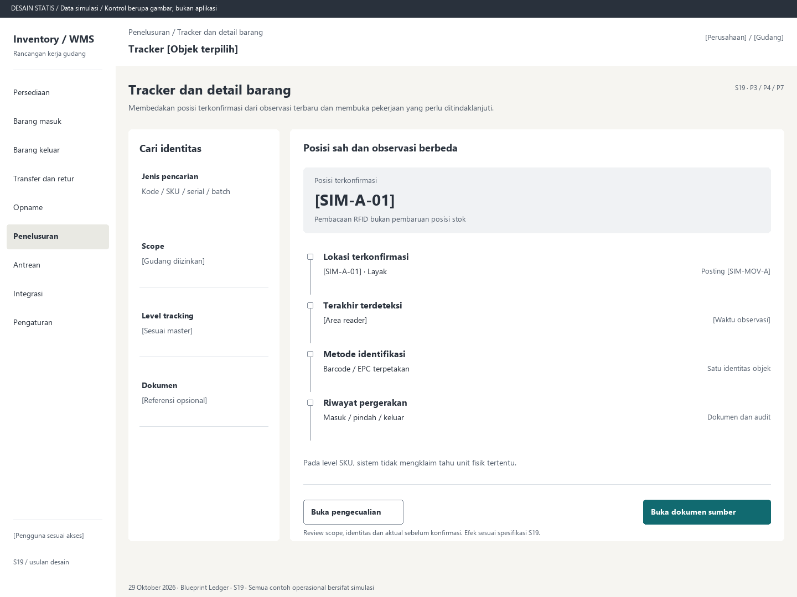

# S19. Tracker dan detail barang

Status: usulan desain statis, tanpa implementasi. Semua angka/kode pada papan adalah **Data simulasi**; bukan hasil transaksi atau UAT.

**Pengguna:** Operator, supervisor, auditor. **Paket:** P3 / P4 / P7. **Pola:** timeline.

**Kebutuhan asal:** FR-02, FR-13, FR-04; TRK-08, TRK-09, TRK-15, TRK-22. **Keputusan terbuka:** D01, D02, D03; T01, T07.

**Pekerjaan layar:** Membedakan posisi terkonfirmasi dari observasi terbaru dan membuka pekerjaan yang perlu ditindaklanjuti.

[Vektor SVG](../boards/19-tracker-dan-detail-unit.svg). Gambar kontrol tidak interaktif; kontraknya berada di bawah.

## Komposisi dan prioritas

Konteks utama: Tracker [Objek terpilih]. Fokus: Posisi terkonfirmasi, dengan nilai ilustrasi [SIM-A-01]. Pembacaan RFID bukan pembaruan posisi stok.

Bagian pemilihan/konteks: Cari identitas. Ruang kerja: Posisi sah dan observasi berbeda. Pemisahan ini membantu pengguna memilih objek lalu meninjau dampaknya. Papan menggunakan shell yang sama; isi mengikuti kebutuhan fungsi, bukan menambah grafik atau KPI.

Informasi minimum yang tetap terbaca:

- Jenis pencarian: Kode / SKU / serial / batch.
- Scope: [Gudang diizinkan].
- Level tracking: [Sesuai master].
- Dokumen: [Referensi opsional].

Field/kolom penentu: Jenis informasi, Hasil terpilih, Bukti / waktu. Nama barang, kode, kuantitas dan unit tidak diganti dengan ikon atau tooltip.

## Urutan kerja

1. Ringkasan tracker mengutamakan mutasi masuk/keluar terposting, pending dan konflik dalam gudang, dengan waktu data; angka hanya dari sumber nyata.
2. Cari kode/SKU/batch/serial/dokumen dan resolusi identitas sesuai level tracking.
3. Detail menampilkan posisi/kondisi terkonfirmasi dan observasi terakhir sebagai dua bidang terpisah.
4. Telusuri timeline ke sesi scan, konfirmasi, movement, sumber, koreksi dan hasil ERP; buka pengecualian yang relevan.

## Kontrol dan hasil yang direncanakan

| Kontrol | Perilaku dan hasil |
|---|---|
| Cari identitas | Pertahankan namespace dan nol depan; hasil ambigu meminta pemilihan/pemetaan sah. |
| Buka dokumen sumber | Periksa akses lalu buka transaksi yang membuktikan lokasi. |
| Buka pengecualian | Buka S17 atau S21, bukan mengubah saldo dari observasi. |
| Lihat isi kemasan | Tampilkan keanggotaan/versi yang disahkan tanpa menggandakan child. |

## Validasi dan dampak

Zona waktu gudang, waktu perangkat, diterima server dan posted_at berbeda konsep. RSSI tidak membuktikan arah/lokasi, deteksi hilang tidak membuktikan barang keluar.

Tracker membaca ledger yang sama. Tidak membuat saldo terpisah atau posisi RTLS kontinu.

Pada level SKU, sistem tidak mengklaim tahu unit fisik tertentu.

## Keadaan selain berhasil

| Keadaan | Pesan dan pemulihan |
|---|---|
| Kosong | Belum ada identitas atau kejadian terkonfirmasi yang cocok dengan pencarian ini. |
| Memuat | Memuat tracker dan detail barang pada lingkup terpilih. Data sebelumnya tidak dianggap terbaru. |
| Filter kosong | Tidak ada hasil untuk filter aktif. Pertahankan filter dan sediakan Hapus filter. |
| Error | Riwayat objek belum dapat dimuat. Coba ulang dengan kode dan scope yang sama. |
| Konflik / tertahan | Identifier ambigu atau tidak diizinkan. Jangan menebak objek; minta pemetaan yang sah. |
| Akses ditolak | Tindakan atau lingkup ini tidak diizinkan. Kembali ke scope sah; jangan tampilkan isi objek terlarang. |
| Offline / hasil belum pasti | Untuk perintah konfirmasi, gunakan kontrak S17; pending lokal, unknown dan penolakan pasti mempunyai pemulihan berbeda. Baca saja menampilkan data tidak tersedia/belum segar. |

## Desktop, rentang menengah dan scanner

Desktop mengikuti komposisi papan. Pada rentang menengah, menu berlabel dan pemilih objek menggantikan sidebar/panel sempit. Pada rentang sempit, objek, field penentu, status, aktual/satuan dan aksi menjadi record vertikal. Metadata boleh dipindahkan ke detail, tetapi tidak menghilangkan alasan tertahan atau dampak kuantitas.

Kontrak minimum: target 44px, scanner 52px; label terlihat, fokus 3px, Tab sesuai alur, dialog Escape saat aman dan fokus kembali. Input tidak boleh tertutup keyboard. Scope/dokumen tidak berubah saat pending tanpa keputusan eksplisit. Lihat [fondasi](../00-foundation.md) dan [komponen/state](../02-components-and-states.md).

## Bukti penerimaan yang perlu disiapkan

Skenario terkait: UAT-13; TRK-UAT-10, TRK-UAT-17, TRK-UAT-21. Semuanya tetap **Belum dijalankan**. Pemetaan ini menyebut cakupan yang perlu dibuktikan, bukan hasil lulus.

Tinjauan desain: baca konteks, tentukan langkah yang benar, jelaskan dampak dan jalankan kembali skenario gagal menggunakan spesifikasi. Setelah implementasi: uji semua kontrol yang disebut di atas, narrow/menengah/desktop, kedua tema, keyboard dan perangkat nyata. Pemeriksaan API/database dibutuhkan untuk akses, idempotensi, transaksi dan saldo; gambar tidak membuktikannya.

## Sumber

[PRD](../../../docs/planning/01-product-requirements.md), [TRD](../../../docs/planning/02-technical-requirements.md), [Flow](../../../docs/planning/03-app-flow.md), [Design Brief](../../../docs/planning/04-design-brief.md), [Schema](../../../docs/planning/05-backend-schema.md), [Plan](../../../docs/planning/06-implementation-plan.md), [PRD tracker](../../../docs/planning/prd-tracker-barcode-rfid.md).
