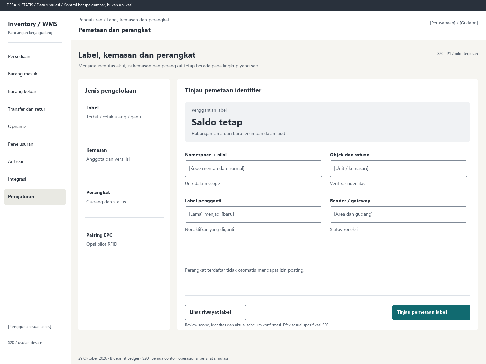

# S20. Label, kemasan dan perangkat

Status: usulan desain statis, tanpa implementasi. Semua angka/kode pada papan adalah **Data simulasi**; bukan hasil transaksi atau UAT.

**Pengguna:** Admin master/perangkat yang diberi izin. **Paket:** P1 / pilot terpisah. **Pola:** form.

**Kebutuhan asal:** FR-01, FR-04, FR-14, FR-16; TRK-01, TRK-02, TRK-08, TRK-09, TRK-14, TRK-18, TRK-21. **Keputusan terbuka:** D02, D03, D05; T01, T02, T04, T05.

**Pekerjaan layar:** Menjaga identitas aktif, isi kemasan dan perangkat tetap berada pada lingkup yang sah.

[Vektor SVG](../boards/20-label-kemasan-dan-perangkat.svg). Gambar kontrol tidak interaktif; kontraknya berada di bawah.

## Komposisi dan prioritas

Konteks utama: Pemetaan dan perangkat. Fokus: Penggantian label, dengan nilai ilustrasi Saldo tetap. Hubungan lama dan baru tersimpan dalam audit.

Bagian pemilihan/konteks: Jenis pengelolaan. Ruang kerja: Tinjau pemetaan identifier. Pemisahan ini membantu pengguna memilih objek lalu meninjau dampaknya. Papan menggunakan shell yang sama; isi mengikuti kebutuhan fungsi, bukan menambah grafik atau KPI.

Informasi minimum yang tetap terbaca:

- Label: Terbit / cetak ulang / ganti.
- Kemasan: Anggota dan versi isi.
- Perangkat: Gudang dan status.
- Pairing EPC: Opsi pilot RFID.

Field/kolom penentu: Bagian pemetaan, Isi rancangan, Kontrol. Nama barang, kode, kuantitas dan unit tidak diganti dengan ikon atau tooltip.

## Urutan kerja

1. Pilih identifier/kemasan/perangkat; tampilkan scope dan riwayat aktif.
2. Penerbitan/cetak ulang/penggantian menampilkan kode manusia, objek, satuan, alasan serta label lama yang diganti.
3. Kemasan memiliki anggota dan versi isi; split/merge diaudit, isi belum sah tidak dipakai untuk posting.
4. Jika pilot dipilih, pairing EPC memverifikasi objek, encode/read-back bila menulis tag, hasil gagal dan penonaktifan label yang diganti. Perangkat/antena terikat area dan gudang.

## Kontrol dan hasil yang direncanakan

| Kontrol | Perilaku dan hasil |
|---|---|
| Tinjau pemetaan label | Review unik, objek, satuan dan masa aktif sebelum simpan. |
| Cetak ulang / ganti | Simpan alasan dan jenis tindakan; penggantian menonaktifkan identifier lama yang diganti, cetak ulang mengikuti T02. |
| Ubah isi kemasan | Split/merge eksplisit dan versi baru; tidak menambah total barang. |
| Verifikasi pairing EPC | Hanya pilot terpilih: tampilkan baca balik dan tahan jika gagal. |
| Buka perangkat | Status, last contact, antrean dan konfigurasi aman; jangan tampilkan kredensial. |

## Validasi dan dampak

Kode aktif tidak ambigu, identitas label benar, akses perangkat/area terbatas. Kode internal tidak diklaim sebagai GTIN resmi; format simbol final mengikuti T02.

Penerbitan/penggantian label dan pairing tidak mengubah saldo. Barcode/EPC untuk objek sama memakai identitas yang sama.

Perangkat terdaftar tidak otomatis mendapat izin posting.

## Keadaan selain berhasil

| Keadaan | Pesan dan pemulihan |
|---|---|
| Kosong | Belum ada pemetaan/perangkat dalam scope ini. Tambahkan hanya sesuai izin dan keputusan teknologi. |
| Memuat | Memuat label, kemasan dan perangkat pada lingkup terpilih. Data sebelumnya tidak dianggap terbaru. |
| Filter kosong | Tidak ada hasil untuk filter aktif. Pertahankan filter dan sediakan Hapus filter. |
| Error | Baca balik atau cetak label gagal. Tandai kegagalan dan tinjau sebelum mengaktifkan pemetaan. |
| Konflik / tertahan | Kode sudah aktif pada objek lain atau versi isi kemasan berubah. Hentikan simpan dan tinjau. |
| Akses ditolak | Tindakan atau lingkup ini tidak diizinkan. Kembali ke scope sah; jangan tampilkan isi objek terlarang. |
| Offline / hasil belum pasti | Untuk perintah konfirmasi, gunakan kontrak S17; pending lokal, unknown dan penolakan pasti mempunyai pemulihan berbeda. Baca saja menampilkan data tidak tersedia/belum segar. |

## Desktop, rentang menengah dan scanner

Desktop mengikuti komposisi papan. Pada rentang menengah, menu berlabel dan pemilih objek menggantikan sidebar/panel sempit. Pada rentang sempit, objek, field penentu, status, aktual/satuan dan aksi menjadi record vertikal. Metadata boleh dipindahkan ke detail, tetapi tidak menghilangkan alasan tertahan atau dampak kuantitas.

Kontrak minimum: target 44px, scanner 52px; label terlihat, fokus 3px, Tab sesuai alur, dialog Escape saat aman dan fokus kembali. Input tidak boleh tertutup keyboard. Scope/dokumen tidak berubah saat pending tanpa keputusan eksplisit. Lihat [fondasi](../00-foundation.md) dan [komponen/state](../02-components-and-states.md).

## Bukti penerimaan yang perlu disiapkan

Skenario terkait: UAT-13; TRK-UAT-01, TRK-UAT-14, TRK-UAT-15, TRK-UAT-19, TRK-UAT-20. Semuanya tetap **Belum dijalankan**. Pemetaan ini menyebut cakupan yang perlu dibuktikan, bukan hasil lulus.

Tinjauan desain: baca konteks, tentukan langkah yang benar, jelaskan dampak dan jalankan kembali skenario gagal menggunakan spesifikasi. Setelah implementasi: uji semua kontrol yang disebut di atas, narrow/menengah/desktop, kedua tema, keyboard dan perangkat nyata. Pemeriksaan API/database dibutuhkan untuk akses, idempotensi, transaksi dan saldo; gambar tidak membuktikannya.

## Sumber

[PRD](../../../docs/planning/01-product-requirements.md), [TRD](../../../docs/planning/02-technical-requirements.md), [Flow](../../../docs/planning/03-app-flow.md), [Design Brief](../../../docs/planning/04-design-brief.md), [Schema](../../../docs/planning/05-backend-schema.md), [Plan](../../../docs/planning/06-implementation-plan.md), [PRD tracker](../../../docs/planning/prd-tracker-barcode-rfid.md).
