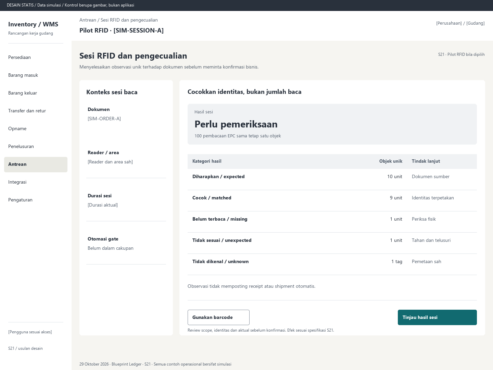

# S21. Sesi RFID dan pengecualian

Status: usulan desain statis, tanpa implementasi. Semua angka/kode pada papan adalah **Data simulasi**; bukan hasil transaksi atau UAT.

**Pengguna:** Operator pilot; supervisor pengecualian. **Paket:** Pilot RFID bila dipilih. **Pola:** queue.

**Kebutuhan asal:** FR-05, FR-07, FR-11, FR-14, FR-15, FR-16; TRK-03, TRK-08, TRK-09, TRK-12, TRK-16, TRK-17, TRK-18, TRK-19, TRK-20, TRK-21. **Keputusan terbuka:** D02, D03, D05; T01, T05, T06, T07.

**Pekerjaan layar:** Menyelesaikan observasi unik terhadap dokumen sebelum meminta konfirmasi bisnis.

[Vektor SVG](../boards/21-sesi-rfid-pilot.svg). Gambar kontrol tidak interaktif; kontraknya berada di bawah.

## Komposisi dan prioritas

Konteks utama: Pilot RFID · [SIM-SESSION-A]. Fokus: Hasil sesi, dengan nilai ilustrasi Perlu pemeriksaan. 100 pembacaan EPC sama tetap satu objek.

Bagian pemilihan/konteks: Konteks sesi baca. Ruang kerja: Cocokkan identitas, bukan jumlah baca. Pemisahan ini membantu pengguna memilih objek lalu meninjau dampaknya. Papan menggunakan shell yang sama; isi mengikuti kebutuhan fungsi, bukan menambah grafik atau KPI.

Informasi minimum yang tetap terbaca:

- Dokumen: [SIM-ORDER-A].
- Reader / area: [Reader dan area sah].
- Durasi sesi: [Durasi aktual].
- Otomasi gate: Belum dalam cakupan.

Field/kolom penentu: Kategori hasil, Objek unik, Tindak lanjut. Nama barang, kode, kuantitas dan unit tidak diganti dengan ikon atau tooltip.

## Urutan kerja

1. Pilih satu dokumen, area, reader dan operator; mulai sesi dengan scope eksplisit.
2. Kelompokkan pembacaan berulang menjadi objek unik; tampilkan expected, matched, missing, unexpected dan unknown.
3. Akhiri baca, periksa fisik/arah ambigu/lintas area. Parent-child, unknown dan unit order lain tidak boleh dihitung ganda atau disahkan diam-diam.
4. Gunakan fallback barcode pada identitas yang sama bila perlu. Review hasil sah menuju S05/S10; opname tetap S14 dengan blind count. Pilot tidak mengaktifkan otomasi gate.

## Kontrol dan hasil yang direncanakan

| Kontrol | Perilaku dan hasil |
|---|---|
| Mulai / akhiri baca | Mengubah status capture, bukan stok; berhenti baca tidak berarti posting. |
| Tinjau hasil sesi | Kelompokkan objek/pengecualian dan tahan baris belum selesai sebelum konfirmasi bisnis. |
| Gunakan barcode | Lanjut pada objek dan maksud yang sama dengan metode tercatat, tanpa hitung ganda. |
| Buka kasus | Tampilkan kode, resolusi, reader/area, bukti, pemilik tindak lanjut dan alasan. |

## Validasi dan dampak

Jumlah raw read bukan jumlah barang. RSSI bukan bukti tunggal arah. Missing tidak otomatis hilang; lintasan balik/asing/diam memerlukan pemeriksaan. Perangkat terputus menampilkan keterlambatan, bukan sukses.

Capture dan resolusi tidak mengubah stok. Inventory Core mengesahkan satu dampak setelah konfirmasi; level tracking dan ambang pilot menunggu keputusan.

Observasi tidak memposting receipt atau shipment otomatis.

## Keadaan selain berhasil

| Keadaan | Pesan dan pemulihan |
|---|---|
| Kosong | Sesi belum membaca tag. Periksa konteks reader dan mulai baca bila pilot sudah diaktifkan. |
| Memuat | Memuat sesi rfid dan pengecualian pada lingkup terpilih. Data sebelumnya tidak dianggap terbaru. |
| Filter kosong | Tidak ada hasil untuk filter aktif. Pertahankan filter dan sediakan Hapus filter. |
| Error | Reader atau gateway terputus. Hasil belum lengkap; periksa perangkat atau lanjut dengan barcode pada identitas yang sama. |
| Konflik / tertahan | Arah ambigu, tag asing atau isi kemasan belum sah. Tahan baris terkait dan periksa fisik. |
| Akses ditolak | Tindakan atau lingkup ini tidak diizinkan. Kembali ke scope sah; jangan tampilkan isi objek terlarang. |
| Offline / hasil belum pasti | Untuk perintah konfirmasi, gunakan kontrak S17; pending lokal, unknown dan penolakan pasti mempunyai pemulihan berbeda. Baca saja menampilkan data tidak tersedia/belum segar. |

## Desktop, rentang menengah dan scanner

Desktop mengikuti komposisi papan. Pada rentang menengah, menu berlabel dan pemilih objek menggantikan sidebar/panel sempit. Pada rentang sempit, objek, field penentu, status, aktual/satuan dan aksi menjadi record vertikal. Metadata boleh dipindahkan ke detail, tetapi tidak menghilangkan alasan tertahan atau dampak kuantitas.

Kontrak minimum: target 44px, scanner 52px; label terlihat, fokus 3px, Tab sesuai alur, dialog Escape saat aman dan fokus kembali. Input tidak boleh tertutup keyboard. Scope/dokumen tidak berubah saat pending tanpa keputusan eksplisit. Lihat [fondasi](../00-foundation.md) dan [komponen/state](../02-components-and-states.md).

## Bukti penerimaan yang perlu disiapkan

Skenario terkait: UAT-12; TRK-UAT-10, TRK-UAT-11, TRK-UAT-12, TRK-UAT-13, TRK-UAT-15, TRK-UAT-18, TRK-UAT-20. Semuanya tetap **Belum dijalankan**. Pemetaan ini menyebut cakupan yang perlu dibuktikan, bukan hasil lulus.

Tinjauan desain: baca konteks, tentukan langkah yang benar, jelaskan dampak dan jalankan kembali skenario gagal menggunakan spesifikasi. Setelah implementasi: uji semua kontrol yang disebut di atas, narrow/menengah/desktop, kedua tema, keyboard dan perangkat nyata. Pemeriksaan API/database dibutuhkan untuk akses, idempotensi, transaksi dan saldo; gambar tidak membuktikannya.

## Sumber

[PRD](../../../docs/planning/01-product-requirements.md), [TRD](../../../docs/planning/02-technical-requirements.md), [Flow](../../../docs/planning/03-app-flow.md), [Design Brief](../../../docs/planning/04-design-brief.md), [Schema](../../../docs/planning/05-backend-schema.md), [Plan](../../../docs/planning/06-implementation-plan.md), [PRD tracker](../../../docs/planning/prd-tracker-barcode-rfid.md).

[Papan handheld](../boards/21-sesi-rfid-pilot-handheld.png) dan [SVG handheld](../boards/21-sesi-rfid-pilot-handheld.svg).
