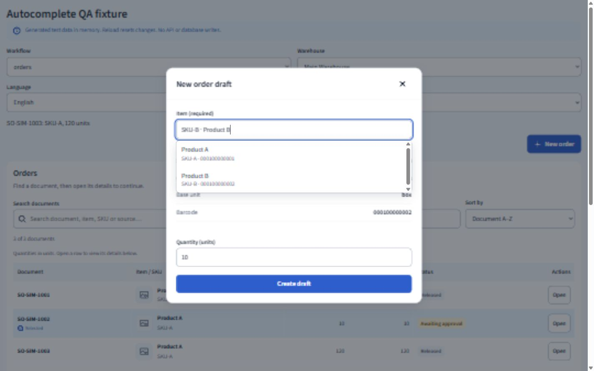
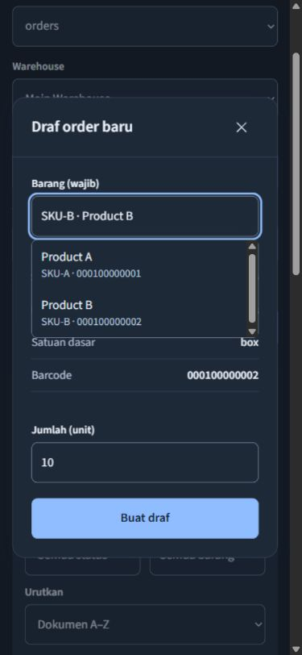

# Verifikasi autocomplete dan autofill

Tanggal: 1 November 2026. Hasil: **PASS untuk cakupan perubahan ini**.

Implementasi mengikuti Clear Operations dalam `DESIGN.md`, dengan ENERGY 1 / RHYTHM 1 / MOTION 1. Fokus perubahan adalah mengurangi pengetikan nilai yang sudah tersimpan. Daftar saran memakai permukaan, warna pilihan cyan, focus biru dan tipografi aplikasi. Shadow hanya membedakan popup dari formulir di belakangnya.

## Perilaku yang tersedia

- Pencarian master barang dan stok: nama, SKU dan barcode; stok juga menawarkan lokasi dari posisi di gudang aktif.
- Pencarian katalog dokumen: nomor dokumen, nama barang, SKU atau sumber; pilihan mengisi query, kemudian pengguna membuka detail dengan tindakan Open.
- Pilihan barang pada katalog dokumen, kartu stok, pelacakan dan label dapat dicari lewat nama/SKU/barcode. Kategori dan lokasi pada filter juga dapat dicari.
- Kategori dan satuan pada form barang menggunakan nilai yang sudah disimpan. Nilai baru tetap dapat diketik dan menjadi saran setelah barang disimpan.
- Order baru memerlukan pemilihan barang aktif. SKU, kategori, satuan dasar dan barcode tampil dari master setelah pemilihan. Payload draf menggunakan SKU yang dipilih. Jumlah tetap diisi pengguna.
- Pemilihan sumber/dokumen/tugas memperbarui konteks detail draf. Perubahan tujuan penempatan mengosongkan scan lokasi agar tujuan baru diperiksa kembali.
- Panah atas/bawah mengaktifkan opsi, Enter memilih tanpa mengirim form, Escape menutup saran dan membatalkan query pada pilihan master, Tab meneruskan fokus. Query pada pilihan master yang belum dipilih menahan submit melalui validasi native.
- Maksimal delapan saran ditampilkan. Kode tetap berupa string, termasuk nol awal. Saran diambil dari snapshot/master yang telah tersedia; tidak ada riwayat pengetikan baru yang disimpan ke localStorage.

Kolom Perusahaan pada registrasi memakai token autofill browser `organization`. Model aplikasi saat ini belum menyediakan master perusahaan/supplier/pelanggan bersama. Token tersebut tidak membuat penyimpanan master perusahaan di aplikasi.

## Pemeriksaan aktual

| Pemeriksaan | Hasil |
|---|---|
| `npm run build` | PASS: TypeScript, Vite dan packaging selesai. Dua pemberitahuan annotation SignalR yang sudah ada tetap muncul. |
| `npm run test:autocomplete` | PASS: 4 tes; barcode bernol awal, item aktif, nama serupa, pencarian multi-kata, deduplikasi, 10.000 opsi, ranking dan batas delapan hasil. |
| `npm run test:catalogue` | PASS: 3 tes. |
| `npm run test:work-queue` | PASS: 4 tes. |
| `npm run test:sites` | PASS: 4 tes. Tidak dilakukan deployment. |
| Browser: pilih barcode B dengan panah dan Enter | PASS: detail menjadi SKU-B / Tools / box / 000100000002; Enter tidak mengirim form. |
| Browser: pemilihan dan penyimpanan order | PASS: fixture menyimpan SO-SIM-1004 dengan SKU-B dan jumlah 7. |
| Browser: pilihan yang tidak dikenal dan item nonaktif | PASS: pilihan tidak dikenal menahan submit; pencarian Product C menghasilkan nol saran untuk order baru. |
| Browser: kegagalan penyimpanan yang diinjeksi fixture | PASS: pesan tampil di dialog, SKU-B dan jumlah 7 tetap tersedia; percobaan berikutnya berhasil. |
| Browser: simpan dan gunakan ulang kategori/satuan baru | PASS: Reusable category dan pack muncul pada form barang berikutnya. |
| Browser: scope gudang | PASS: Main hanya menawarkan PO-SIM-100; Secondary hanya menawarkan PO-QA-SECONDARY pada fixture. |
| Browser: filter dan pencarian | PASS: barcode stok memilih SKU-B, lokasi QC dapat dipilih, kartu stok memakai SKU-B, filter SKU-B menghasilkan 16 dari 32 dokumen. |
| Browser: tujuan putaway | PASS: memilih A-02 mengosongkan scan A-01; tidak ada transaksi dikonfirmasi. |
| Browser: desktop 1440 x 900 / tablet 900 x 900 / ponsel 390 x 844 | PASS: tidak ada horizontal page overflow; popup desktop dan ponsel berada dalam viewport. |
| Browser: tema/bahasa | PASS: popup ponsel pada tema gelap dan Bahasa Indonesia; desktop terang berbahasa Inggris. |
| Browser: console akhir | PASS: sesi baru setelah pengeditan tidak menghasilkan log error selama pemeriksaan akhir. |
| `git diff --check` | PASS. |

Browser memakai `prototype/qa/autocomplete-fixture.html` dan `prototype/qa/work-queue-fixture.html`. Data sintetis disimpan dalam memori dan diberi label. Pengeditan awal fixture dengan HMR sempat mencatat error root React; fixture sekarang melepas root saat HMR dan sesi pemeriksaan akhir tidak menunjukkan error tersebut. Tidak ada penulisan ke API/database selama QA ini. Backend tidak diubah atau diuji ulang. Ini bukan hasil UAT atau pengujian scanner fisik.

## Gate antislop untuk perubahan ini

- R-02 PASS: teks baru tidak memakai em dash.
- R-03 PASS: ukuran desktop/tablet/ponsel diperiksa; popup berada dalam viewport pada desktop dan ponsel.
- R-17 PASS: tidak ada metrik bisnis baru; jumlah dokumen berasal dari fixture berlabel.
- R-18 PASS: tidak ada testimoni atau profil fiktif.
- R-23 PASS: tidak ada aset logo, avatar atau ilustrasi baru.
- R-24 PASS: tidak ada link navigasi produk baru.
- R-25 PASS: checker antislop-human mengukur teks dan keterangan pada warna pilihan terang/gelap: 13,88 / 5,65 / 10,07 / 6,60 banding 1.
- R-26 PASS: pencarian, pilihan, keyboard, filter, penyimpanan dan pemulihan draf diperiksa di browser.
- R-27 PASS: hasil kosong dan kegagalan simpan diperiksa; status menyimpan serta disabled terimplementasi. Loading/error snapshot tetap ditangani shell aplikasi.
- R-28 PASS: tidak ada FAQ baru.
- R-32 PASS: panah, Enter, Escape dan Tab diperiksa. Focus ring memakai token aplikasi; rasio terhadap warna pilihan 5,36:1 terang dan 5,74:1 gelap.
- R-33 PASS: fitur ditulis langsung dalam komponen/model/CSS aplikasi.
- R-34 PASS: popup diperiksa pada tema terang dan gelap.
- R-35 PASS: build berhasil dan kontrol yang berubah diperiksa dengan fixture browser; cakupan ini tidak mencakup seluruh 21 fungsi aplikasi.
- R-36 PASS: tidak ada klaim performa, keamanan atau kepatuhan produksi.
- R-37 PASS: arah Clear Operations dan dial 1/1/1 bersumber dari DESIGN.md.
- R-38 PASS: data browser diberi label Generated test data; aplikasi menggunakan master/snapshot yang tersedia.
- R-39 PASS: combobox/listbox/option, label, expanded/active/invalid, status hasil, hover, fokus dan cursor tersedia; tidak ada animasi baru.
- R-40 PASS: tidak ada media atau script pihak ketiga baru.
- R-01 PASS: popup memakai warna semantik pilihan/fokus; tanpa gradient baru.
- R-04 PASS: tidak menambah icon set atau ikon dekoratif.
- R-06 PASS: menggunakan Source Sans 3 aplikasi; tidak menambah font.
- R-07 PASS: tidak menambah pola latar.
- R-08 PASS: tidak menambah panah dekoratif pada tombol.
- R-09 PASS: tidak menambah badge.
- R-10 PASS: tidak menambah glass/blur pada kontrol.
- R-12 PASS: shadow popup menyatakan lapisan pilihan di atas form.
- R-13 PASS: tidak menambah glow.
- R-14 PASS: tidak menambah kartu fitur.
- R-19 PASS: perubahan status kontrol segera; tidak menambah animasi.
- R-22 PASS: tidak menambah ilustrasi.
- Liveliness PASS: fokus tugas adalah menemukan nilai dan memilihnya; hierarki label/nama/kode, ruang antar opsi, cyan untuk pilihan dan biru untuk fokus mengikuti pola aplikasi. Dial ENERGY 1 / RHYTHM 1 / MOTION 1.
- C-1 PASS: popup dan detail mengurangi pengetikan nilai berulang.
- C-2 PASS: jalur input, pemilihan, simpan dan gagal simpan diperiksa.
- C-3 PASS: hanya kontrol input/filter dan detail barang terkait yang ditambahkan.
- C-4 PASS: hasil kosong, input invalid, gagal simpan, keyboard, tema dan ukuran layar diperiksa dalam cakupan di atas.
- C-5 PASS: bukti sintetis dibedakan dari data operasional.
- R-05 PASS: struktur katalog/detail yang sudah ada dipakai untuk tugas yang sama.
- R-11 PASS: radius kontrol 8px mengikuti aplikasi.
- R-15 PASS: label tindakan tetap spesifik: Create draft, Save changes dan Open.
- R-16 PASS: tidak ada klaim pemasaran baru.
- R-20 PASS: saran memperlihatkan identitas operasional SKU/barcode/dokumen yang relevan.
- R-21 PASS: kedua tema yang sudah tersedia dipakai.
- R-29 PASS: menggunakan token warna aplikasi yang sudah ada.
- R-30 PASS: tidak memperkenalkan arah visual dari produk lain.
- R-31 PASS: label menjelaskan data, keterangan membedakan kode, focus ring menandai opsi keyboard, dan portal menjaga popup di atas form/dialog.

## Bukti gambar

