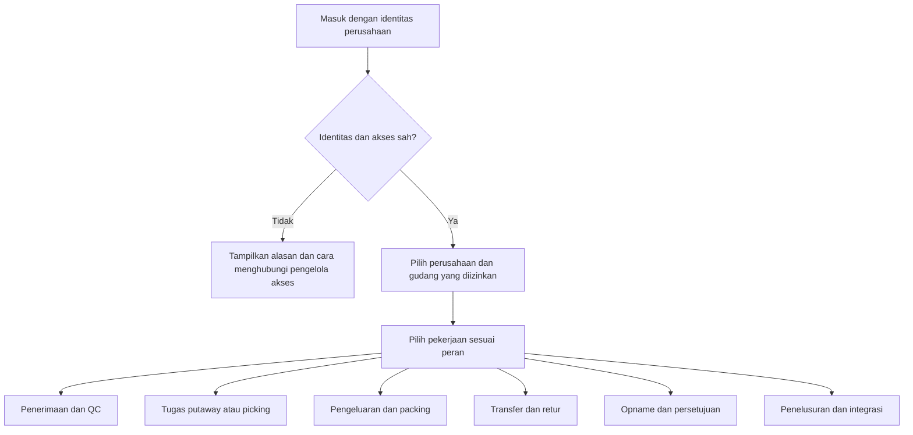
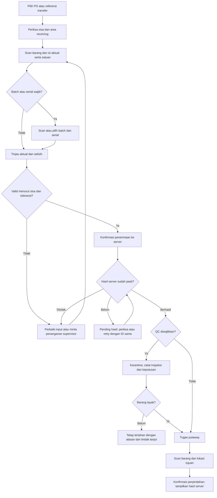
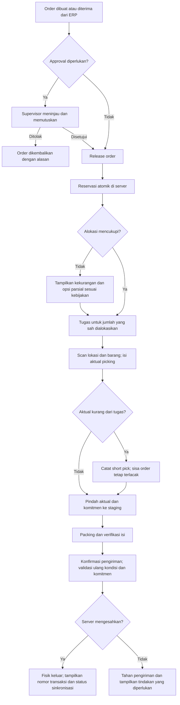
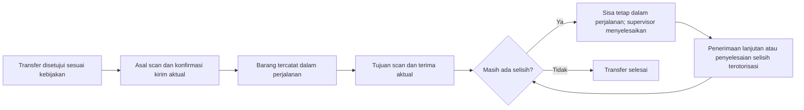
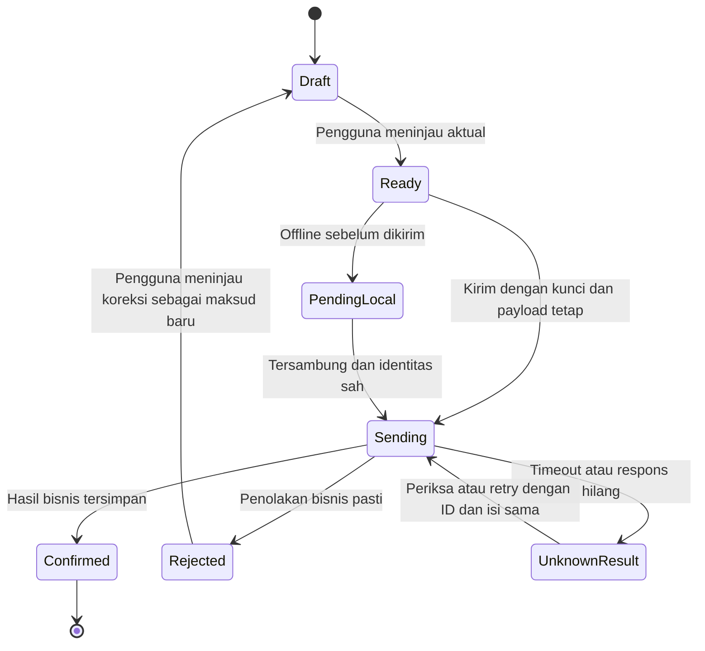

# App Flow Document

ID: INV-WMS-FLOW-001. Versi draf: 0.2. Tanggal: 28 Oktober 2026.

Dokumen ini menjabarkan perjalanan pengguna dari [PRD](01-product-requirements.md). Nama layar, urutan dan diagram adalah usulan perilaku aplikasi. Belum ada halaman atau navigasi yang dibangun.

Mengikuti [acuan proses rekayasa](engineering-basis.md), setiap alur dipakai untuk memperjelas kebutuhan menurut ISO/IEC/IEEE 29148:2018 dan menyiapkan skenario validasi sistem dalam proses ISO/IEC/IEEE 15288:2023. Kondisi awal, percabangan, pengecualian dan hasil harus ditinjau bersama pengguna.

## Masuk dan memilih pekerjaan

Pilihan perusahaan/gudang harus selalu terlihat ketika pengguna bekerja. Perubahan lingkup meminta pengguna menyelesaikan atau menyimpan draf yang masih terbuka. Antrean pending tetap terikat pada lingkup asal, bukan berpindah mengikuti pilihan layar.

Perubahan hak akses di server berlaku pada aksi berikutnya. Layar yang masih terbuka tidak memberi hak tambahan. Ketika sesi kedaluwarsa, aplikasi mempertahankan draf lokal sejauh diizinkan kebijakan perangkat; pengguna masuk kembali sebelum melanjutkan konfirmasi.

## Receiving, QC dan putaway

| Layar usulan | Informasi penentu | Aksi utama dan hasil |
|---|---|---|
| Dokumen masuk | Sumber, sisa per baris, gudang, toleransi | Pilih baris yang masih boleh diterima |
| Konfirmasi receiving | Barang, aktual, satuan, konversi, batch/serial dan kondisi awal | Tinjau lalu konfirmasi; server mengembalikan nomor transaksi |
| Antrean QC | Umur tunggu, barang, jumlah dan alasan tertahan | Buka inspeksi; tetapkan jumlah layak/ditolak beserta bukti |
| Putaway | Receiving asal, barang, jumlah dan tujuan yang diizinkan | Scan lokasi tujuan; backend mengesahkan perpindahan |

Jumlah tidak dikenal atau barcode ambigu memerlukan pemilihan/pemetaan yang berwenang; aplikasi tidak menebak barang. Penerimaan uji 60 dari PO 100 menampilkan sisa 40. Kelebihan tidak diposting sampai lolos aturan toleransi atau persetujuan yang disepakati.

## Order sampai pengiriman

Alokasi sebagian bukan keputusan otomatis pada draf ini. Kebijakan parsial ditetapkan dalam D02. Layar menunjukkan jumlah order, alokasi, picked, shipped dan sisa secara terpisah. Total yang dipenuhi tidak boleh disimpulkan dari status header saja.

Short pick tidak otomatis menghapus barang yang masih tercatat pada lokasi asal. Aktual yang ditemukan berpindah, sisa reservasi ditahan atau ditangani ulang sesuai kebijakan, dan selisih fisik memicu pemeriksaan. Pelepasan/realokasi sisa memerlukan tindakan yang jelas.

### Pembatalan dan perubahan kondisi

| Kondisi saat pembatalan | Alur yang diwajibkan |
|---|---|
| Belum dipicking | Server melepas bagian reservasi yang memang dapat dilepas dan mencatat pembatalan |
| Sebagian/sudah dipicking | Server membuat kebutuhan pengembalian; barang dan komitmen di staging tetap terlacak |
| Barang sudah kembali | Operator scan lokasi kembali; server memindahkan aktual dan menyelesaikan komitmen terkait |
| Sebagian/sudah dikirim | Bagian terkirim mengikuti retur; bagian lain ditangani sesuai keadaan masing-masing |

Jika QC mengubah barang yang sudah dialokasikan menjadi karantina, order/tugas terkait menampilkan alasan tertahan. Picking dan shipment tidak dapat diteruskan dengan reservasi terdampak. Penggantian stok atau pelepasan mengikuti keputusan D02 dan auditnya.

## Transfer dan retur

Pengguna tujuan melihat jumlah dikirim, sudah diterima dan sisa perjalanan. Pada contoh uji kirim 50 dan terima 48, sisa 2 belum dianggap hilang atau diterima. Koreksi membutuhkan alasan, bukti dan kewenangan sesuai D03.

Retur pelanggan memilih dokumen/baris asal, mencatat aktual di area pemeriksaan, lalu mengikuti QC. Retur supplier memilih stok dan referensi yang benar, mengikuti persetujuan yang diwajibkan, lalu mengurangi fisik saat pengiriman sah. Barang yang dikembalikan tidak otomatis berstatus layak.

## Stock opname

1. Supervisor menentukan gudang/lokasi dan lingkup hitung; sistem menampilkan pekerjaan terkait yang harus diselesaikan atau ditahan.
2. Server mengesahkan freeze dan menyimpan saldo pada batas hitung. Pengguna lain melihat alasan lokasi tidak dapat dipakai.
3. Operator menerima tugas blind count tanpa saldo pembanding pada layar atau respons API yang ditujukan untuk menghitung.
4. Operator memasukkan aktual dan satuan. Hitung ulang, jika diwajibkan, tersimpan sebagai percobaan baru; bukti sebelumnya tidak ditimpa.
5. Peninjau membandingkan hasil dengan snapshot dan memeriksa penyebab selisih.
6. Penyetuju yang berwenang mengesahkan penyesuaian. Server memposting satu kali dan mencatat hubungan ke hasil hitung.
7. Supervisor membuka kembali lokasi melalui tindakan yang tercatat. Pembatalan hitung juga memerlukan alasan dan pelepasan freeze yang sah.

Menutup browser tidak melepas freeze. Aplikasi menyediakan daftar hitung yang masih menahan lokasi agar pekerjaan tidak tertinggal tanpa pemilik.

## Konfirmasi, pending dan retry

`PendingLocal` berarti scan belum disahkan. `UnknownResult` berarti server mungkin sudah commit. Pada keadaan kedua, aplikasi tidak menyediakan tombol yang diam-diam membuat kunci baru. Jika pengguna membutuhkan koreksi atas transaksi berhasil, ia membuka proses koreksi yang merujuk transaksi asal.

Konfirmasi keberhasilan memperlihatkan nomor transaksi, aktual, lokasi/kondisi hasil dan sisa yang relevan. Status ERP muncul terpisah. Pesan seperti **Penerimaan tercatat; sinkronisasi ERP menunggu** lebih tepat daripada satu label selesai untuk dua proses berbeda.

## Status layar yang harus dirancang

| Keadaan | Perilaku / pesan usulan |
|---|---|
| Belum ada tugas | Jelaskan bahwa belum ada tugas pada gudang/peran tersebut dan ke mana pengguna meminta penugasan |
| Filter tanpa hasil | Tampilkan filter aktif dan aksi hapus filter |
| Memuat | Nyatakan data yang dimuat; cegah konfirmasi berulang saat hasil masih dikirim |
| Akses ditolak | Jelaskan lingkup/tindakan yang ditolak tanpa membocorkan data gudang lain |
| Data berubah | Minta pengguna memuat keadaan terbaru dan meninjau aktual sebelum maksud baru |
| Barcode tidak dikenal | Tampilkan hasil scan dan pilihan scan ulang atau bantuan pemetaan yang sah |
| Koneksi terputus | Tampilkan jumlah scan pending dan bahwa stok belum dikonfirmasi |
| Hasil belum pasti | Tampilkan tindakan periksa/retry yang mempertahankan kunci asli |
| ERP gagal | Pertahankan hasil stok lokal, tampilkan sinkronisasi tertunda/gagal dan tindak lanjut sesuai peran |

## Penelusuran dan penanganan integrasi

Auditor membuka kartu stok, memilih mutasi, lalu melihat dokumen, entri, pelaku, kondisi, batch/serial dan koreksi terkait. Semua tautan detail memeriksa kewenangan lagi di server.

Petugas integrasi memilih event bermasalah, melihat objek/versi, riwayat percobaan dan respons, lalu menjalankan retry atau rekonsiliasi sesuai kewenangan. Replay setelah restore ditahan sampai petugas menyelesaikan pemeriksaan ERP. Retry memakai ID event yang sama; mengedit payload event yang sudah diposting memerlukan proses koreksi tersendiri.

## Dasar pemeriksaan flow

Receiving dan QC diperiksa melalui UAT-02/UAT-03. Picking dan pembatalan melalui UAT-01/UAT-04/UAT-05. Transfer dan opname melalui UAT-06/UAT-07. Pending/retry melalui UAT-08 sampai UAT-12. Akses dan pemulihan melalui UAT-13/UAT-14. Semua skenario tersebut belum dijalankan.
