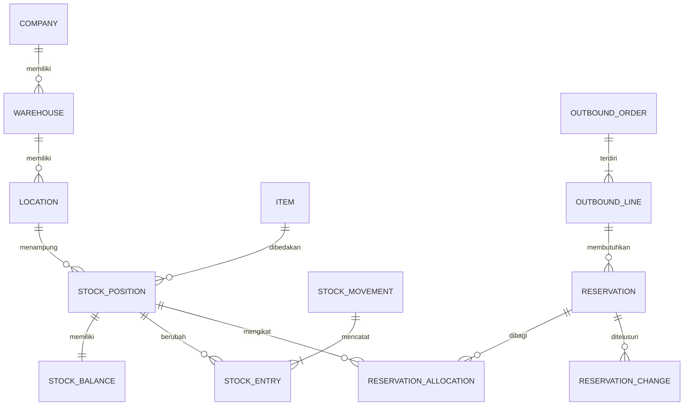

# Backend Schema Document

ID: INV-WMS-DATA-001. Versi draf: 0.2. Tanggal: 28 Oktober 2026.

Dokumen ini merupakan model data logis untuk [PRD](01-product-requirements.md) dan [TRD](02-technical-requirements.md). Belum ada database, migrasi atau DDL produksi. Nama tabel/kolom berikut adalah usulan yang perlu ditinjau sebelum implementasi.

Mengikuti [acuan proses rekayasa](engineering-basis.md), model data dan integrasinya dikembangkan sebagai bagian dari desain sistem dengan acuan ISO/IEC/IEEE 15288:2023. Invarian dan constraint harus terhubung pada kebutuhan serta bukti verifikasinya; perubahan schema memerlukan penilaian dampak pada transaksi, integrasi dan pemulihan.

## Konvensi dan lingkup data

Objek transaksi memiliki ID stabil, `company_id`, waktu pembuatan dan versi yang relevan. Referensi antartabel harus menjaga perusahaan dan hubungan gudang yang sah. Usulan foreign key gabungan `(company_id, id)` mencegah referensi lintas perusahaan yang tidak disengaja, di samping validasi akses backend.

`owner_id` wajib menunjuk pemilik yang sah, termasuk perusahaan sendiri untuk stok milik sendiri. Skema tidak memakai pemilik kosong sebagai arti tersembunyi. Multi-owner, konsinyasi dan transfer antar perusahaan belum diaktifkan sebagai cakupan final; D01 menetapkan kebutuhannya.

Jumlah memakai `NUMERIC` dengan presisi/skala yang dipilih berdasarkan D02. Input API berupa string desimal. Faktor konversi transaksi disimpan bersama jumlah input dan jumlah satuan dasar. Waktu posting server dan waktu kejadian fisik disimpan terpisah.

## Kelompok master dan akses

| Entitas usulan | Field dan hubungan utama | Aturan penting |
|---|---|---|
| `companies` | ID, kode, nama, status | Lingkup bisnis dan akses |
| `stock_owners` | Perusahaan, kode, jenis pemilik | Pemilik stok eksplisit; kewenangan mengikuti D01 |
| `warehouses` | Perusahaan, kode, nama, status | Kode unik dalam perusahaan |
| `locations` | Gudang, kode, jenis, `is_pickable`, status | Jenis receiving, storage, staging, return, dan virtual transit; kode unik per gudang |
| `items` | Perusahaan, SKU, nama, satuan dasar, kebijakan tracking, status | SKU unik per perusahaan; satuan dasar tidak mengubah riwayat lama |
| `item_barcodes` | Barang, barcode, satuan, status | Pemetaan aktif tidak ambigu pada lingkup scan yang disepakati |
| `units` / `item_uoms` | Satuan, barang, faktor ke dasar, aturan pembulatan | Faktor positif; perubahan master tidak mengubah snapshot transaksi |
| `lots` | Perusahaan, barang, nomor lot, produksi, expiry | Keunikan lot dan validasi expiry mengikuti D02 |
| `serials` | Perusahaan, barang, serial, posisi aktif, lifecycle | Serial unik pada lingkup D02; satu identitas tidak hadir di dua posisi fisik |
| `business_partners` | Perusahaan, kode, peran supplier/pelanggan, ID sumber | Master ERP atau lokal mengikuti D04 |
| `principals` / `roles` / `permissions` | Identitas SSO/integrasi, peran dan izin | Rahasia autentikasi tidak dicatat sebagai audit bisnis |
| `access_grants` | Principal, peran, perusahaan, gudang | Kombinasi akses diperiksa pada baca dan mutasi |
| `approval_policies` / `approval_decisions` | Jenis objek/tindakan, versi kebijakan, pembuat, penyetuju, keputusan, alasan | Keputusan terhubung revisi/dampak yang disetujui; perubahan isi memerlukan peninjauan ulang |

## Inti persediaan

| Entitas usulan | Field utama | Makna |
|---|---|---|
| `stock_positions` | Perusahaan, pemilik, barang, lokasi, kondisi, lot opsional, serial opsional | Identitas satu kombinasi dimensi stok |
| `stock_balances` | Posisi, `on_hand_qty`, `committed_qty`, versi | Saldo fisik dan komitmen terkini; satu baris per posisi |
| `stock_movements` | Jenis, sumber tindakan, pelaku, alasan, `occurred_at`, `posted_at`, referensi pembalikan | Header posting yang tidak ditimpa sesudah sah |
| `stock_entries` | Movement, posisi, `quantity_delta`, input/satuan/faktor jika relevan | Entri kuantitas bertanda; sumber penjumlahan fisik |
| `reservations` | Order line, jumlah dibuat, dipenuhi, dilepas, status | Komitmen logis terhadap permintaan |
| `reservation_allocations` | Reservasi, posisi, jumlah komitmen tersisa, status ACTIVE/HELD/CLOSED | Bagian komitmen yang masih melekat pada posisi tertentu |
| `reservation_changes` | Reservasi, aksi, posisi asal/tujuan, jumlah, sumber perintah | Riwayat alokasi, penahanan, perpindahan, pemenuhan dan pelepasan |
| `posting_references` | Sumber, jenis tindakan, identitas konfirmasi/baris | Perlindungan posting bisnis ganda di luar kunci HTTP |

Tabel `reservation_allocations` adalah perincian baru dari konsep reservasi pada arsitektur. Pemisahan ini mengizinkan satu order dipenuhi dari beberapa posisi dan menjaga komitmen saat sebagian barang berpindah ke staging. Nama dan bentuk fisiknya belum final.



Diagram menunjukkan relasi inti, bukan seluruh tabel atau seluruh kolom. Foreign key, dimensi pemilik, lot/serial dan kontrol integrasi tetap diperlukan meskipun tidak digambar.

## Invarian yang harus dibuktikan

Gunakan satuan dasar dan dimensi posisi yang sama pada seluruh perhitungan.

```text
on_hand_qty(position) = SUM(stock_entries.quantity_delta untuk posisi tersebut)

committed_qty(position) = SUM(reservation_allocations.remaining_qty
                             yang berstatus ACTIVE atau HELD pada posisi tersebut)

0 <= committed_qty(position) <= on_hand_qty(position)

reservation.outstanding_qty = created_qty - fulfilled_qty - released_qty
reservation.outstanding_qty = SUM(remaining_qty alokasi ACTIVE atau HELD miliknya)

allocatable_qty(position) = on_hand_qty - committed_qty
                           jika kondisi, lokasi, expiry dan freeze mengizinkan;
                           selain itu 0
```

Usulan kolom jumlah tersisa pada alokasi dinamai `remaining_qty`. Status HELD tetap menghitung komitmen, tetapi mencegah picking/shipment sampai masalah terselesaikan. Kuantitas CLOSED adalah nol. Karantina dengan komitmen tertahan tetap memiliki fisik; sistem tidak melepas perlindungan barang secara diam-diam.

Staging tidak menjadi sumber alokasi baru pada rancangan awal. Pengiriman memakai komitmen yang sudah ditetapkan bagi shipment/order terkait. Penerimaan atau perpindahan ke kondisi layak tidak membuat barang otomatis tersedia jika lokasi atau freeze masih melarangnya.

Untuk perpindahan lokasi/kondisi dalam lingkup kepemilikan yang sama, jumlah delta sumber dan tujuan harus nol. Receiving, shipment dan penyesuaian mempunyai jumlah bersih sesuai tindakan fisik dan otorisasi. Saldo awal adalah movement terotorisasi; bukan angka awal yang tidak memiliki entri.

## Keunikan dan batasan

| Kontrol | Aturan usulan | Lapisan penerapan |
|---|---|---|
| Identitas posisi | Unik perusahaan + pemilik + barang + lokasi + kondisi + lot + serial | Unique constraint/index dengan penanganan NULL eksplisit |
| Dimensi opsional | Dua posisi dengan lot/serial kosong yang sama tidak boleh lolos sebagai duplikat | Pilih `NULLS NOT DISTINCT` jika versi yang ditetapkan mendukung, atau normalisasi kunci yang setara |
| Saldo | Fisik dan komitmen nonnegatif, komitmen tidak melampaui fisik | CHECK per baris dan transaksi Inventory Core |
| Reservasi | Jumlah dibuat/dipenuhi/dilepas sah, sisa tidak negatif | CHECK per baris; kesetaraan lintas alokasi oleh transaksi dan rekonsiliasi |
| Keunikan konfirmasi | Identitas tindakan sumber hanya diposting sekali | Unique posting reference dan validasi sisa di bawah lock |
| Referensi bisnis | Barang, lot, serial, owner dan lokasi cocok perusahaan dan dokumen | Composite foreign key bila sesuai dan validasi domain |
| Serial | Satu serial aktif berada pada maksimal satu posisi dengan fisik satu unit | Kunci identitas serial, validasi/ubah penunjuk posisi aktif dan saldo dalam transaksi yang sama |
| Dokumen parsial | Jumlah kumulatif aktual tidak melampaui sisa/toleransi yang disahkan | Lock baris sumber dan validasi atomik |
| Riwayat | Entri terposting tidak diedit/dihapus melalui API operasional | Izin database/aplikasi terbatas dan perintah pembalikan |

Foreign key dan CHECK membantu menjaga data per baris. Kesetaraan antarbaris seperti saldo terhadap entri tidak cukup dijamin dengan CHECK biasa. Tim perlu transaksi yang benar dan rekonsiliasi terjadwal. Perilaku constraint dan nilai NULL dijelaskan pada [dokumentasi PostgreSQL](https://www.postgresql.org/docs/current/ddl-constraints.html).

Posisi baru dibuat dengan perlindungan unik agar dua request tidak membentuk posisi sama. Transaksi kemudian mengunci saldo yang sah. Perubahan batch/serial pada barang yang sudah ada merupakan tindakan terotorisasi dengan riwayat, bukan pengubahan identitas posisi secara langsung.

## Dokumen dan pekerjaan gudang

| Entitas usulan | Informasi minimum dan hubungan |
|---|---|
| `source_orders` / `source_order_lines` | PO atau sumber lain, sistem/ID sumber, versi, barang, rencana, sisa dan toleransi yang disahkan |
| `receipts` / `receipt_lines` | Sumber/baris, gudang, aktual, satuan/faktor, kondisi awal, lot/serial dan posting |
| `quality_inspections` / `quality_results` | Receiving/posisi asal, jumlah inspected, hasil per kondisi, alasan, bukti dan pelaku |
| `outbound_orders` / `outbound_lines` | Sumber, gudang, barang, ordered, cancelled, allocated, picked, shipped dan versi |
| `warehouse_tasks` / `task_confirmations` | Jenis, sumber, posisi asal/tujuan, rencana, aktual, operator, identitas konfirmasi, hambatan dan status |
| `shipments` / `shipment_lines` | Order line, paket bila dipakai, aktual, alokasi/serial yang dipenuhi dan posting |
| `transfers` / `transfer_lines` | Gudang asal/tujuan, barang, dikirim, diterima dan selisih terbuka |
| `transfer_dispatches` / `transfer_receipts` | Setiap kirim/terima parsial, baris sumber, aktual, posisi perjalanan dan posting |
| `returns` / `return_lines` | Jenis pelanggan/supplier, sumber asli, barang, aktual, keputusan kondisi dan posting |
| `stock_counts` / `count_scopes` | Lokasi/lingkup, status freeze, waktu/snapshot batas hitung dan penanggung jawab |
| `count_attempts` / `count_lines` | Percobaan hitung, penghitung, barang/posisi, aktual, satuan dan waktu; hasil lama dipertahankan |
| `count_adjustments` | Hasil yang disetujui, delta, approval, alasan dan movement koreksi |

Kolom allocated/picked/shipped yang disimpan sebagai ringkasan diperbarui dalam transaksi sumbernya dan harus dapat direkonsiliasi. Tabel detail pemenuhan menjadi dasar penelusurannya; header tidak menjadi sumber kuantitas kedua yang bebas diedit.

Lokasi virtual perjalanan berada dalam perusahaan yang sama dan terhubung transfer/baris terkait. Penerimaan mengurangi posisi perjalanan yang benar, bukan total perjalanan barang tanpa referensi. Barang yang sudah dikirim tidak muncul sekaligus di stok asal dan tujuan. Penetapan transfer antar perusahaan memerlukan rancangan tambahan D01/D04.

## Integrasi, bukti dan audit

| Entitas usulan | Field penting | Perlindungan |
|---|---|---|
| `idempotency_requests` | Perusahaan, principal, command, key, target/hash, hasil, waktu | Unik lingkup kunci; sukses commit bersama dampak bisnis |
| `external_references` | Sistem, perusahaan, jenis/ID objek eksternal, objek internal dan versi | Referensi dokumen eksternal tidak diimpor ganda |
| `outbox_events` | ID tetap, perusahaan, jenis/ID aggregate, versi, jenis/schema event, payload, status, next attempt, lease | Tersimpan bersama transaksi; versi/event tidak berubah saat retry |
| `delivery_attempts` | Event, tujuan, waktu, hasil transport/bisnis dan error aman | Riwayat retry; tidak menimpa seluruh bukti dengan error terakhir |
| `inbox_events` | Sistem sumber, perusahaan, ID event, hash, versi, hasil pemrosesan | Unik identitas event; konflik payload ditolak, dampak bisnis commit bersama |
| `reconciliation_cases` | Objek/event, perbedaan, bukti, keputusan dan penanggung jawab | Selisih antar sistem ditangani eksplisit |
| `audit_events` | Principal, tindakan, sumber, request, alasan dan perubahan yang relevan | Audit sukses bersama posting; akses perubahan dibatasi |
| `attachments` / `attachment_links` | Object key, hash, lingkup, status upload, sumber dan pelaku | Periksa kewenangan, ketersediaan dan pemeriksaan file sebelum bukti wajib dipakai |

Jumlah event per versi aggregate dapat lebih dari satu menurut kontrak D04. Keunikan harus mengikuti `(aggregate, version, event_sequence/type)` yang disepakati, bukan mengasumsikan hanya satu event. Penerima membedakan event lama, duplikat dan celah versi.

## Dampak data per tindakan

| Tindakan | Fisik / mutasi | Komitmen dan dokumen |
|---|---|---|
| Receiving | Tambah aktual di receiving dengan kondisi awal | Sisa PO berkurang; outbox dan hasil permintaan tersimpan |
| QC | Kurangi kondisi asal, tambah kondisi hasil sebesar aktual | Pindahkan/hold alokasi yang terdampak secara atomik |
| Reservasi | Tidak ada perubahan fisik | Buat reservasi/alokasi; committed bertambah |
| Picking aktual | Kurangi sumber, tambah staging | Pindahkan bagian alokasi aktual; sisa dipertahankan/ditangani sesuai kebijakan |
| Shipment | Kurangi staging sebesar aktual sah | Kurangi alokasi dan committed; fulfilled serta shipped bertambah |
| Pembatalan sebelum pick | Tidak ada perubahan fisik | Lepas hanya komitmen yang sah dibatalkan |
| Pengembalian sesudah pick | Kurangi staging, tambah lokasi kembali | Lepas komitmen terkait setelah perpindahan balik dikonfirmasi |
| Transfer kirim | Asal berkurang, perjalanan bertambah | Dikirim bertambah; sisa transfer terlacak |
| Transfer terima | Perjalanan berkurang, tujuan bertambah | Diterima sebesar aktual; selisih belum selesai tetap terbuka |
| Penyesuaian opname | Delta approved pada posisi yang dihitung | Hubungkan hitung, approval dan movement; jangan melepas komitmen yang terdampak tanpa keputusan |

Jika opname menunjukkan fisik kurang dari komitmen, peninjau harus menyelesaikan atau mengalihkan bagian komitmen yang tidak lagi didukung fisik sebelum/bersama posting yang disetujui. Sistem tidak boleh memaksa saldo negatif atau mengurangi reservasi tanpa riwayat.

## Indeks, rekonsiliasi dan migrasi

Usulan jalur indeks meliputi pencarian saldo per perusahaan/gudang/barang, entri per posisi/waktu/ID, alokasi aktif per posisi dan order line, tugas per gudang/operator/status, outbox per status/next attempt, serta semua kunci deduplikasi. Indeks final memerlukan query nyata dan profil beban D01; dokumen ini tidak mengklaim performa.

Rekonsiliasi membandingkan saldo dengan entri, committed dengan alokasi aktif/held, sisa reservasi dengan alokasinya, dan jumlah per dokumen dengan detail pemenuhan. Selisih membuka kasus pemeriksaan. Pekerjaan rekonsiliasi tidak langsung menimpa saldo agar terlihat cocok.

Migrasi perlu diuji pada database kosong dan data uji yang representatif. Impor saldo awal memakai dokumen yang ditinjau, tidak menimpa saldo produksi. Perubahan schema dan pembersihan data memiliki rencana pemulihan yang tidak menghapus mutasi terposting. Bentuk DDL final ditulis setelah D01-D03 serta pilihan backend/versi database ditetapkan.
