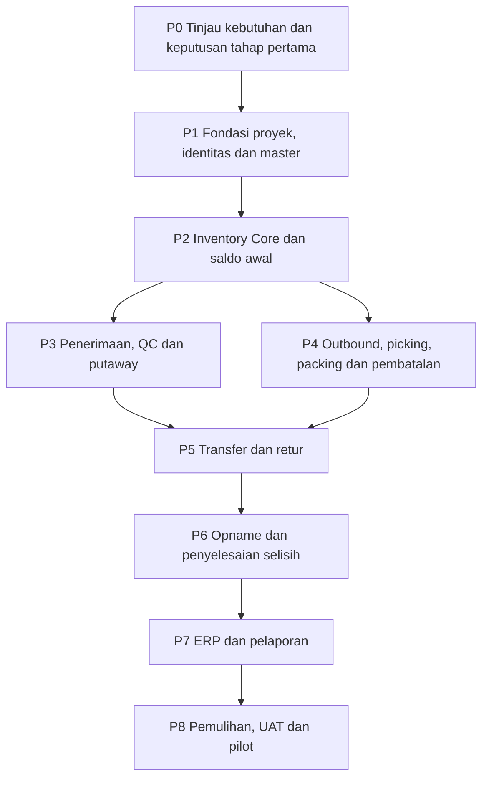

# Implementation Plan Document

ID: INV-WMS-PLAN-001. Versi draf: 0.2. Tanggal: 28 Oktober 2026.

Rencana ini menghubungkan [PRD](01-product-requirements.md), [TRD](02-technical-requirements.md), [App Flow](03-app-flow.md), [Design Brief](04-design-brief.md), dan [Backend Schema](05-backend-schema.md). **P0 sedang berjalan**; P1-P8 berstatus **Belum dimulai**. Penyusunan dokumen tidak menandai fitur telah dibangun atau diuji.

Acuan proses: ISO/IEC/IEEE 29148:2018 untuk peninjauan kebutuhan dan ISO/IEC/IEEE 15288:2023 untuk perencanaan arsitektur, integrasi, implementasi, verifikasi, validasi serta siklus hidup. [Acuan proses rekayasa](engineering-basis.md) menjelaskan pemetaan yang dipilih proyek. Pelaksanaan dan status keputusan awal dicatat pada [catatan P0](p0/README.md).

## Urutan dan ketergantungan

Urutan ini menyatakan ketergantungan, bukan jadwal. Dokumentasi kontrak ERP, kebutuhan perangkat dan pemulihan dibahas sejak P0, walaupun implementasi ujung ke ujungnya selesai pada paket berikut. Outbox/inbox, audit dan perlindungan retry dibangun sebagai fondasi, bukan tambahan sesudah semua modul selesai.

## Paket pekerjaan

| Paket | Tahap PDF | Keluaran yang harus dibangun | Kebutuhan | Bukti untuk melanjutkan |
|---|---|---|---|---|
| P0 | Persiapan F1 | Ruang lingkup disepakati, register keputusan, stack/versi, perangkat uji dan backlog paket pertama | FR-01 sampai FR-16 sesuai cakupan | D01-D03 yang memengaruhi fondasi ditetapkan; kebutuhan D04/D05 dan penanggung jawab teridentifikasi |
| P1 | F1 Fondasi | Struktur modular, migrasi, identitas, lingkup perusahaan/gudang, izin, master dan lingkungan PostgreSQL uji | FR-01, FR-04 | Master unik dan referensi sah; API langsung tidak menembus lingkup akses |
| P2 | F1 Fondasi | Posisi, movement/entry, saldo awal, reservasi/alokasi, idempotensi, audit, outbox/inbox dasar dan rekonsiliasi | FR-02, FR-03, FR-15 | Saldo cocok; uji paralel, rollback dan respons hilang menghasilkan satu dampak bisnis |
| P3 | F2 Operasional | Receiving parsial, toleransi, QC, bukti dan tugas putaway | FR-05, FR-06, FR-14 | Penerimaan aktual, sisa sumber dan perubahan kondisi/lokasi terbukti; pending tidak menjadi stok sah |
| P4 | F2 Operasional | Release, reservasi order, picking aktual, short pick, packing, shipment dan pembatalan/return-to-stock | FR-03, FR-07, FR-08, FR-14 | Komitmen mengikuti barang; kekurangan dan pembatalan tidak membuat stok bebas secara keliru |
| P5 | F2 Operasional | Transfer parsial, perjalanan, selisih, retur pelanggan dan supplier | FR-09, FR-10 | Asal/perjalanan/tujuan dapat direkonsiliasi; retur mengikuti kondisi dan sumbernya |
| P6 | F2 Operasional | Freeze scope, snapshot, blind count, hitung ulang, approval, adjustment dan buka lokasi | FR-11, FR-04 | Perpindahan bersamaan ditahan; adjustment disetujui satu kali; komitmen terdampak terselesaikan |
| P7 | F3 Integrasi & operasi | Adapter ERP nyata, versi/ack, retry/rekonsiliasi, kartu stok, traceability dan ekspor | FR-12, FR-13 | Event berulang/di luar urutan ditangani; laporan bisa ditelusuri dan menunjukkan kesegaran data |
| P8 | F3 Integrasi & operasi | Monitoring, backup, latihan restore, prosedur, pelatihan, UAT dan persiapan pilot | FR-16 dan seluruh kebutuhan | UAT lengkap memiliki bukti, target D05 dibandingkan hasil aktual, serta pemilik operasi menerima prosedur |

## P0: hal yang perlu ditetapkan terlebih dahulu

Workshop kebutuhan dapat memakai register D01-D05 sebagai daftar keputusan. Catat fakta yang diberikan klien; jangan mengisi jumlah gudang, batas toleransi, volume, retensi atau target pemulihan dari asumsi tim.

Peninjauan kebutuhan memeriksa sumber, kejelasan, konsistensi, batasan dan cara pembuktian sebelum kebutuhan dijadikan acuan coding. Keputusan arsitektur mencatat pilihan, alasan, dampak dan bukti yang diperlukan. Perubahan berikutnya dinilai terhadap kebutuhan, desain, backlog dan pengujian terkait.

Sebelum memfinalkan P1/P2, tetapkan lingkup perusahaan/pemilik, dimensi tracking, satuan, peran dan cara autentikasi. Tinjau model reservasi dan skenario pembatalan dengan pemilik proses. Tentukan bahasa/framework backend dan versi PostgreSQL beserta alasan operasionalnya.

D04 dan D05 tidak harus selesai seluruhnya untuk meninjau model data, tetapi pekerjaan yang bergantung pada kontrak ERP atau perangkat tidak dianggap siap diimplementasikan sebelum detail terkait tersedia. Target layanan yang belum disepakati tetap dicatat sebagai terbuka.

## Potongan pertama yang dibuktikan

Setelah keputusan fondasi tersedia, bangun satu alur end-to-end terbatas: pengguna berwenang membuka gudang, master dan lokasi tersedia, saldo awal diposting melalui dokumen terotorisasi, lalu dua permintaan reservasi bersaing atas stok uji yang sama.

Hasil yang harus terlihat adalah saldo, entri, komitmen, hasil idempotensi, audit dan outbox yang konsisten. Respons yang sengaja diputus setelah commit harus dapat ditemukan lewat retry dengan ID sama. Pengguna gudang lain tetap ditolak. Ini menjadi bukti fondasi P2; belum membuktikan seluruh operasional WMS siap dipakai.

## Strategi pengujian

| Tingkat | Yang dibuktikan | Lingkungan / bukti |
|---|---|---|
| Aturan domain | Jumlah, satuan, transisi status, parsial, pembatalan dan kebijakan kondisi | Data uji berlabel serta input/output yang dapat diulang |
| Integrasi database | Constraint, lock, saldo/entri, alokasi, rollback dan idempotensi | PostgreSQL nyata sesuai versi; gunakan koneksi/proses terpisah untuk persaingan |
| API dan akses | Izin baca/mutasi, versi, identitas dan error bisnis | HTTP request/response dengan principal dan lingkup yang berbeda |
| Alur pengguna | Receiving, picking, packing, retur, opname, pending dan konflik | Aplikasi yang berjalan pada perangkat/scanner sasaran |
| Integrasi ERP | Ack, duplikasi, urutan, kegagalan, retry dan rekonsiliasi | Sandbox/lingkungan representatif dengan kontrak D04 |
| Beban | Waktu respons, konflik, antrean dan perilaku pada beban puncak | Profil D01, ambang D05, spesifikasi lingkungan dan metrik tercatat |
| Pemulihan | Konsistensi restore, bukti, titik pemulihan dan replay ERP | Restore terisolasi, log dan pengukuran waktu aktual |

Mock atau database in-memory dapat membantu pengujian unit, tetapi tidak menjadi bukti penguncian PostgreSQL. Demo UI tidak menggantikan pemeriksaan mutasi dan saldo. Pengujian jumlah kecil tidak menjadi klaim kapasitas produksi.

## Penempatan UAT

Semua baris di bawah berstatus **Belum dijalankan**. Paket menyatakan waktu paling awal skenario dapat dibuktikan. Pada P8, tinjau kembali seluruh bukti terhadap konfigurasi rilis dan perubahan yang terjadi setelah pengujian awal.

| ID | Paket awal | Bukti utama |
|---|---|---|
| UAT-01 | P2 | Permintaan paralel, saldo akhir dan total alokasi |
| UAT-02 | P3 | Penerimaan parsial, sisa sumber dan entri |
| UAT-03 | P3/P4 | Karantina setelah reservasi dan penolakan picking/shipment |
| UAT-04 | P4 | Short pick aktual, sisa order dan alokasi |
| UAT-05 | P4 | Pembatalan, pengembalian fisik dan pelepasan komitmen |
| UAT-06 | P5 | Transfer parsial dengan sisa perjalanan |
| UAT-07 | P6 | Freeze, hitung, approval dan satu adjustment |
| UAT-08 | P2 | ID sama/isi sama dan penolakan isi berbeda |
| UAT-09 | P2 | Rollback seluruh dampak sebelum commit |
| UAT-10 | P2 | Hasil tersimpan ditemukan setelah respons hilang |
| UAT-11 | P7 | ERP gagal, duplikat, celah versi dan rekonsiliasi |
| UAT-12 | P3/P4 | Scan offline lalu konflik server pada perangkat sasaran |
| UAT-13 | P1 dan setiap paket API | Penolakan baca/mutasi/berkas lintas gudang |
| UAT-14 | P8 | Restore, pengukuran D05 dan replay setelah rekonsiliasi |

Untuk setiap eksekusi, catat versi aplikasi/schema, konfigurasi kebijakan, lingkungan, identitas penguji, langkah, expected/actual, waktu, bukti, hasil dan defect terkait. Hasil yang belum memiliki bukti tidak diubah menjadi lulus.

## Migrasi, pilot dan operasi

Sebelum pilot, tinjau master, barcode dan lokasi; siapkan hasil hitung saldo awal yang disetujui. Impor saldo awal melalui posting yang dapat direkonsiliasi. Tetapkan cutoff perpindahan antara pencatatan lama dan WMS agar kejadian fisik tidak terlewat atau tercatat dua kali.

Pilot menggunakan lingkup gudang/pengguna yang disepakati pada D01. Tim melatih operator untuk aktual, pending, konflik, short pick dan pembatalan. Petugas operasi menerima prosedur antrean gagal, freeze yang tertinggal, backup, restore dan eskalasi.

Rencana penghentian atau rollback pilot harus mempertimbangkan transaksi fisik yang sudah terjadi. Mengembalikan schema atau database lama tanpa rekonsiliasi bukan pembatalan operasional yang aman. Keputusan cutover, downtime, rekonsiliasi dan pemulihan memerlukan prosedur yang disepakati sebelum eksekusi.

Pemeliharaan perlu mencatat perubahan versi, dampak migrasi dan pengujian ulang yang relevan. Sebelum penghentian layanan, tetapkan ekspor/arsip data, retensi bukti, penyelesaian event integrasi, serah terima dan penutupan akses. Penanggung jawab serta batas retensinya mengikuti D01/D05.

## Syarat penerimaan implementasi

- Seluruh kebutuhan dalam cakupan memiliki demonstrasi dan bukti data yang sesuai; pengecualian tercatat dan diterima pemilik proses.
- UAT-01 sampai UAT-14 memiliki hasil yang dapat diperiksa pada konfigurasi rilis, dengan defect yang menghambat konsistensi atau akses terselesaikan.
- Target kinerja dan RPO/RTO yang benar-benar disepakati dibandingkan dengan hasil uji representatif.
- Pemilik ERP menerima rekonsiliasi, retry dan prosedur setelah restore.
- Pemilik operasi menerima monitoring, backup, akun/peran dan prosedur penanganan masalah.

Saat ini keenam dokumen merupakan draf untuk peninjauan. P0 sedang berjalan dan belum selesai karena keputusan fondasi masih terbuka. P1-P8 belum dimulai, aplikasi belum dibangun dan seluruh UAT belum dijalankan.
