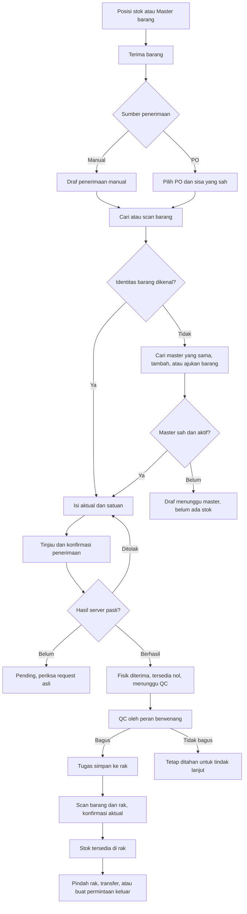
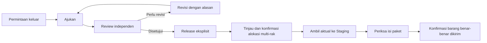

# PRD: ruang kerja stok dan alur barang terpandu

ID: WMS-PRD-STOCK-WORKSPACE-20261104. Versi: 1.0 draft untuk review. Tanggal: 4 November 2026.

Sumber: [audit menyeluruh](2026-11-04-workflow-audit.md), keputusan pengguna pada chat ini, [PRODUCT.md](../../PRODUCT.md), dan kontrak aplikasi saat ini. [Spesifikasi desain](../superpowers/specs/2026-11-04-stock-workspace-design.md) menerjemahkan PRD ke layar dan interaksi. Dokumen ini menentukan perilaku yang dituju, bukan bukti bahwa fitur sudah tersedia.

## 1. Masalah dan hasil yang dituju

Pengguna dapat mendaftarkan barang tetapi tidak tahu cara meneruskannya ke QC atau pengeluaran. Penerimaan bergantung pada PO; berbagai tahap meminta pengguna membuka modul lain dan menemukan ulang dokumen. Error global dapat kehilangan konteks. Beberapa fungsi terlihat selesai walaupun belum tersimpan.

Hasil yang dituju: pengguna bekerja dari barang/posisi/dokumen yang terlihat, memilih tindakan yang sesuai, melihat prasyarat dan dampak, mengonfirmasi secara eksplisit, lalu meneruskan dokumen yang sama. Proses rutin tidak menuntut hafalan nama menu WMS.

### Keputusan pengguna yang sudah pasti

- Penerimaan manual boleh dilakukan tanpa PO ERP.
- Posisi stok menjadi titik aksi utama; tabel dan form ditampilkan bersama melalui panel samping.
- Barang belum terdaftar harus dapat dibuat/diajukan dari alur penerimaan.
- Ganti fungsi tidak efisien berdasarkan audit; pertahankan yang efektif.
- Hasil pekerjaan saat ini adalah audit, PRD dan desain, kemudian ditinjau sebelum implementasi.

### Sasaran pengguna dan penggunaan

Operator mencatat aktual, memindahkan fisik dan melanjutkan pekerjaan; supervisor/admin menangani QC, persetujuan dan master sesuai kontrak saat ini; viewer membaca tanpa posting. Satu orang dapat memegang peran yang berbeda di gudang berbeda. Jangan menganggap peran dari satu gudang berlaku di semua gudang.

## 2. Scope dan batas

| Termasuk | Tetap dipertahankan | Di luar scope |
|---|---|---|
| Panel aksi stok; penerimaan manual/PO; barang belum dikenal; perpindahan rak; perjalanan penerimaan/order; perbaikan temuan audit | Inventory Core; ledger/outbox/audit; scope/versi/idempotency; QC hold; blind count; konfirmasi fisik; hak reviewer; katalog; identitas lengkap; ekspor | Pembelian/keuangan ERP; auto-approve; stok dari scan/RFID saja; mengganti IdP; implementasi perangkat; sertifikasi; klaim UAT; rebrand |

Satu halaman berarti satu konteks kerja yang berlanjut. Tahap yang mengubah stok, persetujuan dan pengiriman tetap memerlukan tindakan sah masing-masing. Menutup atau membuka panel tidak mengubah stok.

Usulan tambahan yang belum merupakan keputusan pengguna diberi kata **default usulan**. Implementer tidak boleh menganggapnya sebagai perubahan kebijakan klien yang sudah disetujui.

## 3. Alur utama

## 4. Struktur ruang kerja

**Posisi stok** tetap tabel berkelompok per gudang/SKU, dengan detail posisi. Aksi per baris membuka panel. Header menyediakan Terima barang agar pengguna tetap dapat memulai ketika stok kosong. Master tidak berubah menjadi saldo stok.

**Barang masuk** menjadi satu katalog penerimaan dengan detail tahap Terima, QC, Simpan ke rak dan Riwayat. Antrean QC/penempatan tetap dapat dipakai sebagai filter pekerjaan berdasarkan peran dan membuka panel dokumen yang sama.

**Barang keluar** menjadi satu katalog order dengan tahap Permintaan, Review, Alokasi, Ambil, Kirim dan Riwayat. Pembatalan berada pada order terkait. Persetujuan dan release tidak digabung menjadi efek tersembunyi.

**Transfer, retur dan opname** tetap punya dokumen/aturan masing-masing, tetapi dapat dimulai dari konteks stok atau sumber yang benar. **Kontrol** menautkan pending dan kasus ERP dengan semantik pemulihan berbeda. **Master, pengguna, perangkat dan pengaturan** tetap terpisah dari langkah rutin.

Default usulan: kurangi navigasi tingkat atas menjadi Persediaan, Barang masuk, Barang keluar, Operasi gudang, Kontrol dan Administrasi. Rute lama tetap menjadi alias/filter menuju konteks baru; jangan menghilangkan kemampuan yang masih berguna. Tidak perlu menambah dashboard metrik atau sistem tugas generik untuk memenuhi kebutuhan ini.

## 5. Persyaratan fungsional

| ID | Prioritas | Persyaratan dan hasil yang wajib terlihat | Temuan |
|---|---|---|---|
| FR01 | P0 | Posisi stok menyediakan Terima barang dan aksi per barang/posisi dalam panel samping. Pilih parent SKU tidak boleh diam-diam memilih posisi pertama. | F02,F26,F28 |
| FR02 | P0 | Penerimaan baru menawarkan Manual dan Dari PO. Manual tidak memerlukan ERP, tidak menciptakan PO palsu dan tidak menggunakan opening balance. Draf tidak mengubah stok. | F01 |
| FR03 | P0 | Pencarian/scan tidak dikenal menampilkan Cari barang yang sudah ada, Tambah barang baru atau Ajukan barang baru sesuai hak. Identitas yang belum terselesaikan memblokir konfirmasi receipt, bukan menghapus draf. | F03 |
| FR04 | P1 | Sesudah master berhasil dibuat, barang langsung terpilih pada draf asal. Nama, SKU, satuan dan barcode sah terisi dari master. Jumlah aktual dan verifikasi scan tetap input eksplisit. | F02,F03 |
| FR05 | P1 | Panel menyimpan gudang, SKU, posisi, receipt/order/line/task, versi dan return context. Tautan lanjut membuka tugas yang terkait, bukan tugas pertama. | F04,F20 |
| FR06 | P1 | QC menunjukkan jumlah diterima, bagus, tidak bagus dan belum diklasifikasikan. Review hanya aktif ketika klasifikasi seluruh sisa tugas seimbang. Tugas belum lengkap dapat disimpan sebagai draf. | F07,F08 |
| FR07 | P1 | Satuan asli dan aturan presisi yang sah muncul pada input, review, ledger, label terkait dan ekspor. Validasi client tidak boleh membatasi semua item menjadi integer. | F06 |
| FR08 | P1 | Draf tersimpan mempunyai status keberhasilan nyata dan dapat dibuka ulang sesuai scope. Gagal simpan mempertahankan isian; jangan memakai toast sukses sebagai pengganti persistence. | F09,F18 |
| FR09 | P1 | Error terikat aksi/dokumen, menyebut objek, kebutuhan, ketersediaan dan pemulihan bila datanya diketahui. Banner lama tidak mengikuti navigasi yang tidak terkait. Pending/unknown tetap dapat ditelusuri. | F05,F26 |
| FR10 | P1 | Order perlu revisi bisa diedit dan diajukan kembali dengan versi baru, alasan serta reviewer historis. Pembuatan ulang order bukan satu-satunya solusi. | F10 |
| FR11 | P1 | Alokasi satu order dapat memakai beberapa posisi dalam satu transaksi atomik. Partial order policy tidak disamakan dengan jumlah rak sumber. | F11 |
| FR12 | P1 | Pindah rak memerlukan posisi asal eksplisit, tujuan sah, aktual, verifikasi dan review. Awal V1 hanya stok bagus yang belum dipesan pada storage aktif yang tidak dibekukan. | F28 |
| FR13 | P1 | Deactivation menampilkan ketergantungan terbuka dan tidak menelantarkan tugas lama. Default usulan: blokir nonaktif jika masih ada receipt/QC/putaway/order/label atau kebutuhan operasional aktif yang mengandalkan item; tampilkan detail penghalang. | F12 |
| FR14 | P1 | Riwayat tetap tersedia ketika stok nol. Total ledger yang disebut seluruh filter dihitung untuk seluruh filter oleh server, bukan satu halaman. Satuan tidak dicampur. | F13,F14 |
| FR15 | P1 | Kasus ERP dapat dicari sampai kasus lama, dengan pagination server dan filter needs attention. Jumlah kasus dan hasil daftar memakai scope yang sama. | F15 |
| FR16 | P1 | Editor akses menampilkan role per gudang dan review perubahan yang tepat. Menyimpan tanpa perubahan tidak boleh mengubah role campuran. Individual dan bulk memakai kemampuan yang sama. | F16,F17 |
| FR17 | P1 | Respons sukses hanya setelah hasil persistence diketahui. Label membedakan file dibuat, riwayat tercatat dan pencetakan fisik. Catatan tindak lanjut terkait kasus asli. | F18 |
| FR18 | P2 | Master lokasi membaca status operasional yang benar; kemasan dapat dicari untuk seluruh daftar; pengaturan perangkat tidak memenuhi layar pekerjaan label rutin. | F19,F21 |
| FR19 | P1 | Pending menyediakan ringkasan bisnis dan tindakan pemulihan tunggal yang aman. Offline, unknown, rejected, conflict dan confirmed mempunyai pesan/tindakan berbeda. | F22 |
| FR20 | P2 | RFID tetap opsional dan diberi status pilot. Capture operasional masa depan harus memulai dari dokumen sah, mempertahankan sesi/sumber dan tidak memposting stok dari jumlah bacaan. | F23 |
| FR21 | P1 | Desktop mempertahankan tabel dan panel. Pada layar sempit panel menjadi subview layar penuh yang mempertahankan return context. Tabel tetap punya region horizontal berlabel dan dapat difokuskan. | F24 |
| FR22 | P2 | Pencarian ketik didebounce atau disubmit secara sengaja, read usang dibatalkan, scanner dapat submit kode lengkap segera. Tindakan tulis tidak dibatalkan atau diulang otomatis mengikuti pencarian. | F25 |
| FR23 | P1 | Retur dipilih dari pengiriman/QC sumber yang diizinkan, dengan jumlah yang masih boleh diretur. Pembatalan setelah picking membuat tugas kembali ke rak sebelum melepas komitmen. | F27 |
| FR24 | P1 | Seluruh fungsi efektif dalam matriks audit tetap tersedia melalui route/filter yang jelas; penggabungan presentasi tidak menghapus evidence, ekspor atau aturan domain. | seluruh audit |

## 6. Barang belum terdaftar

### Resolver dan tambah ringkas

Ketika kode/nama belum cocok, tampilkan “Barang belum ditemukan” di dekat input, berikut nilai yang dicari. Jangan menyatakan scanner rusak atau membuat master otomatis dari barcode yang tidak diketahui. Cari kandidat nama/SKU/barcode dalam scope yang sah, termasuk barang nonaktif dengan label yang benar, untuk mencegah duplikasi.

Form ringkas: nama barang, SKU unik, satuan dasar dan barcode yang diketahui. Kategori opsional; dimensi, berat dan foto tersedia lewat Detail tambahan. Barcode beserta nol awal dipertahankan verbatim. Bila barang tidak punya barcode, pengguna memilih secara eksplisit Buat kode internal; jangan mengklaim GTIN resmi. Default usulan SKU dapat dibuat otomatis hanya melalui pilihan yang terlihat, tanpa mengganti SKU yang sudah ada.

Admin/supervisor yang berwenang dapat membuat master dari subview di panel yang sama. Operator yang tidak mempunyai hak master memakai Ajukan barang baru. Proposal mempunyai owner/gudang, isian, kode hasil scan yang belum dipetakan, alasan dan status diajukan/disetujui/perlu perbaikan. Pengajuan tidak memberi hak master tambahan dan tidak menambah stok. Setelah disetujui, reviewer menghubungkan proposal ke master baru atau master yang ternyata sudah ada. Draf receipt asal mempertahankan jumlah, sumber dan baris lain; pengguna memeriksa ulang barang sebelum konfirmasi.

Jika barang sebenarnya sudah ada tetapi barcode baru belum dipetakan, cari dan pilih master yang benar. Verifikasi memakai kode terdaftar atau jalur konfirmasi manual yang berwenang, tidak memalsukan scan. Perubahan mapping harus lewat tindakan master berwenang dengan review dampak. Dukungan alias barcode tambahan adalah fase tersendiri bila model saat ini belum mendukung; jangan diam-diam mengganti barcode lama saat pengguna hanya menerima barang.

Race: dua orang membuat SKU/barcode sama harus menghasilkan satu identitas canonical atau respons konflik yang dapat diselesaikan dengan memilih master yang ada. Kode yang cocok dengan beberapa identitas harus dihentikan sebagai konflik mapping, bukan memilih hasil pertama.

## 7. Penerimaan manual dan lineage

Default usulan V1: satu header penerimaan mendukung beberapa baris SKU. Ini membutuhkan perluasan model; source saat ini mempunyai satu ItemId per dokumen. Jika implementasi dimulai dengan satu baris, hal itu harus dinyatakan sebagai fase terbatas, tidak ditampilkan sebagai penerimaan multi-item yang sudah lengkap.

| Data | Aturan |
|---|---|
| Identitas receipt/line | ID stabil sebelum posting; sourceType manual/erp-po/transfer/customer-return tidak ambigu |
| Sumber manual | Asal barang dan alasan penerimaan tanpa PO; nomor surat jalan/referensi bila ada. Jangan menciptakan supplier/PO fiktif. Jika referensi tidak ada, tampilkan status itu secara jujur. |
| Waktu | Waktu kejadian dalam zona gudang dan waktu posting server berbeda; simpan instant UTC dan zona/offset yang diperlukan |
| Baris | Identitas master aktif, actual qty positif, base unit dan presisi; kuantitas tidak terisi dari jumlah rencana atau scan total |
| Konversi | Default V1 memakai base unit. Bila unit kemasan ditambahkan, snapshot faktor konversi berversi dan qty dasar menjadi evidence permanen. |
| Review | Barang, jumlah, satuan, sumber, tujuan Receiving, QC hold dan siapa yang dapat memeriksa |
| Hasil pasti | Receipt/transaction ID, timestamp, baris yang diterima dan task QC terkait dikembalikan server |

Konfirmasi manual memposting aktual per dokumen secara atomik. Semua baris ditinjau; satu baris invalid/stale menggagalkan posting dokumen tanpa perubahan sebagian tersembunyi. Split delivery manual dibuat sebagai receipt lain yang boleh berbagi referensi bisnis dengan peringatan duplikasi; tidak mengarang “sisa PO” untuk manual. Penerimaan dari PO tetap menghormati sisa PO dan versi sumber.

Pada posting berhasil: fisik bertambah di Receiving, condition unassessed, hold awaiting-qc, tersedia tetap nol. Buat child QC per baris dan immutable linkage dari receipt → receipt line → posting → QC → putaway. Riwayat menampilkan partial putaway, barang ditahan, aktor dan waktu.

Saat contoh 30 unit diterima, QC 24 bagus/6 tidak bagus, kemudian 24 disimpan ke rak: fisik total 30, available 24, rejected hold 6. Memindahkan 5 dari rak A-01 ke A-02 mempertahankan fisik gudang 30 dan available total 24. Tidak ada penambahan stok karena membuka panel atau menyimpan master.

Model posisi sekarang menggabungkan item/lokasi/kondisi/hold. Link dokumen membuktikan kuantitas dan asal transaksi, **bukan** lot fisik individual. Batch/serial, kedaluwarsa, recall per lot dan pemisahan stok per pemasok tidak boleh dijanjikan tanpa keputusan dan model tambahan.

Pencocokan receipt manual dengan PO ERP yang datang belakangan adalah rekonsiliasi metadata. Ia tidak memposting actual kedua kali atau menandai PO diterima tanpa rekonsiliasi yang sah. Kebijakan/counterpart ERP dan pajak/pembelian tetap di sistem pemiliknya.

## 8. Panel aksi: tujuan dan proses yang sah

| Konteks | Aksi yang tersedia | Penghalang yang harus dijelaskan |
|---|---|---|
| Master tanpa stock position | Terima barang, ubah master sesuai hak | “Belum ada stok fisik untuk dipindahkan” |
| Receiving awaiting QC | Buka tugas QC terkait / lihat status | Role QC diperlukan; tersedia nol |
| Good Receiving dengan putaway task | Simpan ke rak lewat tugas itu | Rak nonpickable/frozen tidak sah |
| Stok bagus di rak | Pindah rak, transfer gudang, buat permintaan keluar, riwayat, label | Kuantitas yang dipesan/ditahan/frozen tidak bebas dipindah |
| Stok reserved / Staging | Buka order dan tahap pengambilan/pengiriman | Perubahan harus mengikuti order dan allocation |
| QC rejected / hold | Lihat alasan, sumber, tindak lanjut atau retur supplier yang sah | Tidak boleh diubah menjadi bagus lewat dropdown tujuan |
| Frozen untuk opname | Buka status tugas bila berwenang | Aksi stok diblokir; saldo blind count tidak dibocorkan |
| Sudah shipped / qty nol | Riwayat dan retur pelanggan dari source shipment | Tidak ada stok di rak untuk dipindahkan |

Pindah rak V1 hanya antar storage yang sah pada gudang sama, kondisi/identitas tetap, sumber unreserved. Tidak boleh memilih Receiving/QC/Staging untuk melewati workflow. Transfer gudang tetap send → in-transit → receive → QC; satu pemilihan tujuan tidak berarti penerimaan target sudah terjadi.

Panel membedakan posisi dari jumlah agregat SKU. Untuk SKU di beberapa lokasi, tampilkan posisi asal yang eligible dan jumlah bebas masing-masing. Default usulan V1: satu tindakan relokasi fisik per dokumen/barang; checkbox multi-item yang sudah ada tetap untuk ekspor/label, bukan mass posting tanpa review. Relokasi multi-item berikutnya harus punya review per baris dan hasil yang jelas.

## 9. Order, alokasi dan pengiriman

Status order: draft → pending review → needs revision atau approved → released. Needs revision menyimpan alasan dan mengizinkan submit versi revisi. Reviewer tidak boleh pembuat; release tetap aksi terpisah yang berwenang.

Alokasi menghitung kebutuhan, posisi eligible dan kekurangan dalam satuan yang benar. Default usulan memilih kandidat posisi secara deterministik tanpa mengklaim FEFO/FIFO jika data umur/lot belum ada. User meninjau rencana beberapa rak, server memvalidasi ulang dan mengunci posisi. Order 10 dari rak 6+4 harus dapat dialokasikan penuh secara atomik saat partial fulfilment dilarang. Jika total hanya 8, tidak mencatat 8 diam-diam; jelaskan kurang 2 dan tindakan sah menurut kebijakan gudang.

Picking mencatat aktual yang ditemukan; short pick butuh alasan dan tidak menghapus fisik sisa secara otomatis. Shipment memerlukan stok Staging yang sesuai, pengecekan paket, kebijakan parsial dan konfirmasi keberangkatan. Packing plan yang diekspor tidak menjadi bukti barang sudah keluar.

## 10. Hak, state dan kontrak keselamatan

| Aksi | Operator | Supervisor/Admin | Viewer |
|---|---|---|---|
| Lihat stok/dokumen | Dalam scope dan aturan blind count | Dalam scope | Read-only dalam scope |
| Buat draf dan konfirmasi receipt | Ya, sesuai kewenangan operasional saat ini | Ya | Tidak |
| Tambah master langsung | Tidak secara default | Ya, sesuai scope | Tidak |
| Ajukan barang baru | Default usulan: ya, proposal saja | Dapat meninjau | Tidak |
| QC | Menunggu peran berwenang | Ya sesuai kontrak saat ini | Tidak |
| Putaway, pindah rak, pick, ship | Sesuai capability dan prasyarat server | Sesuai capability | Tidak |
| Review order/count | Tidak sebagai operator/pembuat/penghitung | Sesuai policy, bukan diri sendiri | Tidak |
| Kelola grant | Tidak | Admin yang berwenang atas gudang target | Tidak |

Tabel adalah batas desain; implementasi memakai capability dari server untuk tindakan/objek/gudang saat ini, bukan role global dari tampilan. Hak harus dicek lagi saat dispatch dan setelah perubahan peran/gudang.

| State | Pesan dan tindakan | Efek stok |
|---|---|---|
| Empty | Jelaskan sebab; mulai receipt/pilih sumber sesuai konteks | Tidak ada |
| Draft | Belum dikonfirmasi; simpan dengan hasil nyata | Tidak ada |
| Awaiting master | Barang perlu didaftarkan/disetujui, draf tetap tersedia | Tidak ada |
| Loading | Tandai data yang sedang diperiksa, tahan review pada data usang | Tidak ada |
| Review | Tampilkan delta dan dokumen, tombol konfirmasi spesifik | Belum ada |
| Submitting | Tahan dispatch kedua; request ID sudah tersimpan | Hasil belum diketahui |
| Offline unsent | Belum dikirim, kirim maksud asal setelah online dan review akses | Belum dikonfirmasi |
| Unknown | Server mungkin sudah memposting; Periksa hasil dahulu | Jangan menyimpulkan gagal atau menambah ulang |
| Rejected | Jelaskan alasan, draf dapat dikoreksi dengan maksud baru bila sesuai | Tidak ada posting dari penolakan pasti |
| Conflict | Tampilkan perubahan relevan dan minta review ulang; jangan auto-overwrite | Tidak ada tambahan otomatis |
| Confirmed | ID dan waktu server, delta aktual, link tugas berikutnya | Sesuai hasil server |
| ERP pending/failed | WMS tetap confirmed, status integrasi terpisah | Tidak repost stok |
| Access revoked | Tahan aksi, pertahankan draf sesuai kebijakan tanpa menampilkan data di luar hak | Tidak ada dispatch baru |

Aturan wajib: request ID/payload/owner/gudang/expectedVersion asal bertahan pada retry; check unknown read-only; 404 hasil bukan bukti pasti gagal. Server mengesahkan semua stok. Jangan membersihkan antrean pending hanya untuk merapikan banner.

Draf baru perlu persistence berversi. Default usulan: draft dokumen yang terselesaikan memakai server, sedangkan isian offline memakai penyimpanan scoped; owner dan gudang selalu terlihat. Nilai waktu retensi belum disetujui. Rilis persistence offline wajib menetapkan konfigurasi retensi/perangkat; jangan menambahkan angka hari sembarang. Logout/login orang lain tidak boleh mengirim atau membuka pending/draf milik orang sebelumnya. Konflik draf server/lokal harus diminta review, bukan last-write-wins tersembunyi.

## 11. Data dan integrasi yang perlu diperluas

Ini kebutuhan kontrak baru, bukan klaim endpoint sudah ada. Nama route/tabel final dapat dipilih implementer tanpa mengubah semantik.

- Receipt header/line, item proposal, linked task graph dan scoped draft version. Legacy dokumen satu-item menjadi header satu-line secara kompatibel; ID/history eksternal tidak diganti atau dipendekkan.
- Capability/action response berisi aksi eligible dan blocker code yang dapat diterjemahkan. Jangan mengirim saldo blind count atau data gudang tak berwenang sebagai bahan menentukan UI.
- Command manual receipt, relocate unreserved storage, revise/resubmit order dan atomic multi-position allocation. Read-only preview boleh menghitung rencana, tetapi tidak menjamin stok terkunci sebelum konfirmasi.
- Command result menyediakan source document, resulting positions/delta, generated child tasks dan canonical identifiers. New business reference IDs mengikuti helper 16 karakter yang ada; technical UUID tetap kontraknya.
- Ledger filtered aggregates per unit; paginated item history; full exception catalogue ERP; warehouse-role matrix dan label persistence result yang tegas.
- Outbox event manual receipt memakai sourceType yang benar. Rekonsiliasi ERP tidak menggandakan movement atau mengubah posted receipt menjadi dokumen pembelian.

Migrasi additive, backfill dapat diulang, pemeriksaan lineage dan konservasi sebelum switch. Feature flag untuk writer baru; jangan mengaktifkan dua writer atas maksud yang sama. Dokumen yang sudah diposting tidak diubah dengan edit/delete; koreksi memakai proses kompensasi yang ditinjau dan memperhitungkan penggunaan stok sesudahnya.

## 12. Kriteria penerimaan

Target berikut harus dibuktikan oleh implementasi baru. Belum dijalankan pada pekerjaan desain ini.

| AC | Skenario dan hasil yang diharapkan | FR |
|---|---|---|
| AC01 | Simpan master baru: saldo tidak berubah; Terima barang membawa item ke draf yang benar | 01,04 |
| AC02 | Gudang kosong, ERP tidak terhubung: operator berwenang dapat membuat receipt manual tanpa PO palsu | 02 |
| AC03 | Barcode belum dikenal: tampilkan resolver, draf sumber/aktual tetap utuh ketika membuka lalu membatalkan tambah barang | 03,08 |
| AC04 | Admin/supervisor membuat item ringkas: kembali ke baris asal, item terpilih, qty/scan tidak direkayasa | 03,04 |
| AC05 | Operator mengajukan item: tidak mendapat hak master; receipt belum bisa diposting sampai identitas sah; keputusan ditautkan ke draf asal | 03,16 |
| AC06 | SKU/barcode duplikat atau dibuat serentak: tidak terbentuk master ganda dan tidak memilih kandidat ambigu diam-diam | 03 |
| AC07 | Receipt manual multi-line: salah satu baris stale/invalid menggagalkan seluruh posting dan menyimpan draf untuk koreksi | 02,05 |
| AC08 | Terima 30: fisik 30, available 0; QC 24/6; putaway 20 lalu 4: available 20 lalu 24, held 6 | 02,06 |
| AC09 | QC 20+5 dari tugas 30: review diblokir, tampilkan belum diklasifikasikan 5; nol kategori diterima jika total seimbang | 06 |
| AC10 | Dua receipt SKU sama: lanjut QC/putaway membuka child task receipt yang dipilih, selesai tetap ada pada timeline | 05 |
| AC11 | Input 0,5 kg atau format locale yang sah: diparse tepat, presisi sesuai unit dan tidak diubah menjadi 5/0; review/export memakai kg | 07 |
| AC12 | Pindah 5 dari A-01 ke A-02: source/destination benar, fisik gudang dan total available tidak bertambah | 12 |
| AC13 | Pindah dari parent multi-posisi meminta source eksplisit; frozen/held/reserved/Receiving/QC/Staging tidak bisa dilewati lewat relokasi | 01,12 |
| AC14 | Konfirmasi ganda/concurrent replay satu request: satu posting, satu hasil canonical dan child task/event tidak dobel | 02,12,19 |
| AC15 | Respons hilang sesudah commit: unknown terlihat; check read-only; retry identitas sama tidak menggandakan stok | 19 |
| AC16 | Akses dicabut/gudang diganti/versi berubah sebelum dispatch: aksi ditahan dan draf asal tidak berpindah scope | 05,08,16 |
| AC17 | Reload/tab dibuka kembali: draf yang diklaim tersimpan dapat dipulihkan; kegagalan simpan tidak menampilkan sukses | 08,17 |
| AC18 | Keluar akun lalu akun lain: tidak membuka/mengirim pending atau draf owner sebelumnya | 08,19 |
| AC19 | Order needs revision: pembuat memperbaiki dan submit versi baru; tetap tidak bisa approve sendiri | 10 |
| AC20 | Order 10, rak 6+4, partial=false: alokasi penuh atomik berhasil; pesaing serentak tidak membuat available negatif | 11 |
| AC21 | Total available 8 untuk order 10, partial=false: tampil kurang 2, tidak ada partial write tersembunyi | 09,11 |
| AC22 | Short pick dan cancel setelah picking: sisa fisik/komitmen terjaga, return task wajib sebelum pelepasan yang memerlukannya | 23 |
| AC23 | Nonaktif item dengan pekerjaan terbuka: tampil dependencies dan blokir sesuai policy; tidak ada tugas stranded | 13 |
| AC24 | Barang qty nol dan >25 ledger rows: riwayat tetap dapat ditemukan; aggregate seluruh filter stabil saat ganti halaman | 14 |
| AC25 | Satu kasus ERP gagal di belakang >200 event selesai: tautan monitoring menemukan kasus lama itu | 15 |
| AC26 | User Operator gudang A dan Viewer gudang B: simpan tanpa edit mempertahankan keduanya; single/bulk authority konsisten | 16 |
| AC27 | File label berhasil tetapi history gagal: jelaskan dua hasil, jangan mengklaim printed; retry tidak mengganti mapping | 17 |
| AC28 | Kemasan kedua/ke-100 dapat dicari dan direvisi dengan versi; tidak menambah stok dari membership | 18 |
| AC29 | RFIDs dibaca ganda/parent-child bersamaan: tetap observation; dokumen expected dan transaksi confirmation terpisah | 20 |
| AC30 | Keyboard membuka, menutup dan kembali dari panel; fokus pulih; form error terbaca; 390px subview tidak memotong footer | 21 |
| AC31 | Ketik cepat dan scan lengkap: read terbaru menang, request usang dibatalkan; draft transaksi tidak hilang | 22 |
| AC32 | Retur memilih source shipment sah dan remaining returnable; source tidak sah atau di luar gudang ditolak | 23 |
| AC33 | Penghitung blind count tidak memperoleh expected balance lewat panel, riwayat, preview, ekspor atau pilihan tindakan | 16,24 |
| AC34 | Menautkan receipt manual ke PO belakangan tidak menambah movement lagi; ERP failed tidak membatalkan WMS diam-diam | 02,15 |
| AC35 | Empty state, error bisnis, unknown, conflict, unauthorized dan success memakai copy yang berbeda serta tindakan yang benar | 09,19,21 |
| AC36 | Bookmark/rute lama membuka dokumen/filter setara; kembali dari panel mempertahankan search, sort, halaman dan scroll sesuai aturan seleksi | 05,24 |

## 13. Pengukuran keberhasilan dan rollout

Baseline pengguna belum diukur. Usulan kriteria usability pilot: peserta menyelesaikan receipt manual → QC → putaway, barang belum terdaftar, pindah rak dan order → kirim tanpa arahan navigasi dari fasilitator. Ukur task completion, kesalahan memilih dokumen/posisi, intervensi fasilitator, jumlah entry ulang dan waktu per tugas. Target numerik ditetapkan sesudah baseline; jangan mengklaim persentase peningkatan sekarang.

Urutan pembangunan yang diusulkan:

1. **Fondasi konteks dan correctness:** capability, lineage, unit, error, draft semantics, revise/resubmit, multi-bin dan ringkasan benar. UI baru tidak menutupi masalah source.
2. **Perjalanan utama:** panel stok, receipt manual, resolver master, QC/putaway terhubung, relokasi rak dan detail order terpadu.
3. **Alur pendukung:** retur/transfer picker, riwayat, pending/ERP, kemasan/label, grant editor. F16/F17/F18 berprioritas tinggi tidak perlu menunggu perombakan visual semua modul.
4. **Verifikasi:** kontrak/domain test, review konkurensi/migrasi, browser tiap role/tema/breakpoint, uji pengguna, kemudian perangkat/integrasi/UAT terpisah.

Rute lama diarahkan kompatibel dahulu. Jangan menghapus fitur lama sampai kemampuan pengganti, evidence, hak akses, ekspor dan recovery setara terbukti. Rollback mematikan writer baru dan mengembalikan entry point yang kompatibel; transaksi yang sudah diposting tidak dihapus untuk rollback UI.

## 14. Keputusan terbuka dan default desain

| Topik | Default usulan untuk rancangan | Batas sebelum rilis |
|---|---|---|
| QC parsial | Tetap seluruh sisa child task, sesuai kontrak sekarang; draf klasifikasi boleh belum lengkap | Perubahan partial QC perlu keputusan eksplisit |
| Presisi satuan | Hormati kontrak sampai 6 desimal; konfigurasi granular unit masih terbuka | Tetapkan presisi bisnis dan aturan locale |
| Partial fulfilment | Jangan otomatis mengaktifkan; gunakan policy gudang yang sah | D02 produksi harus ditutup sebelum menjanjikan parsial |
| Deactivation | Blokir dengan daftar pekerjaan terbuka | Pastikan dependency query lengkap |
| Master operator | Proposal saja; create tetap peran berwenang | Jangan memberi master privilege lewat receipt |
| Multi-line receipt | Model header/lines pada V1 lengkap | Migrasi satu-item dan atomicity harus dibuktikan |
| Pindah stok reserved/held | Di luar relokasi V1; buka order/hold workflow terkait | Tidak menawarkan shortcut status |
| Draft retention | Scoped dan configurable, tanpa angka hari rekaan | Policy perangkat, privasi dan retensi wajib ditetapkan |
| Lot/batch/serial | Tidak dijanjikan oleh linkage transaksi saja | Bila wajib di lapangan, perluasan model sebelum go-live |
| Lampiran / mitra supplier | Bukan syarat V1; teks sumber dan referensi yang jujur cukup | Ukuran/storage/permissions ditentukan jika ditambahkan |

Default ini adalah proposal yang dapat ditinjau pada desain, bukan keputusan klien yang direka. Dokumen siap dipakai untuk review ruang lingkup; pembangunan dimulai setelah desain disetujui dan rencana implementasi dibuat.
