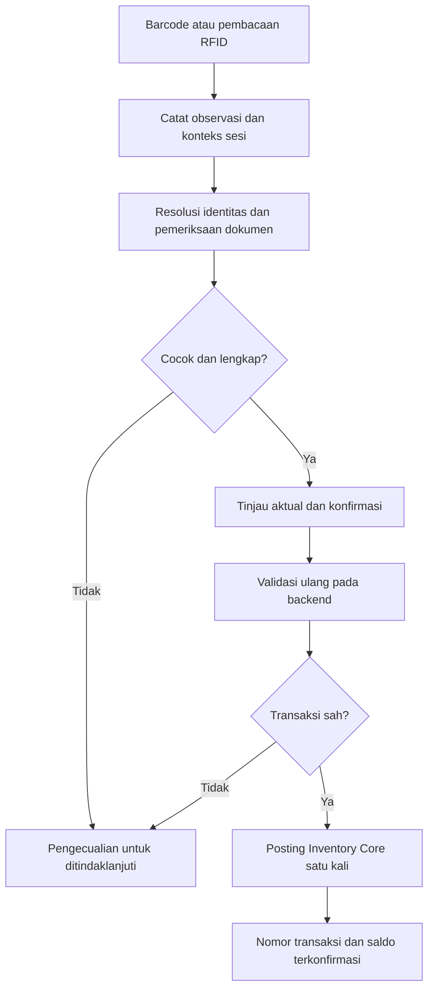

# PRD Tracker Barang Masuk dan Keluar

Barcode dan RFID untuk Inventory + Warehouse Management System

ID: INV-TRK-PRD-001. Versi: 0.1. Tanggal: 28 Oktober 2026.

Status: **Draf kebutuhan; belum diimplementasikan**. Pemilihan perangkat, teknologi identifikasi dan lingkup pilot masih terbuka. Seluruh skenario penerimaan belum dijalankan.

Sumber kebutuhan: permintaan pengguna untuk tracker barang masuk dan keluar dengan pilihan RFID atau barcode. Dokumen ini melengkapi [PRD Inventory + WMS](01-product-requirements.md), khususnya FR-01, FR-02, FR-04 sampai FR-11, FR-13 sampai FR-16. Aturan stok tetap mengikuti PRD induk, [TRD](02-technical-requirements.md), dan [Backend Schema](05-backend-schema.md).

## 1. Tujuan dan hasil yang diharapkan

Operator mencatat barang yang diterima, dipindahkan dan dikirim melalui scan. Supervisor dapat menelusuri jumlah, lokasi terakhir yang dikonfirmasi, kondisi, pelaku serta dokumen sumber setiap mutasi. Sistem menunjukkan selisih antara barang yang diharapkan dan aktual, lalu mengarahkan penyelesaiannya.

Produk harus menjawab:

- Barang apa yang masuk atau keluar, berapa jumlahnya dan dalam satuan apa?
- Dari mana barang datang, ke mana barang dikirim, dan dokumen apa yang mendasarinya?
- Siapa yang mengonfirmasi dan kapan backend membukukan mutasinya?
- Untuk barang dengan identitas unik, unit atau kemasan mana yang berpindah?
- Scan mana yang masih pending, ditolak, atau memerlukan pemeriksaan?

Tracking pada draf ini berbasis kejadian penerimaan, perpindahan dan pengiriman. Posisi stok mengikuti transaksi yang dibukukan. Pembacaan RFID terbaru tampil sebagai **terakhir terdeteksi**, terpisah dari **lokasi stok terkonfirmasi**. Pembacaan di dekat pintu belum membuktikan barang masuk atau keluar.

## 2. Pilihan teknologi dan usulan tahap awal

**Usulan: mulai dengan barcode untuk MVP, lalu uji RFID jika pembacaan banyak barang sekaligus menjadi kebutuhan.** Usulan ini merupakan keputusan rancangan sementara berdasarkan alur WMS yang sudah tersedia. Jenis barang, volume dan kondisi gudang belum diketahui, sehingga belum ada dasar memilih merek perangkat, menghitung biaya, atau menjanjikan peningkatan kecepatan.

Barcode adalah pembawa data yang dibaca secara optik. GS1 menyediakan format untuk identitas produk maupun atribut seperti serial dan batch. RFID dapat membaca beberapa tag tanpa garis pandang langsung ke tiap label. Kemampuan tersebut perlu dibuktikan pada susunan barang dan area baca proyek ini. Sumber: [GS1 Barcodes](https://www2.gs1.org/standards/barcodes), [GS1 Australia EPC/RFID](https://www.gs1au.org/standards/barcodes/epc-rfid).

| Aspek | Barcode / kode 2D | RFID pasif UHF, sebagai kandidat pilot |
|---|---|---|
| Cara operator bekerja | Arahkan scanner ke label, cocokkan item dan aktual | Buka sesi baca, kumpulkan tag, cocokkan hasil unik terhadap dokumen |
| Kebutuhan yang dituju | Pencatatan terarah per barang, kemasan atau lokasi | Pembacaan kelompok barang atau kemasan dalam area yang dikendalikan |
| Komponen yang perlu dievaluasi | Scanner, label, printer jika perlu, perangkat operator | Tag, reader, antena, gateway/SDK, instalasi dan label cadangan |
| Hal yang harus diuji | Keterbacaan, ukuran label, fokus input, jenis simbol dan satuan | Tag terlewat, pembacaan area sebelah, arah lintasan dan interferensi |
| Identitas | Dapat menunjuk SKU atau unit unik, sesuai isi kode | Tag dipetakan ke unit atau kemasan tertentu, sesuai level tracking |
| Dampak ke stok | Backend memvalidasi dan membukukan konfirmasi | Backend memakai aturan posting yang sama setelah hasil baca diselesaikan |

Isi barang dan penempatan label, termasuk logam atau cairan, dapat memengaruhi hasil RFID. Pemilihan tag dan antena harus memakai sampel fisik. Sumber: [Zebra RFID Programming Guide, bagian Maximizing RFID Potential](https://support.zebra.com/cpws/docs/zd500r/RFID%20Prog%20Guide%203%20P1062165-001.pdf).

Pilihan awal bukan komitmen membeli perangkat. Barcode dan RFID boleh dipakai bersama dengan pemetaan ke identitas barang yang sama. Scan melalui dua teknologi tidak boleh membuat dua mutasi untuk unit dan tindakan bisnis yang sama.

## 3. Pengguna dan pekerjaan utama

| Pengguna | Pekerjaan | Hasil yang diperlukan |
|---|---|---|
| Operator receiving | Memilih PO/transfer, scan aktual, mencatat kondisi dan selisih | Penerimaan parsial atau lengkap yang terhubung ke sumber |
| Operator gudang | Scan lokasi, putaway, picking dan transfer | Barang yang benar berpindah dari asal ke tujuan yang benar |
| Operator outbound | Memeriksa barang terhadap order dan mengonfirmasi pengiriman | Aktual terkirim serta sisa order dapat ditelusuri |
| Supervisor | Menangani selisih, label rusak, pembalikan dan approval | Alasan, bukti dan dampak keputusan terlihat |
| Admin master/perangkat | Memetakan kode, mengelola label, perangkat dan area baca | Identitas tidak ambigu; perangkat memiliki lingkup yang jelas |
| Auditor | Mencari barang dan merekonsiliasi mutasi | Riwayat dapat ditelusuri ke scan, dokumen dan posting |

Pembagian peran dan pemisahan pembuat/penyetuju mengikuti D03 pada PRD induk. Tabel ini belum menunjuk orang atau mengesahkan matriks izin final.

## 4. Level tracking dan identitas

Level tracking harus dipilih per jenis barang sebelum implementasi. Memasang barcode atau RFID saja belum menetapkan apakah sistem melacak jumlah, batch, tiap unit, atau kemasan.

| Level | Yang diidentifikasi | Perilaku yang diwajibkan |
|---|---|---|
| SKU dan jumlah | Jenis barang serta satuan/kemasan | Sistem menyimpan jumlah aktual; tidak mengklaim tahu unit fisik tertentu |
| Batch/lot | Kelompok produksi/penerimaan | Mutasi menyimpan batch dan expiry jika diwajibkan |
| Unit unik | Satu barang berserial atau memiliki ID internal unik | Satu unit hanya memiliki satu posisi stok aktif dan satu riwayat identitas |
| Kemasan/logistic unit | Karton, tote atau pallet dengan ID unik | Isi harus tercatat jika scan kemasan akan dipakai untuk mewakili barang di dalamnya |

Aturan identitas:

1. SKU merupakan identitas jenis barang. Barcode produk yang sama pada beberapa unit tidak berubah menjadi serial unik.
2. ID unit internal, serial supplier dan EPC merupakan identifier dengan namespace serta lingkup yang jelas. Sistem menyimpan nilai mentah dan hasil normalisasi, termasuk nol di depan.
3. Satu identifier aktif hanya menunjuk satu objek pada lingkup scan. Pemetaan ambigu ditahan untuk diperbaiki oleh petugas berwenang.
4. Barcode dan EPC dapat menunjuk objek yang sama. Dedup lintas teknologi menggunakan identitas objek tersebut, bukan hanya teks kode.
5. Batch, serial, expiry dan satuan wajib mengikuti kebijakan barang. Operator tidak dapat melewati field wajib dengan scan SKU saja.
6. Penerbitan atau penggantian label tidak mengubah jumlah stok. Penggantian menyimpan alasan, pelaku, hubungan label lama/baru dan penonaktifan identifier lama yang diganti.
7. Scan pallet mewakili isinya hanya jika keanggotaan dan jumlah isi telah dikonfirmasi. Membaca tag pallet saja tidak membuktikan semua isinya hadir.
8. Membaca pallet dan tag barang di dalamnya tidak boleh menjumlahkan isi dua kali. Split/merge kemasan memperbarui keanggotaan dengan riwayat; isi yang belum terkonfirmasi memerlukan pemeriksaan sebelum dipakai untuk posting.

Usulan format MVP: Code 128 untuk kode internal yang sesuai dengan scanner terpilih; dukungan EAN/UPC supplier melalui pemetaan master. QR atau Data Matrix ditambahkan pada lingkup awal bila data dan scanner memerlukannya. QR adalah kode 2D yang diperlakukan sebagai pilihan pembawa data optik di dokumen ini. Kontrak GS1, parser atribut dan format label final mengikuti keputusan T02; kode internal tidak dinyatakan sebagai GTIN resmi.

## 5. Cakupan rilis

| Paket | Cakupan yang diusulkan | Batas penerimaan |
|---|---|---|
| MVP barcode | Master kode, label dan lokasi; scan receiving/outbound; konfirmasi; pencarian riwayat; selisih; pending dan retry; audit serta rekonsiliasi | Alur pada perangkat nyata dan Inventory Core lulus kriteria tracker yang relevan |
| Operasi lanjutan | Transfer/putaway, retur, opname, batch/serial dan kemasan sesuai kebutuhan barang | Memakai modul WMS dan kebijakan yang telah ditetapkan; bukan ledger baru |
| Pilot RFID | Registrasi/penggantian tag, adapter reader, sesi baca, dedup tag, pencocokan dokumen, pengecualian dan konfirmasi operator | Uji fisik memenuhi ambang yang ditetapkan sebelum pilot |
| Otomasi gate | Arah lintasan, pemicu sensor, penguncian dokumen, penanganan pembacaan asing dan pemulihan | Memerlukan keputusan terpisah setelah pilot; tidak termasuk komitmen MVP |

Fitur lanjutan pada barang yang diwajibkan batch/serial tetap menjadi prasyarat pilot barang tersebut. Pembagian paket tidak memberi izin memprosesnya tanpa identitas wajib.

Di luar cakupan awal: pelacakan koordinat terus-menerus/RTLS, GPS di luar gudang, pengenalan barang tanpa label, sistem antimaling, valuasi/invoice, pengadaan perangkat, serta pembukuan final sepenuhnya offline. ERP tetap mengikuti pembagian tanggung jawab pada rancangan WMS.

## 6. Alur barang masuk

1. Operator masuk, memilih gudang, lalu membuka PO atau referensi transfer yang sah. Alur penerimaan tanpa PO hanya tersedia jika kebijakan dan otorisasinya telah ditetapkan.
2. Operator memindai lokasi receiving atau memakai lokasi yang telah ditetapkan dokumen.
3. Operator scan barcode; pada pilot RFID, operator membuka sesi baca untuk satu konteks receiving.
4. Sistem mencocokkan identitas, satuan, batch/serial, kondisi awal dan sisa dokumen. Item tidak dikenal atau tidak cocok masuk daftar pengecualian.
5. Operator meninjau aktual, kekurangan/kelebihan, kondisi serta item yang ditolak. Selisih mengikuti toleransi dan approval yang berlaku.
6. Operator memilih **Konfirmasi penerimaan**. Backend memvalidasi ulang kondisi terbaru dan membukukan aktual ke receiving satu kali.
7. Layar menunjukkan nomor transaksi, aktual diterima dan sisa terbuka. Barang yang memerlukan QC tetap tertahan sesuai kebijakan.
8. Putaway mengonfirmasi perpindahan ke lokasi tujuan melalui tugas WMS. Perpindahan lokasi tidak dihitung sebagai penerimaan eksternal kedua.

Contoh data uji: PO berisi 100 unit, aktual datang 60. Konfirmasi menambah 60 pada receiving dan menyisakan 40 pada PO. Scan atau retry yang mengulang konfirmasi tidak boleh menambah 60 lagi.

## 7. Alur barang keluar

1. Operator membuka order/tugas outbound yang telah dilepas dan memeriksa reservasi serta sumber stoknya.
2. Operator scan lokasi dan barang saat picking. Backend memeriksa barang, batch/serial, kondisi, freeze dan jumlah yang tersedia bagi tugas itu.
3. Picking memindahkan aktual ke staging/packing dan mempertahankan komitmen. Total fisik dalam gudang belum berkurang karena shipment belum dikonfirmasi.
4. Operator mencocokkan barang siap kirim dengan order. Untuk RFID, sesi outbound membandingkan daftar identitas unik dengan daftar yang diharapkan.
5. Salah SKU, unit yang dialokasikan ke order lain, barang kurang, atau tag asing menahan baris terkait. Pengiriman sebagian hanya dapat memakai aktual yang sah; sisa tetap terlacak.
6. Operator memilih **Konfirmasi pengiriman**. Backend memvalidasi ulang dan mengurangi stok pada titik shipment yang ditetapkan WMS.
7. Layar menunjukkan nomor shipment, aktual terkirim dan sisa order. Riwayat mencatat identitas unit jika level tracking mendukungnya.

Contoh data uji: order 10 unit, aktual picking dan siap kirim 8. Shipment mengurangi 8, sedangkan sisa 2 tetap terbuka sesuai kebijakan short pick. Sistem tidak mengisi selisih berdasarkan jumlah order.

Pembatalan sebelum posting membatalkan draf. Setelah picking, pengembalian fisik ke stok mengikuti tugas return-to-stock. Setelah shipment dibukukan, retur atau pembalikan memakai dokumen koreksi yang sah; operator tidak menghapus riwayat shipment.

## 8. Transfer, retur dan stock opname

- **Transfer lokasi:** scan asal, barang dan tujuan. Posting mengurangi asal dan menambah tujuan pada jumlah yang sama, tanpa mengubah total fisik gudang.
- **Transfer antar gudang:** dispatch memindahkan ke perjalanan; receipt mengurangi perjalanan dan menambah tujuan. Sisa yang belum diterima tetap tercatat dalam perjalanan.
- **Retur:** hubungkan ke penerimaan/pengiriman asal, catat aktual dan kondisi. Retur masuk menjalani pemeriksaan sebelum tersedia kembali untuk alokasi.
- **Opname:** tetapkan lingkup hitung dan freeze sesuai WMS; scan menjadi bukti hitung. Selisih memerlukan tinjauan dan approval sebelum adjustment. Tag yang tidak terbaca belum membuktikan kehilangan barang.

Contoh data uji transfer: kirim 50, terima 48. Sistem menunjukkan 48 pada tujuan dan 2 dalam perjalanan, dengan dokumen selisih yang dapat ditindaklanjuti.

## 9. Kebutuhan fungsional

Prioritas **Wajib MVP** berlaku pada paket barcode. **Sesuai barang** menjadi wajib bila kebijakan barang memerlukannya. **Pilot RFID** hanya berlaku ketika pilot dipilih. Setiap kriteria berikut adalah persyaratan yang akan diuji.

| ID | Prioritas | Kebutuhan dan kriteria penerimaan | Acuan induk |
|---|---|---|---|
| TRK-01 | Wajib MVP | Master memetakan kode ke barang/objek, satuan, namespace dan status. Kode tidak dikenal atau ambigu tidak dapat diposting | FR-01 |
| TRK-02 | Wajib MVP | Penerbitan, cetak ulang dan penggantian label menyimpan audit; kode manusia tetap terbaca. Perubahan label tidak mengubah saldo | FR-01, FR-04 |
| TRK-03 | Wajib MVP | Sesi scan mengikat gudang, jenis pekerjaan, dokumen, lokasi dan operator. Pergantian konteks memerlukan penutupan atau pemindahan draf yang eksplisit | FR-04, FR-05, FR-07 |
| TRK-04 | Wajib MVP | Receiving mendukung aktual parsial, satuan dan kondisi. Sistem menjaga sisa dokumen serta menahan kelebihan di luar kebijakan | FR-05, FR-06 |
| TRK-05 | Wajib MVP | Outbound memvalidasi alokasi, aktual dan identitas; picking serta shipment memiliki dampak stok yang berbeda | FR-03, FR-07, FR-08 |
| TRK-06 | Operasi lanjutan | Putaway/transfer memvalidasi asal dan tujuan; barang dalam perjalanan serta penerimaan parsial dapat direkonsiliasi | FR-06, FR-09 |
| TRK-07 | Operasi lanjutan | Retur dan pembalikan merujuk dokumen asal, aktual, kondisi serta alasan; histori terposting tetap tersedia | FR-08, FR-10 |
| TRK-08 | Sesuai barang | Batch/serial/expiry serta satuan wajib tervalidasi. Serial atau ID unit unik tidak berada di dua posisi aktif | FR-01, FR-02, FR-06 |
| TRK-09 | Sesuai barang | Kemasan memiliki keanggotaan dan versi isi; scan parent dan child tidak menggandakan jumlah; split/merge memiliki audit | FR-01, FR-09 |
| TRK-10 | Wajib MVP | Scanner membedakan input lokasi, barang dan dokumen; hasil cocok/salah/pending terlihat melalui teks dan umpan balik perangkat yang tersedia | FR-01, FR-14 |
| TRK-11 | Wajib MVP | Input tidak mengubah stok sebelum konfirmasi. Backend menyimpan dokumen, ledger, saldo, reservasi terkait, audit, outbox dan hasil permintaan secara atomik | FR-02, FR-15 |
| TRK-12 | Wajib MVP | ID scan/permintaan stabil; retry tidak menambah aktual atau posting lagi. Dua perangkat tidak dapat mengirim unit atau sisa dokumen yang sama dua kali | FR-15 |
| TRK-13 | Wajib MVP | Scan belum terkirim bertahan sebagai pending pada lingkungan offline yang disepakati. Saat tersambung, backend memvalidasi ulang akses, master, versi, kondisi dan stok | FR-14, FR-15 |
| TRK-14 | Wajib MVP | Identitas pengguna, perangkat dan lingkup perusahaan/gudang diperiksa di backend. Perangkat penangkap scan tidak mendapat izin posting otomatis hanya karena terdaftar | FR-04 |
| TRK-15 | Wajib MVP | Pencarian kode, SKU, serial, batch atau dokumen menampilkan posisi terkonfirmasi dan timeline mutasi; laporan membedakan masuk, keluar dan perpindahan | FR-02, FR-13 |
| TRK-16 | Wajib MVP | Antrean pengecualian menyimpan alasan, pemilik tindak lanjut dan penyelesaian. Override mengikuti izin/approval serta tidak menghapus scan asal | FR-04, FR-05, FR-07 |
| TRK-17 | Operasi lanjutan | Scan opname membentuk bukti hitung, mempertahankan blind count dan freeze; adjustment memerlukan approval dan tidak berjalan dari hasil baca mentah | FR-11 |
| TRK-18 | Pilot RFID | Pairing EPC ke unit/kemasan memverifikasi identitas dan hasil encode/read-back bila label ditulis. Tag gagal ditandai; penggantian menonaktifkan pemetaan lama yang diganti | FR-01, FR-04 |
| TRK-19 | Pilot RFID | Sesi reader mengelompokkan pembacaan berulang menjadi identitas unik dan menampilkan expected, matched, missing, unexpected serta unknown | FR-05, FR-07, FR-15 |
| TRK-20 | Pilot RFID | Reader/antena terikat area dan konteks kerja. Arah ambigu, lintasan balik dan pembacaan lintas area masuk pengecualian atau memerlukan konfirmasi, tanpa posting otomatis | FR-04, FR-14, FR-15 |
| TRK-21 | Pilot RFID | Status reader/gateway, keterlambatan dan antrean terlihat; gangguan mendukung fallback barcode dengan identitas objek yang sama dan catatan metode | FR-14, FR-16 |
| TRK-22 | Wajib MVP | Rekonsiliasi menghubungkan konfirmasi, mutasi dan saldo; hasil ERP ditampilkan terpisah dari posting lokal. Ekspor mengikuti lingkup akses yang sama | FR-02, FR-12, FR-13 |

## 10. Aturan scan, duplikasi dan konfirmasi

Diagram menjelaskan batas observasi dan transaksi agar implementasi barcode maupun RFID memiliki aturan stok yang sama. Diagram bukan hasil pengujian aplikasi.

**Barcode kuantitas.** Pada mode tambah per scan, satu kejadian scan yang disengaja menambah satu satuan kemasan terpetakan pada draf. Beberapa barang dapat memakai barcode SKU yang sama; sistem tidak boleh membuang seluruh scan berulang hanya karena nilainya sama. Duplikasi transport memakai ID kejadian. Perilaku pemicu ganda scanner diuji pada perangkat dan tidak boleh menghalangi scan sengaja berikutnya. Pada mode input jumlah, scan memilih barang lalu operator mengisi aktual; mode dan faktor satuan selalu terlihat.

**Unit unik.** Pembacaan unit yang sama dalam satu tindakan bisnis hanya dihitung sekali, termasuk bila datang dari barcode dan RFID. Scan ulang menunjukkan bahwa unit sudah tercatat. Kejadian retur atau penerimaan berikutnya memakai tindakan baru yang sah serta memvalidasi lifecycle; dedup tidak berlaku selamanya berdasarkan identitas unit saja.

**RFID.** Jumlah pembacaan radio bukan jumlah barang. Sistem menghitung objek unik yang telah dipetakan sesuai sesi, dokumen dan satuan. RSSI atau kekuatan sinyal tidak menjadi bukti tunggal arah maupun posisi stok. Tag yang tidak terbaca tidak otomatis dianggap keluar/hilang. Identitas yang tidak diharapkan tidak boleh diam-diam dimasukkan ke shipment.

**Retry dan konkurensi.** Backend melindungi ID permintaan sekaligus tindakan bisnis pada dokumen. Permintaan dengan ID dan isi sama mengembalikan hasil yang tersimpan; isi berbeda dengan ID lama ditolak. Validasi sisa dan kepemilikan unit dilakukan dalam transaksi yang sama dengan posting.

**Respons hilang.** Jika konfirmasi mungkin sudah sampai tetapi respons putus, layar menampilkan **Hasil belum pasti**. Aplikasi memeriksa atau mengulang kunci dan payload asli. Operator tidak diarahkan membuat transaksi baru untuk menghilangkan status tersebut.

## 11. Layar dan informasi yang diperlukan

Daftar berikut merupakan kebutuhan layar yang belum dibangun. Detail visual mengikuti [Design Brief](04-design-brief.md) dan design system proyek.

| Layar / bagian | Informasi utama | Tindakan utama |
|---|---|---|
| Ringkasan tracker | Mutasi masuk/keluar terposting, pending, konflik dan waktu pembaruan dalam lingkup gudang | Buka pekerjaan atau pengecualian |
| Barang masuk | Dokumen, lokasi, expected, aktual sah, ditolak, sisa, satuan dan kondisi | Scan dan konfirmasi penerimaan |
| Barang keluar | Order, alokasi, picked, siap kirim, aktual dan sisa | Scan dan konfirmasi pengiriman |
| Detail barang/unit | SKU, identifier, posisi/kondisi terkonfirmasi, terakhir terdeteksi dan timeline | Telusuri dokumen sumber |
| Sesi RFID | Area/reader, durasi sesi, expected, matched, missing, unexpected dan unknown | Mulai/akhiri baca, periksa selisih, gunakan fallback |
| Antrean dan pengecualian | Belum terkirim, hasil belum pasti, konflik, alasan dan penanggung jawab | Periksa hasil, sinkronkan atau selesaikan konflik |
| Label dan perangkat | Pemetaan aktif, riwayat penggantian, reader/gateway dan status koneksi | Kelola sesuai izin |

Status dipisahkan menurut objek:

- Sesi scan: terbuka, ditutup atau dibatalkan.
- Hasil observasi: belum diresolusi, cocok, tidak dikenal atau tidak cocok.
- Permintaan konfirmasi: belum terkirim, sedang diproses, hasil belum pasti, ditolak atau berhasil.
- Dokumen bisnis: mengikuti status receiving, shipment, transfer atau retur pada WMS.
- Sinkronisasi ERP: mengikuti antrean integrasi, terpisah dari keberhasilan posting lokal.

Layar harus memiliki keadaan belum ada data, sedang memuat, gagal, koneksi terputus dan konflik. Fokus scan tetap jelas; input scanner tidak masuk ke field jumlah/catatan yang salah. Tombol scan dan konfirmasi dapat digunakan dengan keyboard, memiliki fokus terlihat, serta tidak bergantung pada warna saja. Aplikasi meminta tinjauan ulang ketika isi atau konteks yang dikonfirmasi berubah.

## 12. Data dan batas integrasi

Backend tracker menjadi bagian dari WMS dan menggunakan **Inventory Core serta ledger yang sama**. Reader/gateway mengirim observasi melalui adapter; aplikasi scanner mengirim draf serta konfirmasi. Tidak ada adapter yang mengubah saldo langsung.

Entitas berikut adalah usulan tambahan untuk diturunkan ke schema setelah keputusan terkait ditetapkan:

| Data | Isi minimum | Aturan |
|---|---|---|
| Pemetaan identifier | Namespace, nilai mentah/normal, objek, lingkup, satuan, masa aktif | Tidak ambigu; penggantian dapat ditelusuri |
| Unit/kemasan | Identitas, barang/owner, batch/serial terkait, isi dan versi | Menggunakan serial WMS jika sudah sesuai; tidak membentuk stok paralel |
| Perangkat dan area baca | ID, kredensial perangkat, gudang, reader/antena, area, versi konfigurasi | Kredensial tidak dimasukkan ke log; akses dibatasi pada lingkup sah |
| Sesi capture | ID, jenis pekerjaan, dokumen, lokasi, operator, perangkat dan status | Satu konteks eksplisit; perubahan memiliki riwayat |
| Observasi scan | ID kejadian stabil, sesi, kode/tag, waktu perangkat, waktu terima server, metode dan hasil resolusi | Metadata radio hanya bila tersedia; tidak dianggap movement |
| Hasil sesi | Identitas unik, jumlah/satuan, expected/matched/missing, pengecualian dan versi pemetaan | Dapat ditelusuri ke observasi dan revisi dokumen yang ditinjau |
| Referensi konfirmasi | ID permintaan, sidik payload, revisi sumber, hasil, posting dan pelaku | Mengikuti idempotensi dan keunikan tindakan bisnis WMS |

Waktu perangkat, waktu server menerima observasi, dan waktu posting disimpan sebagai konsep terpisah. Tampilan memakai zona waktu gudang yang ditetapkan; urutan pembukuan tidak ditentukan hanya oleh jam perangkat yang bisa meleset.

Model kejadian memuat barang/objek, waktu, lokasi baca, langkah bisnis dan dokumen sumber. Susunan ini merujuk dimensi informasi [GS1 EPCIS](https://ref.gs1.org/epcis/). Implementasi repository/API EPCIS, sertifikasi, atau pertukaran data EPCIS tidak termasuk komitmen MVP.

Detail schema, kontrak API/SDK, retensi observasi berfrekuensi tinggi dan cara penyimpanan pending perlu diturunkan ke TRD serta Backend Schema setelah teknologi pilot dipilih. Blueprint ini tidak menetapkan framework atau mengganti keputusan stack P0.

## 13. Kebutuhan nonfungsional dan pengukuran

| Area | Persyaratan / ukuran yang dikumpulkan | Status target |
|---|---|---|
| Integritas | Tidak ada mutasi ganda dari retry; saldo sesuai ledger; unit unik tidak terhitung di dua posisi | Kriteria wajib; pembuktian belum dijalankan |
| Akses | Uji baca, scan, pairing, konfirmasi, approval dan ekspor melalui API dengan lingkup sah/tidak sah | Mengikuti D03; belum diuji |
| Kinerja operator | Waktu membuka dokumen, respons scan dan konfirmasi; catat median/p95 pada beban serta perangkat yang disepakati | Angka target menunggu T01/T04/T07 |
| RFID | Identitas expected yang terbaca dibagi expected fisik; barang di luar sesi yang salah diterima; arah salah dan keberhasilan ulang | Ambang ditetapkan sebelum pilot; bukan klaim spesifikasi reader |
| Offline/pemulihan | Pending bertahan sesuai lingkungan perangkat terpilih; antrean tidak ditandai berhasil sebelum hasil server; konflik terlihat | Durasi, batas antrean dan target pulih menunggu T04/T07 |
| Operasi | Status perangkat, antrean, umur pending, kegagalan posting dan rekonsiliasi dapat ditindaklanjuti | Penanggung jawab serta ambang menunggu D05/T07 |
| Audit/retensi | Observasi terhubung ke hasil sesi, konfirmasi dan koreksi; penghapusan observasi tidak menghapus bukti transaksi wajib | Kebijakan retensi dan data sensitif menunggu T07 |

Keberhasilan usaha diukur dari waktu proses per dokumen/unit, frekuensi koreksi manual, selisih opname dan kelengkapan penelusuran. Tim mencatat baseline proses saat ini sebelum pilot. Belum ada angka penghematan, akurasi lapangan, kapasitas, biaya atau SLA yang telah dibuktikan.

Untuk RFID, pengujian harus membedakan tag tidak terbaca, tag asing yang terdeteksi tetapi ditolak, dan tag asing yang salah diterima sebagai barang sah. Jumlah pembacaan tinggi saja tidak menjadi ukuran keberhasilan. Kebijakan default adalah menahan kasus yang belum terselesaikan sebelum konfirmasi baris terkait.

## 14. Matriks penerimaan tracker

Semua skenario di bawah berstatus **Belum dijalankan**. Angka dan identifier merupakan data uji. Bukti harus mencakup tampilan/request, hasil server, mutasi, saldo dan audit yang relevan. Uji RFID memerlukan barang dan perangkat nyata; simulator hanya membuktikan logika perangkat lunak.

| ID | Skenario | Hasil yang diwajibkan | Kebutuhan |
|---|---|---|---|
| TRK-UAT-01 | Satu kode memetakan ke dua item aktif atau belum dikenal | Posting ditolak; operator dapat melihat alasan; saldo tetap | TRK-01, TRK-16 |
| TRK-UAT-02 | PO 100 diterima 60 lalu 40 | Dua penerimaan sah, total 100, sisa 40 lalu 0 | TRK-04, TRK-11 |
| TRK-UAT-03 | Tiga barang memakai barcode SKU yang sama; kejadian scan kedua dikirim ulang | Draf berisi 3, bukan 1 atau 4 | TRK-10, TRK-12 |
| TRK-UAT-04 | Konfirmasi berhasil tetapi respons hilang, lalu retry | Satu posting; hasil dan nomor transaksi yang sama kembali | TRK-11, TRK-12, TRK-13 |
| TRK-UAT-05 | Barcode kemasan memetakan 12 unit; operator menerima 2 kemasan | Aktual 24 unit dasar dengan faktor konversi tersimpan | TRK-01, TRK-04, TRK-08 |
| TRK-UAT-06 | Order 10, aktual picking dan shipment 8 | Staging mengikuti picking; stok berkurang 8 saat shipment; sisa 2 terlacak | TRK-05, TRK-11 |
| TRK-UAT-07 | Dua perangkat mengirim unit terakhir atau memenuhi sisa order yang sama bersamaan | Hanya jumlah/unit yang sah diposting; permintaan lain mendapat konflik | TRK-05, TRK-08, TRK-12 |
| TRK-UAT-08 | Barang salah, karantina, lokasi freeze atau serial salah discan untuk outbound | Backend menahan pengiriman dan menunjukkan alasan | TRK-05, TRK-08, TRK-16 |
| TRK-UAT-09 | Scan offline; stok atau izin berubah sebelum sinkronisasi | Pending tidak mengubah stok; validasi ulang menghasilkan hasil sah atau konflik | TRK-13, TRK-14 |
| TRK-UAT-10 | Satu unit terbaca lewat barcode dan RFID pada konfirmasi yang sama | Satu unit pada hasil sesi dan satu dampak stok | TRK-08, TRK-12, TRK-19 |
| TRK-UAT-11 | Satu EPC terbaca 100 kali dalam satu sesi | Satu objek unik; jumlah pembacaan tidak menjadi jumlah barang | TRK-18, TRK-19 |
| TRK-UAT-12 | Expected 10 unit; terbaca 9 expected, 1 tag order lain dan 1 tag tidak dikenal | Tampil matched 9, missing 1, unexpected 1 dan unknown 1; kasus terkait tertahan sampai diselesaikan | TRK-16, TRK-19 |
| TRK-UAT-13 | Tag terbaca dari pintu sebelah, barang diam, lintasan balik atau arah ambigu | Tidak ada shipment/receipt otomatis dari observasi itu; pengecualian tercatat | TRK-19, TRK-20 |
| TRK-UAT-14 | Label rusak diganti, lalu label lama dan baru dibaca | Hubungan penggantian terlacak; identifier lama yang dinonaktifkan tidak memicu transaksi; saldo tidak bertambah | TRK-02, TRK-18 |
| TRK-UAT-15 | Pallet dan seluruh child terbaca, lalu pallet dipecah sebagian | Isi dihitung satu kali; versi isi dan sisa kemasan sesuai aktual | TRK-09, TRK-19 |
| TRK-UAT-16 | Transfer kirim 50, terima 48 | Asal, perjalanan dan tujuan cocok; sisa 2 belum diterima tetap terlacak | TRK-06, TRK-22 |
| TRK-UAT-17 | Barang dikirim, diretur, lalu unit yang sama dikirim pada dokumen baru | Retur mengikuti pemeriksaan; riwayat identitas berlanjut; tindakan sah baru tidak ditolak oleh dedup lama | TRK-07, TRK-08, TRK-12 |
| TRK-UAT-18 | RFID opname tidak membaca satu tag; hasil fisik diperiksa ulang | Hasil baca belum mengubah saldo; adjustment hanya setelah hitung dan approval sah | TRK-17, TRK-19 |
| TRK-UAT-19 | Pengguna/perangkat gudang lain mencoba membaca, pairing atau posting lewat API | Backend menolak tindakan di luar izin; tidak ada perubahan parsial | TRK-14, TRK-18 |
| TRK-UAT-20 | Reader/gateway terputus dan sebagian barang dilanjutkan dengan barcode | Gangguan terlihat; identitas/konfirmasi tetap satu; tidak ada sukses palsu | TRK-12, TRK-21 |
| TRK-UAT-21 | Telusuri mutasi penerimaan/pengiriman serta ERP yang sedang gagal | Timeline terhubung ke sumber dan audit; saldo sesuai ledger; status ERP terpisah | TRK-15, TRK-22 |
| TRK-UAT-22 | Scanner mengirim input saat fokus berpindah atau operator mengganti dokumen | Input tidak mencemari jumlah/catatan atau draf dokumen lain; konteks perlu dikonfirmasi | TRK-03, TRK-10 |

Matriks ini melengkapi UAT-01 sampai UAT-14 pada PRD induk. Uji rollback, approval, akses, rekonsiliasi dan pemulihan WMS tetap berlaku; tracker tidak menggantinya dengan demonstrasi scan.

## 15. Keputusan yang masih diperlukan

T01 sampai T08 berstatus **Terbuka**. Usulan di dokumen ini tidak mengisi keputusan atas nama klien. Fungsi peninjau mengikuti pemilik proses, produk dan IT pada P0; nama orang belum ditetapkan.

| ID | Keputusan | Data yang dibutuhkan | Kaitan / dampak |
|---|---|---|---|
| T01 | Barang dan level tracking | Contoh SKU, material/kemasan, jumlah vs batch vs unit, volume puncak, jumlah gudang/pintu | D01/D02; menentukan label, identitas dan profil uji |
| T02 | Format kode dan label | Kode supplier yang ada, kebutuhan GS1, unit dasar/kemasan, kondisi pemasangan, cetak ulang dan tag replacement | D02/D05; menentukan parser, konversi dan pemetaan |
| T03 | Dokumen serta titik konfirmasi | PO/order, penerimaan tanpa PO, QC, toleransi, shipment parsial, perpindahan dan retur | D02/D03; menentukan kapan stok berubah dan siapa berwenang |
| T04 | Perangkat dan koneksi | Scanner HID/kamera/handheld, OS/browser, jaringan, lama putus dan penyimpanan pending | D05; menentukan uji input, offline dan pemulihan |
| T05 | Kebutuhan RFID | Alasan barcode belum cukup, handheld vs fixed gate, susunan area, label dan tag sampel | D01/D05; menentukan apakah pilot RFID diperlukan |
| T06 | Arah lintasan dan otomasi | Alur fisik pintu, satu/dua arah, sensor, barang berhenti/berbalik dan penanganan exception | D02/D03/D05; otomasi tetap ditahan sampai aturan serta bukti tersedia |
| T07 | Target dan operasi | Baseline waktu/selisih, ambang baca, false accept, beban, retensi, backup, anggaran dan pemilik layanan | D01/D05; ambang ditetapkan sebelum pilot dan pengadaan |
| T08 | Integrasi serta kepemilikan data | ERP tujuan, asal master, barcode/serial supplier, kontrak ID, status serta kebutuhan berbagi event | D04; menentukan mapping dan rekonsiliasi |

Untuk perangkat RFID, evaluasi juga mencakup kompatibilitas tag/reader, dukungan SDK, pengaturan wilayah penggunaan yang sah dan bukti instalasi dari penyedia. Dokumen ini belum memilih frekuensi, daya atau sertifikasi perangkat untuk lokasi tertentu.

## 16. Urutan pembangunan yang diusulkan

1. **Tetapkan lingkup pilot.** Selesaikan bagian T01 sampai T04 serta D01-D03 yang memengaruhi paket pertama. Ukur proses saat ini dan siapkan sampel label/barang.
2. **Bangun fondasi WMS.** Ikuti P1/P2 pada [Implementation Plan](06-implementation-plan.md): master, akses, Inventory Core, ledger, idempotensi dan audit. Jangan membuat aplikasi tracker dengan saldo sendiri.
3. **Buktikan barcode masuk sampai keluar.** Hubungkan ke P3/P4; uji parsial, satuan, konflik, retry dan pending pada perangkat sasaran. Lengkapi transfer/retur/opname sesuai paket WMS dan jenis barang pilot.
4. **Jalankan pilot RFID bila dipilih.** Tetapkan T05-T07, ambang lulus dan paket uji fisik lebih dahulu. Bandingkan dengan barcode pada barang, alur dan beban yang sama. Catat layout, perangkat, tag, konfigurasi dan semua pengecualian.
5. **Tinjau kesiapan operasi.** Rekonsiliasi saldo/riwayat, latih operator, uji fallback serta pemulihan, dan catat persetujuan pemilik proses atas lingkup yang benar-benar dibuktikan.

Tracker barcode dapat menjadi keluaran pertama tanpa menunggu RFID. Pemilihan RFID berikutnya mempertahankan aturan stok dan identitas WMS yang sudah dibuktikan. Jadwal, biaya, kapasitas produksi dan penerimaan akhir belum ditetapkan.
